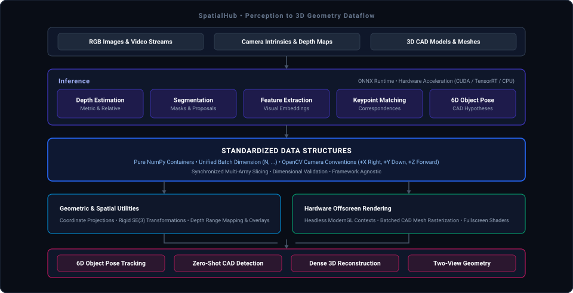
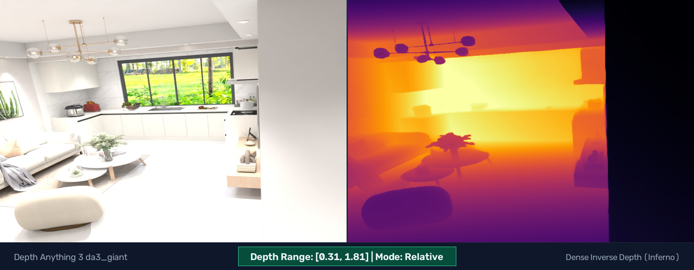
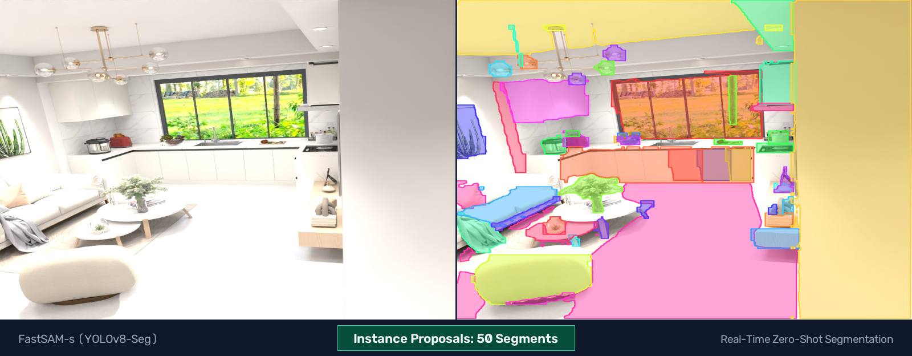
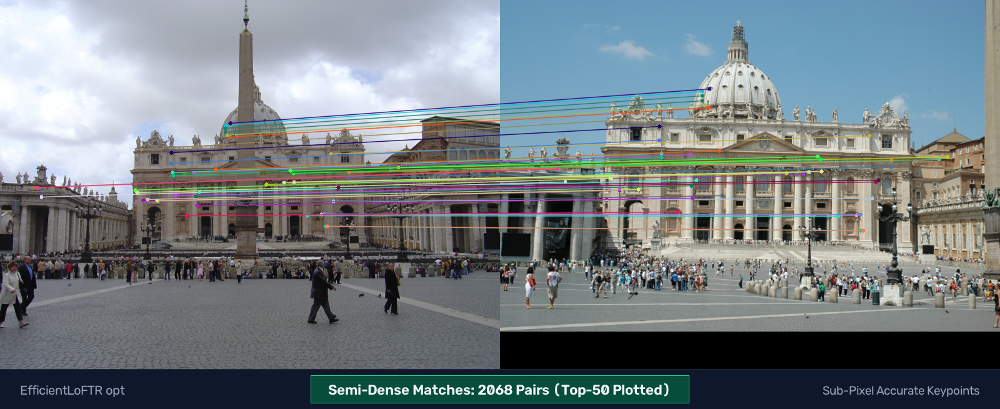
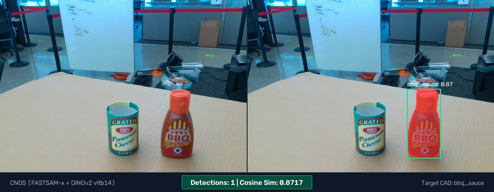

<div align="center">
  
  <p><strong>Zero-PyTorch Python library for composing deep vision models and geometric algorithms into spatial perception pipelines.</strong></p>

  [](https://badge.fury.io/py/spatialhub)
  [](https://spatialhub-ai.github.io/spatialhub/)
  [](https://www.python.org/downloads/)
  [](https://opensource.org/licenses/Apache-2.0)
</div>

---

## Architecture

SpatialHub decouples deep vision model execution from geometric estimation and 3D rendering through standardized NumPy spatial data contracts:



* **Input Ingestion**: Ingests raw RGB images, sequential video frames, pinhole camera intrinsics ($K \in \mathbb{R}^{3 \times 3}$), metric depth maps, and 3D CAD meshes (`.ply`, `.obj`, `.stl`).
* **Zero-PyTorch Inference**: Self-contained ONNX Runtime execution (`CUDAExecutionProvider`, `TensorrtExecutionProvider`, `CPUExecutionProvider`). Pretrained ONNX graphs are automatically resolved and cached from Hugging Face Hub on first run.
* **Standardized Data Contracts**: Validated dataclasses in `spatialhub.structures` enforce pure NumPy containers, automatic leading batch promotion $(N, \dots)$, synchronized multi-field slicing, and the OpenCV camera coordinate standard ($+X$ right, $+Y$ down, $+Z$ forward).
* **Geometric & Rendering Utilities**: Headless ModernGL rasterization (batched CAD template rendering, multi-buffer generation, fullscreen shaders) alongside functional utilities for camera projections, $\mathrm{SE}(3)$ transformation algebra, and 3D overlays.
* **Downstream Tasks**: Compose custom multi-stage pipelines for 6D object pose tracking, zero-shot CAD detection, dense 3D point cloud reconstruction, and two-view epipolar geometry.

---

## Supported Models

| Model Architecture | Vision Task | Returned Dataclass | Documentation |
| :--- | :--- | :--- | :--- |
| **FoundationPose** | 6D Object Pose Estimation & Tracking | [`ObjectPose6D`](https://spatialhub-ai.github.io/spatialhub/structures/poses_and_cameras/#objectpose6d) | [Docs](https://spatialhub-ai.github.io/spatialhub/models/foundationpose/) • [README](src/spatialhub/models/foundationpose/README.md) |
| **EfficientLoFTR** | Semi-Dense Feature Matching | [`KeypointMatches`](https://spatialhub-ai.github.io/spatialhub/structures/perception_primitives/#keypointmatches) | [Docs](https://spatialhub-ai.github.io/spatialhub/models/eloftr/) • [README](src/spatialhub/models/efficient_loftr/README.md) |
| **Depth Anything 3** | Monocular & Multi-View Depth | [`DepthMap`](https://spatialhub-ai.github.io/spatialhub/structures/scene_and_bounds/#depthmap) | [Docs](https://spatialhub-ai.github.io/spatialhub/models/depthanything3/) • [README](src/spatialhub/models/depth_anything_3/README.md) |
| **DINOv2** | Visual Feature Extraction | [`FeatureEmbedding`](https://spatialhub-ai.github.io/spatialhub/structures/perception_primitives/#featureembedding) | [Docs](https://spatialhub-ai.github.io/spatialhub/models/dinov2/) • [README](src/spatialhub/models/dinov2/README.md) |
| **FastSAM** | Real-Time Proposal Segmentation | [`InstanceSegmentation`](https://spatialhub-ai.github.io/spatialhub/structures/perception_primitives/#instancesegmentation) | [Docs](https://spatialhub-ai.github.io/spatialhub/models/fastsam/) • [README](src/spatialhub/models/fastsam/README.md) |
| **SAM** | Automatic Mask Generation (AMG) | [`InstanceSegmentation`](https://spatialhub-ai.github.io/spatialhub/structures/perception_primitives/#instancesegmentation) | [Docs](https://spatialhub-ai.github.io/spatialhub/models/sam/) • [README](src/spatialhub/models/sam/README.md) |
| **CNOS** | CAD-Based Zero-Shot Object Detection | [`InstanceSegmentation`](https://spatialhub-ai.github.io/spatialhub/structures/perception_primitives/#instancesegmentation) | [Docs](https://spatialhub-ai.github.io/spatialhub/models/cnos/) • [README](src/spatialhub/models/cnos/README.md) |

---

## Installation

Requires **Python 3.10+**.

### Standard Installation

```bash
# CPU execution
pip install "spatialhub[cpu]"

# NVIDIA GPU acceleration (CUDA / TensorRT)
pip install "spatialhub[gpu]"
```

### 3D CAD & Offscreen Rendering Support

For pipelines requiring CAD mesh rasterization and OpenGL contexts (e.g., FoundationPose, CNOS, atlas rendering):

```bash
# CPU with rendering
pip install "spatialhub[cpu,render]"

# GPU with rendering
pip install "spatialhub[gpu,render]"
```

> [!NOTE]
> Do not install both `onnxruntime` and `onnxruntime-gpu` in the same Python environment, as their binary namespaces conflict.

### Development Setup via `uv`

```bash
git clone https://github.com/spatialhub-ai/spatialhub.git
cd spatialhub
uv sync --extra gpu --extra render
```

---

## Quickstart

### Composing Depth Estimation & 3D Point Cloud Unprojection

```python
import numpy as np
from spatialhub import DepthAnything3
from spatialhub.utils import load_image, reproject_depth_to_3d, save_image, visualize_depth

# Load RGB image and pinhole camera intrinsics matrix (3x3)
image = load_image("examples/assets/room_image.jpg")
intrinsics = np.load("examples/assets/room_intrinsics.npy")

# Estimate metric depth map
with DepthAnything3(model_name="da3metric_large") as estimator:
    depth_result = estimator.estimate_depth(images=[image])
    pred_depth = depth_result.depth[0]

# Unproject metric depth map to 3D camera-space point cloud (N, 3)
point_cloud = reproject_depth_to_3d(depth=pred_depth, K=intrinsics)
print(f"Reconstructed point cloud vertices: {point_cloud.shape}")

# Save depth visualization
colored_depth = visualize_depth(pred_depth, colormap="inferno")
save_image(colored_depth, "depth_visualization.png")
```

<p align="center">
  
</p>

<p align="center">
  <em>For an interactive 3D point cloud reconstruction with orbit controls, see <a href="https://spatialhub-ai.github.io/spatialhub/getting_started/quickstart/#reproject-to-3d">Reproject to 3D in the Quickstart Guide &rarr;</a></em>
</p>

### Real-Time Instance Segmentation (FastSAM)

```python
from spatialhub import FastSAM
from spatialhub.utils import blend_masks, load_image, save_image

image = load_image("examples/assets/room_image.jpg")

with FastSAM(model_variant="s") as segmentor:
    results = segmentor.generate_masks(image=image, conf_threshold=0.25, max_det=50)

overlay = blend_masks(image=image, masks=results.masks, alpha=0.45)
save_image(overlay, "segmented_instances.png")
```

<p align="center">
  
</p>

### Semi-Dense Feature Matching (EfficientLoFTR)

```python
from spatialhub import EfficientLoFTR
from spatialhub.utils import load_image, save_image, visualize_matched_keypoints

image_a = load_image("examples/assets/scene_a.jpg")
image_b = load_image("examples/assets/scene_b.jpg")

with EfficientLoFTR(model_type="opt") as matcher:
    matches = matcher.match(image_a=image_a, image_b=image_b, max_dim=1024)

vis = visualize_matched_keypoints(
    image_a=image_a,
    image_b=image_b,
    keypoints_a=matches.keypoints_a,
    keypoints_b=matches.keypoints_b,
    confidence=matches.confidence,
    top_k=50,
)
save_image(vis, "keypoint_correspondences.png")
```

<p align="center">
  
</p>

### Zero-Shot CAD Detection (CNOS)

```python
from spatialhub import CNOS, DINOv2, FastSAM
from spatialhub.utils import blend_masks, load_image, save_image

image = load_image("examples/assets/bba_sauce_rgb.png")
descriptor = DINOv2(model_variant="vitb14")
segmentor = FastSAM(model_variant="x")

with CNOS.from_cad_model(
    model="examples/assets/hope_000002.ply",
    model_unit="mm",
    descriptor=descriptor,
    segmentor=segmentor,
    object_name="bbq_sauce",
    num_viewpoints=42,
) as detector:
    results = detector.inference(image=image, conf_threshold=0.60)

overlay = blend_masks(image=image, masks=results.masks)
save_image(overlay, "cad_detection.png")
```

<p align="center">
  
</p>

### Model-Based 6D Pose Tracking (FoundationPose)

> [!NOTE]
> The `mustard0` RGB-D benchmark sequence and CAD model can be automatically downloaded by running `uv run python examples/foundationpose.py`.

```python
import glob
import numpy as np
from spatialhub import FoundationPose

# Load pinhole camera intrinsics matrix (3x3)
intrinsics = np.loadtxt("examples/assets/mustard0/cam_K.txt")

rgb_files = sorted(glob.glob("examples/assets/mustard0/rgb/*.png"))
depth_files = sorted(glob.glob("examples/assets/mustard0/depth/*.png"))
mask_files = sorted(glob.glob("examples/assets/mustard0/masks/*.png"))

with FoundationPose(
    intrinsics=intrinsics,
    model="examples/assets/mustard0/mesh/textured_simple.obj",
    model_unit="m",
    model_name="mustard",
) as tracker:
    # Register initial 6D pose from first RGB-D frame and 2D segmentation mask
    init_pose = tracker.register(
        rgb=rgb_files[0],
        depth=depth_files[0],
        mask=mask_files[0],
        depth_unit="mm",
    )
    print(f"Registered pose translation: {init_pose.pose[0, :3, 3]}")

    # Track 6D pose sequentially in subsequent RGB-D frames
    next_pose = tracker.track(
        rgb=rgb_files[1],
        depth=depth_files[1],
        depth_unit="mm",
    )
    print(f"Tracked pose translation: {next_pose.pose[0, :3, 3]}")
```

https://github.com/user-attachments/assets/726ac4bc-338d-4bf9-af38-f0e037ca5f28

---

## Runnable Demonstration Scripts

Full standalone demonstration scripts with CLI parsing and visual canvas generation are located under `examples/`:

```bash
# Instance proposal segmentation
uv run python examples/fastsam.py

# Monocular metric depth estimation
uv run python examples/depth_anything_3.py

# Semi-dense local feature matching
uv run python examples/efficient_loftr.py

# Global image embedding & cosine similarity
uv run python examples/dinov2.py

# CAD-based zero-shot detection
uv run python examples/cnos.py

# Model-based 6D pose tracking
uv run python examples/foundationpose.py --max-frames 30

# Multi-view CAD atlas rasterization
uv run python examples/render_cad_atlas.py
```

---

## ONNX Export

Export scripts for converting PyTorch checkpoints to optimized ONNX models are located in `tools/export/`:

```bash
uv run python tools/export/export_foundationpose.py
uv run python tools/export/export_depth_anything_3.py --model-name da3_base
```

---

## Author & Contact

Developed and maintained by **Pankaj Kaushik** ([@pankajkaushik12](https://github.com/pankajkaushik12)).

* **Email**: pankajkaushik12r@gmail.com
* **GitHub Issues**: [spatialhub-ai/spatialhub/issues](https://github.com/spatialhub-ai/spatialhub/issues)
* **Documentation**: [spatialhub-ai.github.io/spatialhub](https://spatialhub-ai.github.io/spatialhub/)

---

## License

SpatialHub is released under the [Apache 2.0 License](LICENSE). Pretrained ONNX model weights fetched from Hugging Face Hub maintain their respective upstream licenses.
