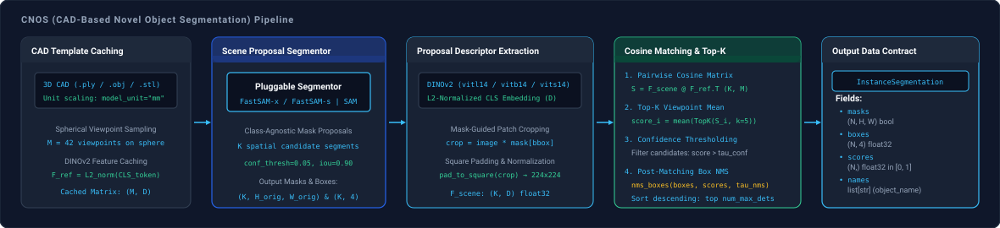

# CNOS

`spatialhub.models.cnos` provides an ONNX Runtime adapter for **CNOS (CAD-Based Novel Object Segmentation)**, executing zero-shot 2D instance segmentation by combining 3D CAD mesh template rendering, DINOv2 descriptor extraction, FastSAM or SAM proposal segmentation, and cosine similarity matching.

---

## Pipeline Components

CNOS operates by coupling two modular sub-adapter stages with a 3D CAD mesh file (`.ply`, `.obj`, `.stl`):

| Stage | Supported Models & Variants | Primary Role |
| :--- | :--- | :--- |
| **Descriptor** | `DINOv2` (Default: `"vitb14"`; `"vits14"`, `"vitl14"`, `"vitg14"`) | Extracts L2-normalized feature embeddings from rendered CAD templates and proposal crops. |
| **Segmentor** | `FastSAM` (Default: `"x"`; `"s"`), `SAM` (`"vit_b"`, `"vit_l"`, `"vit_h"`) | Generates class-agnostic candidate mask proposals across the input scene. |

!!! note
    Coarser backbones (`"vits14"`, `"vitb14"`) prioritize global object silhouette and boundary completeness. Higher-capacity variants (`"vitl14"`, `"vitg14"`) attend sharply to local text, logos, and high-frequency patterns, which can rank textured sub-components higher than complete objects.

---

## Initialization

### From CAD Model

Generate multi-view template embeddings from a 3D CAD mesh using `CNOS.from_cad_model`:

```python
from spatialhub import CNOS, DINOv2, FastSAM

descriptor = DINOv2(model_variant="vitb14")
segmentor = FastSAM(model_variant="x")

cnos = CNOS.from_cad_model(
    model="cad_models/valve.ply",
    descriptor=descriptor,
    segmentor=segmentor,
    model_unit="mm",
    num_viewpoints=42,
)
```

#### Parameters

| Parameter | Type | Default | Description |
| :--- | :--- | :--- | :--- |
| `model` | `str | Path | trimesh.Trimesh` | *required* | Path to 3D CAD mesh file (`.ply`, `.obj`, `.stl`) or loaded `trimesh.Trimesh` object. |
| `descriptor` | `DINOv2` | *required* | Initialized DINOv2 descriptor sub-adapter instance. |
| `segmentor` | `FastSAM | SAM` | *required* | Initialized FastSAM or SAM proposal segmentor sub-adapter instance. |
| `model_unit` | `str | float` | `"m"` | Linear unit of raw mesh vertices (`"m"`, `"cm"`, `"mm"`, or float scale factor). |
| `num_viewpoints` | `int` | `42` | Number of viewpoint cameras sampled on a sphere around the CAD object. |
| `template_output_dir` | `str | Path | None` | `None` | Optional directory path to serialize rendered multi-view RGBA CAD templates to disk. |
| `object_name` | `str | None` | `None` | Semantic label for detected object instances (defaults to model filename stem). |
| `top_k` | `int` | `5` | Number of highest-scoring template viewpoints averaged per candidate proposal. |
| `chunk_size` | `int` | `32` | Batch chunk size for processing proposal crops through the descriptor. |

### From Pre-computed Features

Instantiate `CNOS` directly using pre-computed reference features via `CNOS.__init__`:

```python
cnos = CNOS(
    reference_features=cached_embeddings,
    descriptor=descriptor,
    segmentor=segmentor,
    object_name="valve",
)
```

#### Parameters

| Parameter | Type | Default | Description |
| :--- | :--- | :--- | :--- |
| `reference_features` | `FeatureEmbedding | np.ndarray` | *required* | Pre-computed L2-normalized reference descriptor matrix $(M, D)$. |
| `descriptor` | `DINOv2` | *required* | Initialized DINOv2 descriptor sub-adapter instance. |
| `segmentor` | `FastSAM | SAM` | *required* | Initialized FastSAM or SAM proposal segmentor sub-adapter instance. |
| `object_name` | `str` | `"object"` | Semantic label assigned to detected instances. |
| `top_k` | `int` | `5` | Number of top template matches averaged per proposal. |
| `chunk_size` | `int` | `32` | Batch chunk size for descriptor feature extraction. |

---

## Methods

### `inference`

Generates mask proposals, extracts descriptor embeddings on masked image patches, and matches against CAD templates.

```python
results = cnos.inference(image="scene.jpg", conf_threshold=0.60)
```

#### Parameters

| Parameter | Type | Default | Description |
| :--- | :--- | :--- | :--- |
| `image` | `str | Path | np.ndarray` | *required* | Input scene image as file path or RGB array $(H, W, 3)$ with values in $[0, 255]$. |
| `proposals` | `InstanceSegmentation | None` | `None` | Optional pre-computed mask proposals (bypasses segmentor pass if supplied). |
| `num_max_dets` | `int` | `5` | Maximum number of matched object instances retained after ranking. |
| `conf_threshold` | `float` | `0.15` | Cosine similarity cutoff threshold for candidate detection. |
| `proposal_conf_threshold` | `float` | `0.05` | Confidence cutoff threshold passed to the segmentor sub-adapter. |
| `proposal_iou_threshold` | `float` | `0.90` | Non-Maximum Suppression IoU threshold passed to the segmentor sub-adapter. |
| `top_k` | `int | None` | `None` | Overrides instance top-$k$ match averaging count. |
| `nms_iou_threshold` | `float | None` | `None` | Optional post-matching Non-Maximum Suppression IoU threshold across detections. |

#### Return Value

The `inference` method returns an [`InstanceSegmentation`](../structures/perception_primitives.md#instancesegmentation) dataclass:

| Attribute | Shape | Dtype | Description |
| :--- | :--- | :--- | :--- |
| `boxes` | `(N, 4)` | `np.float32` | Bounding boxes in `[x1, y1, x2, y2]` native pixel space. |
| `masks` | `(N, H, W)` | `bool` | Binary instance segmentation masks at native scene resolution $(H, W)$. |
| `scores` | `(N,)` | `np.float32` | Averaged top-$k$ cosine similarity matching scores in $[0, 1]$. |
| `ids` | `(N,)` | `np.int32` | Detection candidate identifiers. |
| `names` | `list[str]` | `list[str]` | Configured object semantic class name per detected instance. |

---

## Example

Demonstration script detecting a CAD object from multi-view template matching:

```python title="examples/cnos.py"
--8<-- "examples/cnos.py:cnos"
```


Execute the sample script from the repository root:

```bash
uv run python examples/cnos.py
```

Visualization is saved to `examples/output/cnos_detection.png`.

??? example "Zero-Shot CAD Detection with FastSAM-x and DINOv2-vitb14"

    ```python
    from spatialhub import CNOS, DINOv2, FastSAM

    providers = ["CUDAExecutionProvider", "CPUExecutionProvider"]

    # Initialize sub-adapters
    descriptor = DINOv2(model_variant="vitb14", providers=providers)
    segmentor = FastSAM(model_variant="x", providers=providers)

    # Initialize CNOS from CAD model
    with CNOS.from_cad_model(
        model="examples/assets/hope_000002.ply",
        descriptor=descriptor,
        segmentor=segmentor,
        model_unit="mm",
        object_name="bbq_sauce",
        num_viewpoints=42,
    ) as cnos:
        results = cnos.inference(
            image="examples/assets/bba_sauce_rgb.png",
            num_max_dets=1,
            conf_threshold=0.60,
            nms_iou_threshold=0.50,
        )

        for box, score, name in zip(results.boxes, results.scores, results.names):
            print(f"Detected {name} ({score:.3f}): box={box}")
    ```

??? example "High-Precision Inspection with SAM ViT-H"

    ```python
    from spatialhub import CNOS, DINOv2, SAM

    providers = ["CUDAExecutionProvider"]

    descriptor = DINOv2(model_variant="vitl14", providers=providers)
    segmentor = SAM(model_variant="vit_h", points_per_side=32, providers=providers)

    with CNOS.from_cad_model(
        model="cad_models/industrial_valve.ply",
        descriptor=descriptor,
        segmentor=segmentor,
        model_unit="mm",
        num_viewpoints=84,
    ) as cnos:
        results = cnos.inference(
            image="assembly_line_camera.png",
            conf_threshold=0.65,
            nms_iou_threshold=0.40,
        )

        print(f"Identified {len(results.boxes)} instances with SAM AMG proposals.")
    ```

---

## End-to-End Flow



CNOS (CAD-based Novel Object Segmentation) performs zero-shot instance detection and 2D segmentation of unseen rigid objects given only their 3D CAD models. The pipeline couples off-screen CAD template rendering with self-supervised DINOv2 feature embeddings and zero-shot proposal generation from FastSAM or SAM.

### Spherical Template Rendering

In zero-shot detection, no real annotated training imagery exists for novel objects. CNOS overcomes this by rendering synthetic 2.5D observations from a uniform spherical viewpoint tessellation.

Given a 3D CAD mesh scaled from its native `model_unit` to meters, viewpoint sampling distributes $M$ camera positions $t_m \in \mathbb{R}^3$ over a sphere of radius $r$ centered at the object origin:

$$
P_m = [R_m \mid t_m] \in \mathrm{SE}(3), \qquad \forall m \in \{1, \dots, M\}
$$

For each viewpoint, off-screen ModernGL OpenGL rendering generates RGBA buffers $I_{\text{rgba}}^{(m)} \in [0, 255]^{H \times W \times 4}$. The rendered alpha channel isolates the CAD contour:

$$
M_{\text{cad}} = (I_{\text{rgba}}^{(m)}[:, :, 3] > 0)
$$

### Reference Feature Caching

Each template image is cropped to its tight foreground bounding box $[x_1, y_1, x_2, y_2]$, zero-padded symmetrically to a square, resized to $224 \times 224$, and normalized using ImageNet parameters. DINOv2 extracts an L2-normalized global descriptor:

$$
F_{\text{ref}}^{(m)} = \frac{f_{\text{dino}}\left(\operatorname{crop}_{\text{square}}(I_{\text{rgba}}^{(m)})\right)}{\|f_{\text{dino}}\left(\operatorname{crop}_{\text{square}}(I_{\text{rgba}}^{(m)})\right)\|_2} \in \mathbb{R}^{D}
$$

The cached reference descriptor matrix $\mathbf{F}_{\text{ref}} \in \mathbb{R}^{M \times D}$ captures the object's visual appearance and silhouette across all 3D orientations and is precomputed once per object class.

### Proposal Generation

An input RGB scene image $I_{\text{scene}} \in [0, 255]^{H_{\text{orig}} \times W_{\text{orig}} \times 3}$ is processed by the configured proposal segmentor (`FastSAM` or `SAM`), generating $K$ class-agnostic candidate binary masks $M_k \in \{0, 1\}^{H_{\text{orig}} \times W_{\text{orig}}}$ and bounding boxes $B_k \in \mathbb{R}^4$:

$$
\{ (M_k, B_k) \}_{k=1}^K = \text{Segmentor}(I_{\text{scene}})
$$

### Proposal Feature Extraction & Background Masking

If background scene clutter, table textures, or adjacent objects remain inside the proposal crop, DINOv2 self-attention tokens attend to background clutter rather than the target object. To isolate the candidate's pure shape and texture, background pixels outside the mask slice are zeroed:

$$
I_{\text{crop}}^{(k)} = I_{\text{scene}}[y_1 : y_2, \, x_1 : x_2] \cdot M_k[y_1 : y_2, \, x_1 : x_2, \, \text{None}]
$$

Crops are square-padded to preserve native aspect ratio, rescaled to $224 \times 224$, and processed through DINOv2 in batches of `chunk_size` (default: 32) to generate L2-normalized proposal embeddings $\mathbf{F}_{\text{scene}} \in \mathbb{R}^{K \times D}$.

### Similarity Matching & Top-K Confidence Filtering

Pairwise cosine similarity between all $K$ scene proposals and $M$ reference template views is evaluated via matrix multiplication:

$$
\mathbf{S} = \mathbf{F}_{\text{scene}} \cdot \mathbf{F}_{\text{ref}}^T \quad \in [-1, 1]^{K \times M}
$$

In a physical scene, a valid detection matches closely with multiple adjacent viewpoints on the sphere. For each proposal $k$, semantic confidence is computed by averaging its $k_{\text{top}}$ highest similarity scores:

$$
\text{score}_k = \frac{1}{k_{\text{top}}} \sum_{j=1}^{k_{\text{top}}} \operatorname{TopK}\left(\mathbf{S}_{k, :}, \, k_{\text{top}}\right)_j
$$

Averaging the top $k_{\text{top}}$ scores provides robustness against localized specular reflections or single-viewpoint rendering artifacts.

Surviving candidates satisfying $\text{score}_k > \tau_{\text{conf}}$ undergo post-matching Non-Maximum Suppression (NMS) on bounding boxes with threshold $\tau_{\text{nms}}$ to eliminate duplicate detections of the same object instance, and are sorted in descending order up to `num_max_dets`.

---

## Numerical Parity

Numerical parity evaluates mathematical agreement between the original PyTorch reference pipelines (PyTorch Hub `facebookresearch/dinov2` and Ultralytics `YOLO(FastSAM-s.pt)`) and the SpatialHub ONNX Runtime adapter on benchmark datasets across $42$ rendered spherical template viewpoints.

| Dataset | Descriptor | Segmentor | Ref Feat MAE | Ref Feat Max Diff | Ref Cosine Sim | Scene Feat MAE | Scene Cosine Sim | Sim Matrix MAE | Top-1 Score Diff |
| :--- | :--- | :--- | :--- | :--- | :--- | :--- | :--- | :--- | :--- |
| `hope_bba_sauce` | `vitl14` | `s` | 0.000088 | 0.004889 | **99.9969%** | 0.000065 | **99.9995%** | 0.000195 | 0.007040 |
| `needle_holder_tools` | `vitl14` | `s` | 0.000080 | 0.000824 | **99.9993%** | 0.000074 | **99.9945%** | 0.000211 | 0.034284 |

---

## Performance

Latency, throughput, host RAM delta, and peak device VRAM footprint measured across unmeasured warmup iterations and timed measurement iterations on $640 \times 480$ scene imagery with DINOv2 `vitl14` and FastSAM `s` across $42$ spherical template views.

### Test Environment & Hardware Specification
* **Operating System**: Windows 11 (64-bit)
* **GPU**: NVIDIA GeForce RTX (8,192 MB physical VRAM, CUDA Execution Provider)
* **CPU**: Multi-core x86_64 host processor (`CPUExecutionProvider`)
* **ONNX Runtime**: 1.20+ with native CUDA driver synchronization
* **CAD Model**: `hope_000002.ply` ($42$ rendered spherical template viewpoints, resolution $224 \times 224$)

=== "CUDA Execution (`CUDAExecutionProvider`)"

    <table>
      <thead>
        <tr>
          <th>Pipeline Stage</th>
          <th>Device</th>
          <th>Latency Mean (ms)</th>
          <th>P95 (ms)</th>
          <th>Throughput (FPS)</th>
          <th>Peak RAM Delta</th>
          <th>Peak VRAM Delta</th>
        </tr>
      </thead>
      <tbody>
        <tr>
          <td><strong>Template Caching (42 Views)</strong></td>
          <td><code>CUDA</code></td>
          <td>6369.10 +/- 582.42</td>
          <td>7368.29</td>
          <td><strong>0.2</strong></td>
          <td>+46.5 MB</td>
          <td>+389.3 MB</td>
        </tr>
        <tr>
          <td><strong>Proposal Gen (FastSAM-s)</strong></td>
          <td><code>CUDA</code></td>
          <td>118.69 +/- 15.55</td>
          <td>148.23</td>
          <td><strong>8.4</strong></td>
          <td>+1.1 MB</td>
          <td>+36.0 MB</td>
        </tr>
        <tr>
          <td><strong>Descriptor Extract (50 Crops)</strong></td>
          <td><code>CUDA</code></td>
          <td>7068.42 +/- 374.15</td>
          <td>7530.17</td>
          <td><strong>0.1</strong></td>
          <td>+9.3 MB</td>
          <td>0.0 MB</td>
        </tr>
        <tr>
          <td><strong>Cosine Matching &amp; Top-K</strong></td>
          <td><code>CUDA</code></td>
          <td>2.00 +/- 0.28</td>
          <td>2.60</td>
          <td><strong>500.0</strong></td>
          <td>+0.1 MB</td>
          <td>0.0 MB</td>
        </tr>
        <tr style="border-top: 2px solid #ccc; font-weight: bold;">
          <td><strong>End-to-End CNOS Pipeline</strong></td>
          <td><code>CUDA</code></td>
          <td>6469.88 +/- 204.41</td>
          <td>6610.64</td>
          <td><strong>0.2</strong></td>
          <td>+1.9 MB</td>
          <td>0.0 MB</td>
        </tr>
      </tbody>
    </table>

---

## Developer Tooling

=== "Export ONNX"
    ```bash
    # Export DINOv2 descriptor model
    uv run tools/export/export_dinov2.py \
        --variant vitl14 \
        --output-folder onnx_weight

    # Export FastSAM proposal segmentor model
    uv run tools/export/export_fastsam.py \
        --variant x \
        --output-folder onnx_weight \
        --imgsz 640

    # (Optional) Export SAM proposal segmentor model
    uv run tools/export/export_sam.py \
        --variant vit_h \
        --output-folder onnx_weight
    ```

    | Parameter | Type | Default | Description |
    | :--- | :--- | :--- | :--- |
    | `--variant` | `str` | *Required* | Model variant identifier for the sub-adapter export script. |
    | `--output-folder` | `str` | `"onnx_weight"` | Target directory for exported `.onnx` model files. |
    | `--opset` | `int` | `17` | ONNX Operator Set version. |

=== "Parity Check"
    ```bash
    uv run tools/benchmark/parity_cnos.py \
        --descriptor-variant vitl14 \
        --segmentor-variant s \
        --mesh-path examples/assets/hope_000002.ply \
        --image-path examples/assets/bba_sauce_rgb.png \
        --num-viewpoints 42 \
        --output-file .profile/parity_cnos.md
    ```

    | Parameter | Type | Default | Description |
    | :--- | :--- | :--- | :--- |
    | `--descriptor-variant` | `str` | `"vitl14"` | DINOv2 descriptor variant (`vits14`, `vitb14`, `vitl14`, `vitg14`). |
    | `--segmentor-variant` | `str` | `"s"` | FastSAM proposal segmentor variant (`s` or `x`). |
    | `--mesh-path` | `str` | `None` | Optional path to 3D CAD mesh file (`.ply`, `.obj`). |
    | `--image-path` | `str` | `None` | Optional path to scene RGB image file. |
    | `--num-viewpoints` | `int` | `42` | Number of template viewpoints to render on sphere. |
    | `--output-file` | `str` | `None` | Optional path to append Markdown parity report. |

=== "Performance Profile"
    ```bash
    uv run tools/benchmark/profile_cnos.py \
        --descriptor-variant vitl14 \
        --segmentor-variant s \
        --mesh-path examples/assets/hope_000002.ply \
        --image-path examples/assets/bba_sauce_rgb.png \
        --provider all \
        --num-viewpoints 42 \
        --warmup 1 \
        --iters 5 \
        --output-file .profile/profile_cnos.md
    ```

    | Parameter | Type | Default | Description |
    | :--- | :--- | :--- | :--- |
    | `--descriptor-variant` | `str` | `"vitl14"` | DINOv2 descriptor variant to profile. |
    | `--segmentor-variant` | `str` | `"s"` | FastSAM proposal segmentor variant to profile. |
    | `--provider` | `str` | `"all"` | Target execution provider filter (`cuda`, `cpu`, or `all`). |
    | `--mesh-path` | `str` | `None` | Optional path to 3D CAD mesh file. |
    | `--image-path` | `str` | `None` | Optional path to scene RGB image file. |
    | `--num-viewpoints` | `int` | `42` | Number of spherical template viewpoints. |
    | `--warmup` | `int` | `1` | Number of unmeasured warmup iterations. |
    | `--iters` | `int` | `5` | Number of timed measurement iterations. |
    | `--output-file` | `str` | `None` | Optional path to save Markdown benchmark report. |

---
