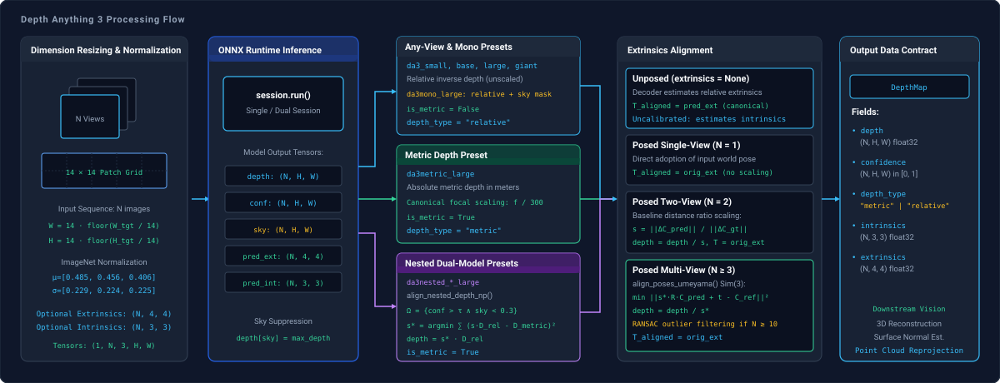

# Depth Anything 3

`spatialhub.models.depth_anything_3` provides an ONNX Runtime adapter for **Depth Anything 3 (DA3)**, a foundation model series supporting monocular relative and metric depth estimation, multi-view camera pose alignment, and nested dual-model scale projection.

---

## Presets

The `DepthAnything3Adapter` accepts official model presets defined in `MODEL_REGISTRY` via `model_name`:

=== "Any-View Series"

    | Model Preset (`model_name`) | Backbone | Target Use Case |
    | :--- | :--- | :--- |
    | `"da3_small"` | ViT-Small| High-throughput, real-time edge processing and low-latency robotics. |
    | `"da3_base"` (Default) | ViT-Base| Balanced spatial accuracy and computational throughput. |
    | `"da3_large"` | ViT-Large| High-fidelity depth mapping and dense multi-view geometry. |
    | `"da3_giant"` | ViT-Giant| Flagship foundation model with maximum geometric precision. |

=== "Monocular Series"

    | Model Preset (`model_name`) | Output Modality | Target Use Case |
    | :--- | :--- | :--- |
    | `"da3mono_large"` | Relative Depth + Sky Mask | High-resolution monocular relative depth with sky probability estimation. |
    | `"da3metric_large"` | Metric Depth (Meters) | Direct absolute metric depth prediction using camera focal length scaling. |

=== "Nested Dual-Model Series"

    | Model Preset (`model_name`) | Primary Model | Metric Reference | Target Use Case |
    | :--- | :--- | :--- | :--- |
    | `"da3nested_small_large"` | `da3_small` | `da3metric_large` | Lightweight metric estimation with high frame throughput. |
    | `"da3nested_base_large"` | `da3_base` | `da3metric_large` | Balanced detail resolution and physical metric projection. |
    | `"da3nested_large_large"` | `da3_large` | `da3metric_large` | High-fidelity dense metric reconstruction. |
    | `"da3nested_giant_large"` | `da3_giant` | `da3metric_large` | Maximum visual fidelity projected to absolute metric units. |

---

## Initialization

Initialize `DepthAnything3` by specifying an Any-View, Monocular, or Nested model preset:

```python
from spatialhub import DepthAnything3

# Any-View foundation model
estimator = DepthAnything3(model_name="da3_base")

# Direct absolute metric depth model with CUDA execution
estimator = DepthAnything3(model_name="da3metric_large", providers=["CUDAExecutionProvider"])
```

### Parameters

| Parameter | Type | Default | Description |
| :--- | :--- | :--- | :--- |
| `model_name` | `str | Path | list[str | Path]` | `"da3_base"` | Model preset identifier or explicit path(s) to `.onnx` weight files. |
| `model_variant` | `str | None` | `None` | Optional explicit variant string matching `MODEL_REGISTRY`. |
| `providers` | `list[str] | str | None` | `None` | ONNX Runtime execution providers (e.g. `["CUDAExecutionProvider", "CPUExecutionProvider"]`). |
| `align_to_input_ext_scale` | `bool` | `True` | Scales predicted multi-view camera translation to match scale of provided input extrinsics. |
| `ransac_view_thresh` | `int` | `10` | Minimum multi-view observations required before executing RANSAC trajectory scale alignment. |
| `process_res` | `int` | `504` | Working image spatial resolution for network input processing. |
| `process_res_method` | `str` | `"upper_bound_resize"` | Spatial resizing strategy (`"upper_bound_resize"` preserving aspect ratio). |

---

## Methods

### `estimate_depth`

Estimates monocular or multi-view depth maps, optionally registering extrinsics and intrinsics.

```python
result = estimator.estimate_depth(images=["frame_01.jpg", "frame_02.jpg"])
```

#### Parameters

| Parameter | Type | Default | Description |
| :--- | :--- | :--- | :--- |
| `images` | `list[np.ndarray | str | Path]` | *required* | Sequence of RGB images as file paths or arrays $(H, W, 3)$. |
| `extrinsics` | `list[np.ndarray] | None` | `None` | Optional camera world-to-camera poses $(N, 4, 4)$ for metric trajectory alignment. |
| `intrinsics` | `list[np.ndarray] | None` | `None` | Optional camera pinhole intrinsics $(N, 3, 3)$. Estimated if omitted. |

#### Return Value

The `estimate_depth` method returns a [`DepthMap`](../structures/scene_and_bounds.md#depthmap) dataclass:

| Attribute | Shape | Dtype | Description |
| :--- | :--- | :--- | :--- |
| `depth` | `(N, H, W)` | `np.float32` | Depth map in meters (metric presets) or relative units (monocular presets). |
| `confidence` | `(N, H, W)` | `np.float32 | None` | Per-pixel prediction confidence scores when produced by model. |
| `depth_type` | `str` | `"metric" | "relative"` | Depth unit indicator (`"metric"` or `"relative"`). |
| `intrinsics` | `(N, 3, 3)` | `np.float32 | None` | Pinhole camera intrinsics estimated or passed. |
| `extrinsics` | `(N, 4, 4)` | `np.float32 | None` | Camera poses estimated or aligned. |

---

## Example

Demonstration script estimating relative depth from a monocular scene:

```python title="examples/depth_anything_3.py"
--8<-- "examples/depth_anything_3.py:depth_anything_3"
```


Execute the sample script from the repository root:

```bash
uv run python examples/depth_anything_3.py
```

Visualization is saved to `examples/output/da3_depth.png`.

??? example "Multi-View Extrinsics Alignment & Depth Scaling"

    ```python
    from spatialhub import DepthAnything3

    with DepthAnything3(
        model_name="da3_large",
        align_to_input_ext_scale=True,
        ransac_view_thresh=10,
        providers=["CUDAExecutionProvider"],
    ) as estimator:
        result = estimator.estimate_depth(
            images=["view_01.jpg", "view_02.jpg", "view_03.jpg", "view_04.jpg"],
            extrinsics=reference_extrinsics,
        )

        print("Estimated depth shape:", result.depth.shape)
        print("Aligned camera extrinsics shape:", result.extrinsics.shape)
    ```

??? example "Direct Metric Depth Estimation"

    ```python
    from spatialhub import DepthAnything3

    with DepthAnything3(model_name="da3metric_large", providers=["CUDAExecutionProvider"]) as estimator:
        result = estimator.estimate_depth(images=["indoor_scene.jpg"])
        print("Metric depth output range (meters):", result.depth.min(), result.depth.max())
    ```

??? example "Nested Dual-Model Metric Projection"

    ```python
    from spatialhub import DepthAnything3

    with DepthAnything3(model_name="da3nested_giant_large", providers=["CUDAExecutionProvider"]) as estimator:
        result = estimator.estimate_depth(images=["indoor_scene.jpg"])
        print("Metric depth output range (meters):", result.depth.min(), result.depth.max())
    ```

---

## End-to-End Flow



Depth Anything 3 provides unified monocular and multi-view dense depth estimation, camera trajectory recovery, and metric surface reconstruction. The model handles both unposed sequences (estimating camera poses and relative depth jointly) and posed sequences (aligning relative geometry to calibrated camera baselines).

### Dimension Resizing & Normalization

Inputs are scaled to spatial dimensions $(W, H)$ that are positive integer multiples of the ViT patch size $P = 14$:

$$
W = 14 \cdot \left\lfloor \frac{W_{\text{target}}}{14} \right\rfloor, \qquad H = 14 \cdot \left\lfloor \frac{H_{\text{target}}}{14} \right\rfloor
$$

The Vision Transformer divides the input into non-overlapping $14 \times 14$ patches. Slicing dimensions to multiples of 14 prevents fractional patch artifacts and boundary padding distortions.

Pixel channels are scaled to $[0.0, 1.0]$ and normalized using standard ImageNet parameters:

$$
x_{\text{norm}} = \frac{\frac{x}{255.0} - \mu}{\sigma}, \qquad \mu = [0.485, 0.456, 0.406], \quad \sigma = [0.229, 0.224, 0.225]
$$

### Model Presets & Scale Alignment

* **Any-View & Mono Presets (`da3_small`, `da3_base`, `da3_large`, `da3_giant`, `da3mono_large`)**: Foundation models predict unscaled relative inverse depth maps $D_{\text{rel}} \in \mathbb{R}^{H \times W}$ and a per-pixel confidence map $C_{\text{rel}} \in [0, 1]^{H \times W}$. In `da3mono_large`, an auxiliary segmentation head emits a binary sky mask $M_{\text{sky}} \in \{0, 1\}^{H \times W}$.
* **Metric Depth Preset (`da3metric_large`)**: Predicts dense physical depth $D_{\text{metric}} \in \mathbb{R}^{H \times W}$ in meters using canonical focal length normalization ($f_c = 300\text{ px}$).
* **Nested Dual-Model Presets (`da3nested_*_large`)**: Relative depth models capture fine surface contours, thin structures, and sharp depth discontinuities, but lack metric scale. Metric depth models predict physical distance in meters, but tend to smooth over sharp geometric boundaries. The nested pipeline fuses the geometric sharpness of the relative model with the absolute scale of the metric model via closed-form linear regression.

Scale parameter $s^*$ is fitted over the valid pixel subset $\Omega$:

$$
\Omega = \{ (u, v) \mid C_{\text{rel}}(u, v) > \tau_{\text{conf}} \land M_{\text{sky}}(u, v) \le 0.5 \}
$$

Sky regions represent optical infinity (zero parallax), which causes ill-conditioned scale fitting and large scale overestimation. Excluding sky pixels and low-confidence predictions confines regression to well-defined physical surfaces:

$$
s^* = \arg\min_s \sum_{(u, v) \in \Omega} \left( s \cdot D_{\text{rel}}(u, v) - D_{\text{metric}}(u, v) \right)^2 = \frac{\sum_{(u, v) \in \Omega} D_{\text{rel}}(u, v) \cdot D_{\text{metric}}(u, v)}{\sum_{(u, v) \in \Omega} D_{\text{rel}}(u, v)^2}
$$

$$
D_{\text{aligned}} = s^* \cdot D_{\text{rel}}
$$

### Extrinsics Alignment & Scale Recovery

Monocular and unposed visual depth estimators suffer from $7\text{ DoF}$ gauge ambiguity (3 rotation, 3 translation, 1 scale) in the similarity group $\mathrm{Sim}(3)$. When calibrated reference camera extrinsics $T_{\text{ref}} = [R \mid t] \in \mathrm{SE}(3)$ are provided, SpatialHub recovers the true metric scale and aligns camera trajectories.

For a camera pose $T_{\text{w2c}} = [R \mid t]$ mapping world coordinates to camera coordinates, the 3D optical center $C$ in world space is:

$$
C = -R^T t = T_{\text{w2c}}^{-1}[:3, 3] \in \mathbb{R}^3
$$

* **Unposed (`extrinsics = None`)**: Relative trajectory $T_{\text{pred}}$ is returned in internal canonical coordinates.
* **Single-View ($N = 1$)**: Direct assignment of reference world coordinate frame without depth scaling:

$$
T_{\text{aligned}} = T_{\text{ref}}
$$

* **Two-View ($N = 2$)**: 3D optical centers $C_1, C_2$ are computed for predicted and reference camera poses. The metric scale factor is the ratio of physical optical center baselines:

$$
s_{\text{baseline}} = \frac{\|C_{\text{pred}, 2} - C_{\text{pred}, 1}\|_2}{\|C_{\text{ref}, 2} - C_{\text{ref}, 1}\|_2}, \qquad D_{\text{aligned}} = \frac{D_{\text{pred}}}{s_{\text{baseline}}}
$$

* **Multi-View ($N \ge 3$)**: Similarity transformation $(R^*, t^*, s^*) \in \mathrm{Sim}(3)$ is computed via Umeyama SVD factorization:

$$
\min_{R \in \mathrm{SO}(3),\, t \in \mathbb{R}^3,\, s > 0} \sum_{i=1}^N \left\| s R C_{\text{pred}, i} + t - C_{\text{ref}, i} \right\|_2^2, \qquad D_{\text{aligned}} = \frac{D_{\text{pred}}}{s^*}
$$

For trajectories with $N \ge 10$ views, RANSAC outlier rejection discards degenerate viewpoint estimations before SVD fitting, preventing tracking drift from corrupting global scale recovery.

---

## Numerical Parity

Evaluates numerical agreement between PyTorch reference checkpoints and the SpatialHub ONNX Runtime adapter on the HiRoom evaluation dataset at $504 \times 504$ resolution across both **Posed** (input camera parameters supplied) and **Unposed** (camera trajectory estimated from visual features alone) evaluation sequences.

### Any-View Foundation Series

=== "Posed Mode (Input Poses Supplied)"

    <table>
      <thead>
        <tr>
          <th>Model Variant</th>
          <th>Views ($N$)</th>
          <th>Depth MAE</th>
          <th>Depth Max Diff</th>
          <th>Relative Error (%)</th>
          <th>Conf MAE</th>
          <th>Extrinsics Rot Error (PT vs ORT)</th>
          <th>Extrinsics Trans Error (PT vs ORT)</th>
        </tr>
      </thead>
      <tbody>
        <tr>
          <td rowspan="3" style="vertical-align: middle; text-align: center; font-weight: bold; border-right: 2px solid #ddd;"><code>da3_small</code></td>
          <td>1</td>
          <td>0.000096</td>
          <td>0.001976</td>
          <td><strong>0.01%</strong></td>
          <td>0.001233</td>
          <td>0.0000°</td>
          <td>0.000000</td>
        </tr>
        <tr>
          <td>2</td>
          <td>0.001272</td>
          <td>0.085482</td>
          <td><strong>0.04%</strong></td>
          <td>0.014252</td>
          <td>0.0000°</td>
          <td>0.000000</td>
        </tr>
        <tr style="border-bottom: 2px solid #ccc;">
          <td>4</td>
          <td>0.004254</td>
          <td>0.246895</td>
          <td><strong>0.05%</strong></td>
          <td>0.000582</td>
          <td>0.0000°</td>
          <td>0.000000</td>
        </tr>
        <tr>
          <td rowspan="3" style="vertical-align: middle; text-align: center; font-weight: bold; border-right: 2px solid #ddd;"><code>da3_base</code></td>
          <td>1</td>
          <td>0.000044</td>
          <td>0.002224</td>
          <td><strong>0.00%</strong></td>
          <td>0.003377</td>
          <td>0.0000°</td>
          <td>0.000000</td>
        </tr>
        <tr>
          <td>2</td>
          <td>0.001764</td>
          <td>0.081946</td>
          <td><strong>0.06%</strong></td>
          <td>0.021171</td>
          <td>0.0000°</td>
          <td>0.000000</td>
        </tr>
        <tr style="border-bottom: 2px solid #ccc;">
          <td>4</td>
          <td>0.002598</td>
          <td>0.281878</td>
          <td><strong>0.03%</strong></td>
          <td>0.000913</td>
          <td>0.0000°</td>
          <td>0.000000</td>
        </tr>
        <tr>
          <td rowspan="3" style="vertical-align: middle; text-align: center; font-weight: bold; border-right: 2px solid #ddd;"><code>da3_large</code></td>
          <td>1</td>
          <td>0.000050</td>
          <td>0.002824</td>
          <td><strong>0.00%</strong></td>
          <td>0.004860</td>
          <td>0.0000°</td>
          <td>0.000000</td>
        </tr>
        <tr>
          <td>2</td>
          <td>0.002046</td>
          <td>0.098485</td>
          <td><strong>0.06%</strong></td>
          <td>0.016927</td>
          <td>0.0000°</td>
          <td>0.000000</td>
        </tr>
        <tr style="border-bottom: 2px solid #ccc;">
          <td>4</td>
          <td>0.006935</td>
          <td>0.441951</td>
          <td><strong>0.09%</strong></td>
          <td>0.001602</td>
          <td>0.0000°</td>
          <td>0.000000</td>
        </tr>
        <tr>
          <td rowspan="3" style="vertical-align: middle; text-align: center; font-weight: bold; border-right: 2px solid #ddd;"><code>da3_giant</code></td>
          <td>1</td>
          <td>0.000188</td>
          <td>0.005118</td>
          <td><strong>0.00%</strong></td>
          <td>0.004523</td>
          <td>0.0000°</td>
          <td>0.000000</td>
        </tr>
        <tr>
          <td>2</td>
          <td>0.001602</td>
          <td>0.084178</td>
          <td><strong>0.04%</strong></td>
          <td>0.021703</td>
          <td>0.0000°</td>
          <td>0.000000</td>
        </tr>
        <tr style="border-bottom: 2px solid #ccc;">
          <td>4</td>
          <td>0.020584</td>
          <td>1.637156</td>
          <td><strong>0.23%</strong></td>
          <td>0.008453</td>
          <td>0.0000°</td>
          <td>0.000000</td>
        </tr>
      </tbody>
    </table>

=== "Unposed Mode (Camera Trajectory Estimated)"

    <table>
      <thead>
        <tr>
          <th>Model Variant</th>
          <th>Views ($N$)</th>
          <th>Depth MAE</th>
          <th>Depth Max Diff</th>
          <th>Relative Error (%)</th>
          <th>Conf MAE</th>
          <th>Extrinsics Rot Error (PT vs ORT)</th>
          <th>Extrinsics Trans Error (PT vs ORT)</th>
          <th>Trajectory Rot (ORT vs GT)</th>
          <th>Trajectory Trans (ORT vs GT)</th>
        </tr>
      </thead>
      <tbody>
        <tr>
          <td rowspan="3" style="vertical-align: middle; text-align: center; font-weight: bold; border-right: 2px solid #ddd;"><code>da3_small</code></td>
          <td>1</td>
          <td>0.000107</td>
          <td>0.001337</td>
          <td><strong>0.01%</strong></td>
          <td>0.001294</td>
          <td>0.0000°</td>
          <td>0.000000</td>
          <td>N/A</td>
          <td>N/A</td>
        </tr>
        <tr>
          <td>2</td>
          <td>0.000261</td>
          <td>0.034103</td>
          <td><strong>0.03%</strong></td>
          <td>0.015273</td>
          <td>0.0033°</td>
          <td>0.000038</td>
          <td>100.2812° *</td>
          <td>4.740358</td>
        </tr>
        <tr style="border-bottom: 2px solid #ccc;">
          <td>4</td>
          <td>0.000205</td>
          <td>0.026474</td>
          <td><strong>0.02%</strong></td>
          <td>0.009382</td>
          <td>0.0083°</td>
          <td>0.000190</td>
          <td><strong>4.7084°</strong></td>
          <td><strong>0.363254</strong></td>
        </tr>
        <tr>
          <td rowspan="3" style="vertical-align: middle; text-align: center; font-weight: bold; border-right: 2px solid #ddd;"><code>da3_base</code></td>
          <td>1</td>
          <td>0.000040</td>
          <td>0.002288</td>
          <td><strong>0.00%</strong></td>
          <td>0.002276</td>
          <td>0.0001°</td>
          <td>0.000001</td>
          <td>N/A</td>
          <td>N/A</td>
        </tr>
        <tr>
          <td>2</td>
          <td>0.000224</td>
          <td>0.023873</td>
          <td><strong>0.02%</strong></td>
          <td>0.021786</td>
          <td>0.0081°</td>
          <td>0.000039</td>
          <td>100.5857° *</td>
          <td>4.721515</td>
        </tr>
        <tr style="border-bottom: 2px solid #ccc;">
          <td>4</td>
          <td>0.000122</td>
          <td>0.021366</td>
          <td><strong>0.02%</strong></td>
          <td>0.017614</td>
          <td>0.0097°</td>
          <td>0.000142</td>
          <td><strong>5.2677°</strong></td>
          <td><strong>0.379212</strong></td>
        </tr>
        <tr>
          <td rowspan="3" style="vertical-align: middle; text-align: center; font-weight: bold; border-right: 2px solid #ddd;"><code>da3_large</code></td>
          <td>1</td>
          <td>0.000037</td>
          <td>0.003703</td>
          <td><strong>0.00%</strong></td>
          <td>0.008109</td>
          <td>0.0001°</td>
          <td>0.000001</td>
          <td>N/A</td>
          <td>N/A</td>
        </tr>
        <tr>
          <td>2</td>
          <td>0.000286</td>
          <td>0.076807</td>
          <td><strong>0.03%</strong></td>
          <td>0.045860</td>
          <td>0.0051°</td>
          <td>0.000089</td>
          <td>100.5322° *</td>
          <td>4.727690</td>
        </tr>
        <tr style="border-bottom: 2px solid #ccc;">
          <td>4</td>
          <td>0.000241</td>
          <td>0.055369</td>
          <td><strong>0.03%</strong></td>
          <td>0.025738</td>
          <td>0.0074°</td>
          <td>0.000181</td>
          <td><strong>2.0173°</strong></td>
          <td><strong>0.151687</strong></td>
        </tr>
        <tr>
          <td rowspan="3" style="vertical-align: middle; text-align: center; font-weight: bold; border-right: 2px solid #ddd;"><code>da3_giant</code></td>
          <td>1</td>
          <td>0.000032</td>
          <td>0.002410</td>
          <td><strong>0.00%</strong></td>
          <td>0.002995</td>
          <td>0.0001°</td>
          <td>0.000004</td>
          <td>N/A</td>
          <td>N/A</td>
        </tr>
        <tr>
          <td>2</td>
          <td>0.000365</td>
          <td>0.062983</td>
          <td><strong>0.03%</strong></td>
          <td>0.050428</td>
          <td>0.0037°</td>
          <td>0.000053</td>
          <td>100.4026° *</td>
          <td>4.733258</td>
        </tr>
        <tr style="border-bottom: 2px solid #ccc;">
          <td>4</td>
          <td>0.000165</td>
          <td>0.093573</td>
          <td><strong>0.02%</strong></td>
          <td>0.202900</td>
          <td>0.0108°</td>
          <td>0.000096</td>
          <td><strong>0.6106°</strong></td>
          <td><strong>0.026799</strong></td>
        </tr>
      </tbody>
    </table>

    !!! note
        For $N=2$ views, the two camera positions define a 1D line segment rather than a full 3D point cloud, so a unique 3D $\mathrm{Sim}(3)$ rotation alignment cannot be geometrically constrained against ground truth. For $N \ge 3$ views, full 3D Umeyama $\mathrm{Sim}(3)$ alignment operates, demonstrating monotonic trajectory recovery improvements as model capacity scales ($4.71^\circ \rightarrow 0.61^\circ$).

### Monocular Series

=== "Posed Mode"

    <table>
      <thead>
        <tr>
          <th>Model Variant</th>
          <th>Views ($N$)</th>
          <th>Depth MAE</th>
          <th>Depth Max Diff</th>
          <th>Relative Error (%)</th>
          <th>Output Modality</th>
        </tr>
      </thead>
      <tbody>
        <tr>
          <td style="vertical-align: middle; text-align: center; font-weight: bold; border-right: 2px solid #ddd;"><code>da3mono_large</code></td>
          <td>1</td>
          <td>0.000062</td>
          <td>0.008396</td>
          <td><strong>0.01%</strong></td>
          <td>Relative Depth + Sky Mask</td>
        </tr>
        <tr style="border-bottom: 2px solid #ccc;">
          <td style="vertical-align: middle; text-align: center; font-weight: bold; border-right: 2px solid #ddd;"><code>da3metric_large</code></td>
          <td>1</td>
          <td>0.000120</td>
          <td>0.008575</td>
          <td><strong>0.00%</strong></td>
          <td>Metric Depth (Meters)</td>
        </tr>
      </tbody>
    </table>

=== "Unposed Mode"

    <table>
      <thead>
        <tr>
          <th>Model Variant</th>
          <th>Views ($N$)</th>
          <th>Depth MAE</th>
          <th>Depth Max Diff</th>
          <th>Relative Error (%)</th>
          <th>Output Modality</th>
        </tr>
      </thead>
      <tbody>
        <tr>
          <td style="vertical-align: middle; text-align: center; font-weight: bold; border-right: 2px solid #ddd;"><code>da3mono_large</code></td>
          <td>1</td>
          <td>0.000063</td>
          <td>0.009497</td>
          <td><strong>0.01%</strong></td>
          <td>Relative Depth + Sky Mask</td>
        </tr>
        <tr style="border-bottom: 2px solid #ccc;">
          <td style="vertical-align: middle; text-align: center; font-weight: bold; border-right: 2px solid #ddd;"><code>da3metric_large</code></td>
          <td>1</td>
          <td>0.000119</td>
          <td>0.008165</td>
          <td><strong>0.00%</strong></td>
          <td>Metric Depth (Meters)</td>
        </tr>
      </tbody>
    </table>

### Nested Dual-Model Series

=== "Posed Mode"

    <table>
      <thead>
        <tr>
          <th>Model Variant</th>
          <th>Views ($N$)</th>
          <th>Depth MAE</th>
          <th>Depth Max Diff</th>
          <th>Relative Error (%)</th>
          <th>Conf MAE</th>
          <th>Extrinsics Rot Error (PT vs ORT)</th>
          <th>Extrinsics Trans Error (PT vs ORT)</th>
        </tr>
      </thead>
      <tbody>
        <tr>
          <td style="vertical-align: middle; text-align: center; font-weight: bold; border-right: 2px solid #ddd;"><code>da3nested_small_large</code></td>
          <td>1</td>
          <td>0.000593</td>
          <td>0.006289</td>
          <td><strong>0.02%</strong></td>
          <td>0.001255</td>
          <td>0.0000°</td>
          <td>0.000000</td>
        </tr>
        <tr>
          <td style="vertical-align: middle; text-align: center; font-weight: bold; border-right: 2px solid #ddd;"><code>da3nested_base_large</code></td>
          <td>1</td>
          <td>0.000351</td>
          <td>0.007988</td>
          <td><strong>0.01%</strong></td>
          <td>0.003424</td>
          <td>0.0000°</td>
          <td>0.000000</td>
        </tr>
        <tr>
          <td style="vertical-align: middle; text-align: center; font-weight: bold; border-right: 2px solid #ddd;"><code>da3nested_large_large</code></td>
          <td>1</td>
          <td>0.000620</td>
          <td>0.008171</td>
          <td><strong>0.02%</strong></td>
          <td>0.004896</td>
          <td>0.0000°</td>
          <td>0.000000</td>
        </tr>
        <tr style="border-bottom: 2px solid #ccc;">
          <td style="vertical-align: middle; text-align: center; font-weight: bold; border-right: 2px solid #ddd;"><code>da3nested_giant_large</code></td>
          <td>1</td>
          <td>0.004001</td>
          <td>0.019733</td>
          <td><strong>0.13%</strong></td>
          <td>0.005890</td>
          <td>0.0000°</td>
          <td>0.000000</td>
        </tr>
      </tbody>
    </table>

=== "Unposed Mode"

    <table>
      <thead>
        <tr>
          <th>Model Variant</th>
          <th>Views ($N$)</th>
          <th>Depth MAE</th>
          <th>Depth Max Diff</th>
          <th>Relative Error (%)</th>
          <th>Conf MAE</th>
          <th>Extrinsics Rot Error (PT vs ORT)</th>
          <th>Extrinsics Trans Error (PT vs ORT)</th>
        </tr>
      </thead>
      <tbody>
        <tr>
          <td style="vertical-align: middle; text-align: center; font-weight: bold; border-right: 2px solid #ddd;"><code>da3nested_small_large</code></td>
          <td>1</td>
          <td>0.000566</td>
          <td>0.006497</td>
          <td><strong>0.01%</strong></td>
          <td>0.001228</td>
          <td>0.0000°</td>
          <td>0.000001</td>
        </tr>
        <tr>
          <td style="vertical-align: middle; text-align: center; font-weight: bold; border-right: 2px solid #ddd;"><code>da3nested_base_large</code></td>
          <td>1</td>
          <td>0.000991</td>
          <td>0.008332</td>
          <td><strong>0.03%</strong></td>
          <td>0.002253</td>
          <td>0.0001°</td>
          <td>0.000002</td>
        </tr>
        <tr>
          <td style="vertical-align: middle; text-align: center; font-weight: bold; border-right: 2px solid #ddd;"><code>da3nested_large_large</code></td>
          <td>1</td>
          <td>0.000258</td>
          <td>0.014519</td>
          <td><strong>0.01%</strong></td>
          <td>0.008264</td>
          <td>0.0001°</td>
          <td>0.000002</td>
        </tr>
        <tr style="border-bottom: 2px solid #ccc;">
          <td style="vertical-align: middle; text-align: center; font-weight: bold; border-right: 2px solid #ddd;"><code>da3nested_giant_large</code></td>
          <td>1</td>
          <td>0.001533</td>
          <td>0.010335</td>
          <td><strong>0.05%</strong></td>
          <td>0.006238</td>
          <td>0.0001°</td>
          <td>0.000012</td>
        </tr>
      </tbody>
    </table>

---

## Performance

Latencies, throughput, host process RAM deltas, and peak device VRAM footprint measured on the HiRoom evaluation dataset at $504 \times 504$ resolution.

### Test Environment & Hardware Specification
* **Operating System**: Windows 11 (64-bit)
* **GPU**: NVIDIA GeForce RTX (8,192 MB GDDR6 physical VRAM, CUDA Execution Provider)
* **CPU**: Multi-core x86_64 host processor (`CPUExecutionProvider`)
* **ONNX Runtime**: 1.20.1 with native CUDA driver synchronization (`cuCtxSynchronize`) and memory telemetry (`cuMemGetInfo_v2`)
* **Evaluation Dataset**: HiRoom multi-view benchmark scene (`504 x 504` spatial resolution)

### Any-View Foundation Series

=== "CUDA Execution (`CUDAExecutionProvider`)"

    <table>
      <thead>
        <tr>
          <th>Model Variant</th>
          <th>Views ($N$)</th>
          <th>Preprocess (ms)</th>
          <th>Inference (ms)</th>
          <th>Postprocess (ms)</th>
          <th>End-to-End Latency (ms)</th>
          <th>Throughput (FPS)</th>
          <th>Peak Host RAM</th>
          <th>Peak VRAM</th>
        </tr>
      </thead>
      <tbody>
        <tr>
          <td rowspan="3" style="vertical-align: middle; text-align: center; font-weight: bold; border-right: 2px solid #ddd;"><code>da3_small</code></td>
          <td>1</td>
          <td>13.02 +/- 0.44</td>
          <td>39.74 +/- 1.43</td>
          <td>0.00 +/- 0.00</td>
          <td>53.08 +/- 3.32</td>
          <td><strong>18.8</strong></td>
          <td>+1.9 MB</td>
          <td>+478.0 MB</td>
        </tr>
        <tr>
          <td>2</td>
          <td>27.24 +/- 1.08</td>
          <td>68.66 +/- 2.87</td>
          <td>0.65 +/- 0.04</td>
          <td>98.78 +/- 3.22</td>
          <td><strong>10.1</strong></td>
          <td>+3.8 MB</td>
          <td>+1226.0 MB</td>
        </tr>
        <tr style="border-bottom: 2px solid #ccc;">
          <td>4</td>
          <td>55.83 +/- 3.94</td>
          <td>161.14 +/- 5.44</td>
          <td>1.17 +/- 0.12</td>
          <td>212.83 +/- 5.19</td>
          <td><strong>4.7</strong></td>
          <td>+7.8 MB</td>
          <td>+3644.0 MB</td>
        </tr>
        <tr>
          <td rowspan="3" style="vertical-align: middle; text-align: center; font-weight: bold; border-right: 2px solid #ddd;"><code>da3_base</code></td>
          <td>1</td>
          <td>14.05 +/- 0.45</td>
          <td>86.54 +/- 5.87</td>
          <td>0.01 +/- 0.00</td>
          <td>133.84 +/- 56.90</td>
          <td><strong>7.5</strong></td>
          <td>+2.7 MB</td>
          <td>+932.0 MB</td>
        </tr>
        <tr>
          <td>2</td>
          <td>64.89 +/- 7.83</td>
          <td>347.98 +/- 69.96</td>
          <td>1.17 +/- 0.25</td>
          <td>353.12 +/- 67.34</td>
          <td><strong>2.8</strong></td>
          <td>+3.8 MB</td>
          <td>+2430.0 MB</td>
        </tr>
        <tr style="border-bottom: 2px solid #ccc;">
          <td>4</td>
          <td>121.48 +/- 12.98</td>
          <td>1543.72 +/- 151.22</td>
          <td>1.90 +/- 0.41</td>
          <td>2221.34 +/- 131.51</td>
          <td><strong>0.5</strong></td>
          <td>+7.8 MB</td>
          <td>+6485.0 MB</td>
        </tr>
        <tr>
          <td rowspan="2" style="vertical-align: middle; text-align: center; font-weight: bold; border-right: 2px solid #ddd;"><code>da3_large</code></td>
          <td>1</td>
          <td>15.41 +/- 0.43</td>
          <td>329.05 +/- 39.97</td>
          <td>0.00 +/- 0.00</td>
          <td>387.64 +/- 40.25</td>
          <td><strong>2.6</strong></td>
          <td>+3.0 MB</td>
          <td>+1724.0 MB</td>
        </tr>
        <tr style="border-bottom: 2px solid #ccc;">
          <td>2</td>
          <td>34.17 +/- 2.46</td>
          <td>1561.09 +/- 170.85</td>
          <td>1.83 +/- 0.18</td>
          <td>1794.84 +/- 33.33</td>
          <td><strong>0.6</strong></td>
          <td>+3.1 MB</td>
          <td>+3530.0 MB</td>
        </tr>
        <tr style="border-bottom: 2px solid #ccc;">
          <td style="vertical-align: middle; text-align: center; font-weight: bold; border-right: 2px solid #ddd;"><code>da3_giant</code></td>
          <td>1</td>
          <td>18.27 +/- 1.63</td>
          <td>1037.12 +/- 110.10</td>
          <td>0.00 +/- 0.00</td>
          <td>1553.26 +/- 174.39</td>
          <td><strong>0.6</strong></td>
          <td>+0.8 MB</td>
          <td>+1945.0 MB</td>
        </tr>
      </tbody>
    </table>

=== "CPU Execution (`CPUExecutionProvider`)"

    <table>
      <thead>
        <tr>
          <th>Model Variant</th>
          <th>Views ($N$)</th>
          <th>Preprocess (ms)</th>
          <th>Inference (ms)</th>
          <th>Postprocess (ms)</th>
          <th>End-to-End Latency (ms)</th>
          <th>Throughput (FPS)</th>
          <th>Peak Host RAM</th>
        </tr>
      </thead>
      <tbody>
        <tr>
          <td rowspan="3" style="vertical-align: middle; text-align: center; font-weight: bold; border-right: 2px solid #ddd;"><code>da3_small</code></td>
          <td>1</td>
          <td>14.86 +/- 1.48</td>
          <td>901.48 +/- 153.93</td>
          <td>0.01 +/- 0.00</td>
          <td>937.77 +/- 119.60</td>
          <td><strong>1.1</strong></td>
          <td>+0.0 MB</td>
        </tr>
        <tr>
          <td>2</td>
          <td>37.16 +/- 4.48</td>
          <td>2179.39 +/- 372.05</td>
          <td>1.45 +/- 0.54</td>
          <td>2220.46 +/- 130.41</td>
          <td><strong>0.5</strong></td>
          <td>+0.0 MB</td>
        </tr>
        <tr style="border-bottom: 2px solid #ccc;">
          <td>4</td>
          <td>111.65 +/- 10.09</td>
          <td>5075.71 +/- 479.09</td>
          <td>3.08 +/- 0.63</td>
          <td>5061.65 +/- 329.81</td>
          <td><strong>0.2</strong></td>
          <td>+5.1 MB</td>
        </tr>
        <tr>
          <td rowspan="2" style="vertical-align: middle; text-align: center; font-weight: bold; border-right: 2px solid #ddd;"><code>da3_base</code></td>
          <td>1</td>
          <td>15.67 +/- 1.01</td>
          <td>2843.99 +/- 271.45</td>
          <td>0.02 +/- 0.01</td>
          <td>2950.36 +/- 209.83</td>
          <td><strong>0.3</strong></td>
          <td>+0.3 MB</td>
        </tr>
        <tr style="border-bottom: 2px solid #ccc;">
          <td>2</td>
          <td>70.62 +/- 7.38</td>
          <td>5223.72 +/- 154.85</td>
          <td>1.20 +/- 0.28</td>
          <td>5422.77 +/- 531.76</td>
          <td><strong>0.2</strong></td>
          <td>+0.0 MB</td>
        </tr>
      </tbody>
    </table>

### Monocular Series

=== "CUDA Execution (`CUDAExecutionProvider`)"

    <table>
      <thead>
        <tr>
          <th>Model Variant</th>
          <th>Views ($N$)</th>
          <th>Preprocess (ms)</th>
          <th>Inference (ms)</th>
          <th>Postprocess (ms)</th>
          <th>End-to-End Latency (ms)</th>
          <th>Throughput (FPS)</th>
          <th>Peak Host RAM</th>
          <th>Peak VRAM</th>
        </tr>
      </thead>
      <tbody>
        <tr>
          <td style="vertical-align: middle; text-align: center; font-weight: bold; border-right: 2px solid #ddd;"><code>da3mono_large</code></td>
          <td>1</td>
          <td>19.07 +/- 1.26</td>
          <td>653.90 +/- 59.21</td>
          <td>0.32 +/- 0.01</td>
          <td>794.54 +/- 39.21</td>
          <td><strong>1.3</strong></td>
          <td>+2.7 MB</td>
          <td>+1400.0 MB</td>
        </tr>
        <tr style="border-bottom: 2px solid #ccc;">
          <td style="vertical-align: middle; text-align: center; font-weight: bold; border-right: 2px solid #ddd;"><code>da3metric_large</code></td>
          <td>1</td>
          <td>17.75 +/- 0.62</td>
          <td>541.70 +/- 72.42</td>
          <td>0.66 +/- 0.04</td>
          <td>725.21 +/- 98.15</td>
          <td><strong>1.4</strong></td>
          <td>+0.1 MB</td>
          <td>+1400.0 MB</td>
        </tr>
      </tbody>
    </table>

=== "CPU Execution (`CPUExecutionProvider`)"

    <table>
      <thead>
        <tr>
          <th>Model Variant</th>
          <th>Views ($N$)</th>
          <th>Preprocess (ms)</th>
          <th>Inference (ms)</th>
          <th>Postprocess (ms)</th>
          <th>End-to-End Latency (ms)</th>
          <th>Throughput (FPS)</th>
          <th>Peak Host RAM</th>
        </tr>
      </thead>
      <tbody>
        <tr>
          <td style="vertical-align: middle; text-align: center; font-weight: bold; border-right: 2px solid #ddd;"><code>da3mono_large</code></td>
          <td>1</td>
          <td>21.11 +/- 0.64</td>
          <td>5914.68 +/- 174.94</td>
          <td>0.66 +/- 0.02</td>
          <td>6274.85 +/- 813.43</td>
          <td><strong>0.2</strong></td>
          <td>+0.0 MB</td>
        </tr>
        <tr style="border-bottom: 2px solid #ccc;">
          <td style="vertical-align: middle; text-align: center; font-weight: bold; border-right: 2px solid #ddd;"><code>da3metric_large</code></td>
          <td>1</td>
          <td>19.16 +/- 1.23</td>
          <td>7622.34 +/- 449.96</td>
          <td>1.08 +/- 0.05</td>
          <td>7223.87 +/- 121.01</td>
          <td><strong>0.1</strong></td>
          <td>+0.1 MB</td>
        </tr>
      </tbody>
    </table>

### Nested Dual-Model Series (Single-View, CUDA)

Evaluates sequential dual-session forward execution (`main_session` + `da3metric_large`) with least-squares scale alignment ($N=1$):

<table>
  <thead>
    <tr>
      <th>Variant</th>
      <th>Primary Backbone</th>
      <th>Metric Backbone</th>
      <th>Inference Latency (ms)</th>
      <th>Postprocess (ms)</th>
      <th>End-to-End Latency (ms)</th>
      <th>Throughput (FPS)</th>
      <th>Peak Host RAM</th>
      <th>Peak VRAM</th>
    </tr>
  </thead>
  <tbody>
    <tr>
      <td style="vertical-align: middle; text-align: center; font-weight: bold; border-right: 2px solid #ddd;"><code>da3nested_small_large</code></td>
      <td>ViT-Small (~25M)</td>
      <td>ViT-Large (~335M)</td>
      <td>835.85 +/- 79.97</td>
      <td>10.67 +/- 0.40</td>
      <td>1073.51 +/- 110.41</td>
      <td><strong>0.9</strong></td>
      <td>+1.0 MB</td>
      <td>+1594.0 MB</td>
    </tr>
    <tr>
      <td style="vertical-align: middle; text-align: center; font-weight: bold; border-right: 2px solid #ddd;"><code>da3nested_base_large</code></td>
      <td>ViT-Base (~98M)</td>
      <td>ViT-Large (~335M)</td>
      <td>1297.79 +/- 58.76</td>
      <td>13.24 +/- 0.82</td>
      <td>1327.52 +/- 62.49</td>
      <td><strong>0.8</strong></td>
      <td>+2.0 MB</td>
      <td>+2048.0 MB</td>
    </tr>
    <tr>
      <td style="vertical-align: middle; text-align: center; font-weight: bold; border-right: 2px solid #ddd;"><code>da3nested_large_large</code></td>
      <td>ViT-Large (~335M)</td>
      <td>ViT-Large (~335M)</td>
      <td>2078.13 +/- 155.49</td>
      <td>11.03 +/- 0.26</td>
      <td>3574.00 +/- 493.71</td>
      <td><strong>0.3</strong></td>
      <td>+0.1 MB</td>
      <td>+2844.0 MB</td>
    </tr>
    <tr style="border-bottom: 2px solid #ccc;">
      <td style="vertical-align: middle; text-align: center; font-weight: bold; border-right: 2px solid #ddd;"><code>da3nested_giant_large</code> *</td>
      <td>ViT-Giant (~1.35B)</td>
      <td>ViT-Large (~335M)</td>
      <td>83770.78 +/- 62867.91</td>
      <td>71.32 +/- 1.73</td>
      <td>135745.27 +/- 84610.80</td>
      <td><strong>0.01</strong></td>
      <td>+3036.8 MB</td>
      <td>+629.0 MB</td>
    </tr>
  </tbody>
</table>

!!! warning "VRAM Footprint Note on `da3nested_giant_large`"
    The concurrent active parameter footprint of ViT-Giant (~5.4 GB weights) and ViT-Large (~1.4 GB weights) along with intermediate attention activation tensors exceeds the 8,192 MB physical VRAM capacity of the test GPU. On Windows WDDM, excess tensors are paged across the PCIe bus into host shared RAM, resulting in elevated inference latency. For dual-model ViT-Giant deployment, a hardware device with $\ge 16\text{ GB}$ dedicated VRAM is recommended.

---

## Developer Tooling

=== "Export ONNX"
    ```bash
    uv run tools/export/export_depth_anything_3.py \
        --variant base \
        --output-folder onnx_weight \
        --width 504 \
        --height 504 \
        --opset 18
    ```

    | Parameter | Type | Default | Description |
    | :--- | :--- | :--- | :--- |
    | `--variant` | `str` | `"base"` | Target model variant (`small`, `base`, `large`, `giant`, `mono_large`, `metric_large`, or `all`). |
    | `--checkpoint` | `str` | `None` | Path to pretrained checkpoint directory or Hugging Face repo ID (downloaded if omitted). |
    | `--output-folder` | `str` | `onnx_weight` | Destination directory for exported `.onnx` model files. |
    | `--width` | `int` | `504` | Input image width in pixels (must be a multiple of 14, $\ge 392$). |
    | `--height` | `int` | `504` | Input image height in pixels (must be a multiple of 14, $\ge 392$). |
    | `--opset` | `int` | `18` | ONNX Operator Set version. |

=== "Parity Check"
    ```bash
    uv run tools/benchmark/parity_depth_anything_3.py \
        --variant all \
        --view-counts 1 2 4 \
        --dataset-dir .cache/hiroom \
        --output-file .profile/parity_da3.md
    ```

    | Parameter | Type | Default | Description |
    | :--- | :--- | :--- | :--- |
    | `--variant` | `str` | `"all"` | Target model variant (`small`, `base`, `large`, `giant`, `mono_large`, `metric_large`, `nested_*`, or `all`). |
    | `--view-counts` | `list[int]` | `[1, 2, 4]` | Sequence view counts to evaluate ($N=1$ for single-view, $N \ge 2$ for multi-view). |
    | `--dataset-dir` | `str` | `None` | Path to extracted HiRoom benchmark dataset directory (defaults to `.cache/hiroom`). |
    | `--model-dir` | `str` | `None` | Optional directory containing local `.onnx` model weight files. |
    | `--output-file` | `str` | `None` | Optional file path to save Markdown parity summary table. |

=== "Performance Profile"
    ```bash
    uv run tools/benchmark/profile_depth_anything_3.py \
        --variant da3_small \
        --provider all \
        --process-res 504 \
        --view-counts 1 2 4 \
        --warmup 3 \
        --iterations 10 \
        --dataset-dir .cache/hiroom \
        --output-file .profile/profile_da3_small.md
    ```

    | Parameter | Type | Default | Description |
    | :--- | :--- | :--- | :--- |
    | `--variant` | `str` | `"all"` | Model preset name to profile (`da3_small`, `da3_base`, etc., or `all`). |
    | `--provider` | `str` | `"all"` | Execution provider filter (`cuda`, `cpu`, or `all`). |
    | `--process-res` | `list[int]` | `[504]` | Spatial input resolutions to evaluate (must be multiples of 14). |
    | `--view-counts` | `list[int]` | `[1, 2]` | View counts to evaluate per run ($N=1$ for single-image, $\ge 2$ for multi-view). |
    | `--dataset-dir` | `str` | `None` | Path to extracted HiRoom dataset directory (defaults to `.cache/hiroom`). |
    | `--model-dir` | `str` | `None` | Optional directory containing local `.onnx` weight files. |
    | `--warmup` | `int` | `10` | Number of unmeasured warmup iterations. |
    | `--iterations` | `int` | `50` | Number of timed measurement iterations. |
    | `--output-file` | `str` | `None` | Markdown report path to incrementally append completed results. |

---

