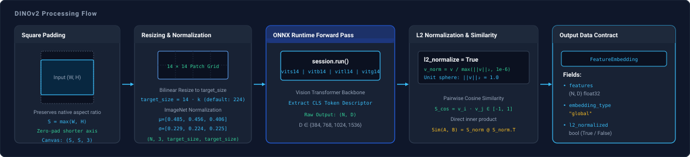

# DINOv2

`spatialhub.models.dinov2` provides an ONNX Runtime adapter for **DINOv2**, extracting global L2-normalized CLS token feature embeddings from images.

---

## Variants

The `DINOv2Adapter` supports 4 Vision Transformer backbone variants via `model_variant`:

| Model Variant (`model_variant`) | Embedding Dimension ($D$) | Architecture & Target Use Case |
| :--- | :--- | :--- |
| `"vits14"` | $D = 384$ | ViT-Small/14 backbone (high throughput, edge processing). |
| `"vitb14"` | $D = 768$ | ViT-Base/14 backbone (balanced descriptor capacity). |
| `"vitl14"` (Default) | $D = 1024$ | ViT-Large/14 backbone (high semantic representation capacity). |
| `"vitg14"` | $D = 1536$ | ViT-Giant/14 backbone (maximum representation capacity). |

---

## Initialization

Initialize `DINOv2` with a model variant:

```python
from spatialhub import DINOv2

# Default ViT-Large backbone
extractor = DINOv2(model_variant="vitl14")

# Hardware acceleration
extractor = DINOv2(model_variant="vitb14", providers=["CUDAExecutionProvider"])
```

### Parameters

| Parameter | Type | Default | Description |
| :--- | :--- | :--- | :--- |
| `model_path` | `str | Path | None` | `None` | Path to local `.onnx` weight file. If omitted, downloads from Hugging Face Hub. |
| `model_variant` | `str` | `"vitl14"` | ViT backbone variant (`"vits14"`, `"vitb14"`, `"vitl14"`, `"vitg14"`). |
| `target_size` | `int` | `224` | Target spatial dimension for bilinear resizing before patch alignment. |
| `providers` | `list[str] | str | None` | `None` | ONNX Runtime execution providers (e.g. `["CUDAExecutionProvider", "CPUExecutionProvider"]`). |

---

## Methods

### `extract_features`

Extracts global CLS token embeddings from a single image or collection of images.

```python
result = extractor.extract_features(images="sample.jpg", l2_normalize=True)
```

#### Parameters

| Parameter | Type | Default | Description |
| :--- | :--- | :--- | :--- |
| `images` | `np.ndarray | str | Path | list[np.ndarray | str | Path]` | *required* | Single image or collection of RGB images as file paths or arrays $(H, W, 3)$. |
| `l2_normalize` | `bool` | `False` | Projects feature embeddings to unit Euclidean length ($\lVert v \rVert_2 = 1.0$). |

#### Return Value

The `extract_features` method returns a [`FeatureEmbedding`](../structures/perception_primitives.md#featureembedding) dataclass:

| Attribute | Shape | Dtype | Description |
| :--- | :--- | :--- | :--- |
| `features` | `(N, D)` | `np.float32` | Global CLS token feature vectors for $N$ input images ($D \in \{384, 768, 1024, 1536\}$). |
| `embedding_type` | `str` | `"global"` | Descriptor modality indicator (`"global"` for CLS embeddings). |
| `l2_normalized` | `bool` | `bool` | Indicates whether output feature vectors are L2-normalized. |

---

## Example

Demonstration script extracting features and evaluating cosine similarity:

```python title="examples/dinov2.py"
--8<-- "examples/dinov2.py:dinov2"
```


Execute the sample script from the repository root:

```bash
uv run python examples/dinov2.py
```

Visualization is saved to `examples/output/dinov2_similarity.png`.

??? example "Single-Image Global Feature Extraction"

    ```python
    from spatialhub import DINOv2

    with DINOv2(model_variant="vitl14", providers=["CUDAExecutionProvider"]) as extractor:
        result = extractor.extract_features(images="sample.jpg", l2_normalize=True)
        print("Feature shape:", result.features.shape)  # (1, 1024)
        print("L2 normalized:", result.l2_normalized)   # True
    ```

??? example "Batch Feature Extraction & Cosine Retrieval"

    ```python
    from spatialhub import DINOv2
    import numpy as np

    images = ["query.jpg", "database_01.jpg", "database_02.jpg"]

    with DINOv2(model_variant="vitl14", providers=["CUDAExecutionProvider"]) as extractor:
        result = extractor.extract_features(images=images, l2_normalize=True)

        # Compute cosine similarity between query (idx 0) and database items
        query_feat = result.features[0:1]
        db_feats = result.features[1:]
        similarities = (query_feat @ db_feats.T)[0]

        best_match_idx = int(np.argmax(similarities))
        print(f"Top match: {images[best_match_idx + 1]} (score: {similarities[best_match_idx]:.4f})")
    ```

---

## End-to-End Flow



DINOv2 employs a Vision Transformer (ViT) architecture trained with self-supervised discriminative objectives to produce dense visual representations without manual class supervision. The pipeline processes RGB images into global feature vectors through aspect-preserving padding, patch tokenization, transformer attention, and optional unit hypersphere normalization.

### Aspect-Preserving Square Padding

Given an input RGB image with native dimensions $(W, H)$, the shorter dimension is zero-padded symmetrically to form a square canvas of side $S = \max(W, H)$:

$$
x_{\text{offset}} = \left\lfloor \frac{S - W}{2} \right\rfloor, \qquad y_{\text{offset}} = \left\lfloor \frac{S - H}{2} \right\rfloor
$$

Vision Transformers lack convolutional inductive biases like translation and scale invariance. Anisotropic scaling deforms object geometry and high-frequency edge orientations. Symmetric zero-padding preserves the original aspect ratio without distortion before spatial interpolation.

### Multiple-of-14 Spatial Resizing & Patch Tokenization

The square canvas is resized to spatial dimension $S_{\text{target}} \times S_{\text{target}}$ (`target_size`, default $224 \times 224$).

The Vision Transformer partitions the input tensor $(3, S_{\text{target}}, S_{\text{target}})$ into a 2D grid of non-overlapping square patches of dimension $P \times P = 14 \times 14$ pixels. The total number of spatial patch tokens is:

$$
N_p = \left(\frac{S_{\text{target}}}{14}\right)^2
$$

Because patches are non-overlapping with fixed stride $14$, $S_{\text{target}}$ must be a positive integer multiple of 14:

$$
S_{\text{target}} = 14 \cdot k, \qquad k \in \mathbb{Z}^+
$$

If $S_{\text{target}}$ is not divisible by 14, fractional boundary patches cannot be constructed, causing a tensor dimension mismatch during linear patch projection.

### ImageNet Normalization

Pixel values scaled to $[0.0, 1.0]$ are normalized per channel $c \in \{R, G, B\}$:

$$
x_{\text{norm}} = \frac{x - \mu_c}{\sigma_c}
$$

where ImageNet mean is $\mu = [0.485, 0.456, 0.406]$ and standard deviation is $\sigma = [0.229, 0.224, 0.225]$.

### Global CLS Token Extraction

A learnable 1D classification token $\mathbf{z}_{\text{cls}} \in \mathbb{R}^D$ is prepended to the sequence of $N_p$ projected patch tokens:

$$
\mathbf{Z}_0 = [\mathbf{z}_{\text{cls}},\, \mathbf{z}_1,\, \mathbf{z}_2,\, \dots,\, \mathbf{z}_{N_p}] \in \mathbb{R}^{(N_p + 1) \times D}
$$

Across stacked Vision Transformer blocks, multi-head self-attention enables the `[CLS]` token to attend to all spatial patches across the receptive field, aggregating global semantic context. SpatialHub extracts the output vector corresponding to index 0:

$$
v = \mathbf{Z}_L[0] \in \mathbb{R}^D
$$

where embedding dimension $D \in \{384, 768, 1024, 1536\}$ corresponds to `vits14`, `vitb14`, `vitl14`, and `vitg14` respectively.

### L2 Feature Normalization

When `l2_normalize=True`, extracted feature vectors are projected onto the unit hypersphere $\mathbb{S}^{D-1}$:

$$
v_{\text{norm}} = \frac{v}{\max(\|v\|_2,\, 10^{-6})} = \frac{v}{\max\left(\sqrt{\sum_{i=1}^D v_i^2},\, 10^{-6}\right)}
$$

On the unit hypersphere, Euclidean distance squared is strictly monotonically related to cosine similarity:

$$
\|u_{\text{norm}} - v_{\text{norm}}\|_2^2 = 2 - 2 \langle u_{\text{norm}},\, v_{\text{norm}} \rangle = 2 - 2 \cos(\theta)
$$

This equivalence converts nearest-neighbor search, clustering, and retrieval across large descriptor collections into matrix inner products without per-vector norm recalculation.

---

## Numerical Parity

Numerical parity evaluates mathematical agreement between the original PyTorch Hub reference models (`facebookresearch/dinov2`) and the SpatialHub ONNX Runtime adapter on $20$ benchmark images sampled from the [COCO 2017 validation dataset](http://images.cocodataset.org/zips/val2017.zip) (`val2017.zip` extracted to `.cache/images/`) at $224 \times 224$ resolution.

| Model Variant | Cosine Sim | Feature L2 Dist | Feature MAE | Max Diff | Rel Error (%) |
| :--- | :--- | :--- | :--- | :--- | :--- |
| `vits14` | 0.999999 | 0.001066 | $4.32 \times 10^{-5}$ | $3.20 \times 10^{-4}$ | **0.11%** |
| `vitb14` | 1.000000 | 0.000874 | $2.50 \times 10^{-5}$ | $1.38 \times 10^{-4}$ | **0.09%** |
| `vitl14` | 1.000000 | 0.000816 | $2.02 \times 10^{-5}$ | $1.96 \times 10^{-4}$ | **0.08%** |
| `vitg14` | 1.000000 | 0.000305 | $6.19 \times 10^{-6}$ | $3.90 \times 10^{-5}$ | **0.03%** |

---

## Performance

Latency, throughput, and memory footprint measured across $10$ unmeasured warmup iterations and $50$ timed measurement iterations at $224 \times 224$ resolution.

=== "CUDA Execution (`CUDAExecutionProvider`)"

    <table>
      <thead>
        <tr>
          <th>Variant</th>
          <th>Stage</th>
          <th>Latency Mean (ms)</th>
          <th>P95 (ms)</th>
          <th>Throughput (FPS)</th>
          <th>Peak RAM Delta</th>
          <th>Peak VRAM Delta</th>
        </tr>
      </thead>
      <tbody>
        <tr>
          <td rowspan="3" style="vertical-align: middle; text-align: center; font-weight: bold; border-right: 2px solid #ddd;"><code>vits14</code></td>
          <td>Preprocess</td>
          <td>1.07 +/- 0.13</td>
          <td>1.29</td>
          <td>931.7</td>
          <td>+0.6 MB</td>
          <td>0.0 MB</td>
        </tr>
        <tr>
          <td>Inference</td>
          <td>4.73 +/- 0.58</td>
          <td>5.64</td>
          <td><strong>211.4</strong></td>
          <td>+0.2 MB</td>
          <td>+6.0 MB</td>
        </tr>
        <tr style="border-bottom: 2px solid #ccc;">
          <td>End-to-End</td>
          <td>5.44 +/- 0.66</td>
          <td>6.37</td>
          <td><strong>183.7</strong></td>
          <td>+2.9 MB</td>
          <td>0.0 MB</td>
        </tr>
        <tr>
          <td rowspan="3" style="vertical-align: middle; text-align: center; font-weight: bold; border-right: 2px solid #ddd;"><code>vitb14</code></td>
          <td>Preprocess</td>
          <td>1.28 +/- 0.16</td>
          <td>1.56</td>
          <td>784.3</td>
          <td>+1.1 MB</td>
          <td>0.0 MB</td>
        </tr>
        <tr>
          <td>Inference</td>
          <td>8.50 +/- 0.59</td>
          <td>9.66</td>
          <td><strong>117.7</strong></td>
          <td>0.0 MB</td>
          <td>+10.0 MB</td>
        </tr>
        <tr style="border-bottom: 2px solid #ccc;">
          <td>End-to-End</td>
          <td>9.20 +/- 0.51</td>
          <td>10.35</td>
          <td><strong>108.7</strong></td>
          <td>+1.1 MB</td>
          <td>0.0 MB</td>
        </tr>
        <tr>
          <td rowspan="3" style="vertical-align: middle; text-align: center; font-weight: bold; border-right: 2px solid #ddd;"><code>vitl14</code></td>
          <td>Preprocess</td>
          <td>1.24 +/- 0.15</td>
          <td>1.63</td>
          <td>806.4</td>
          <td>+1.1 MB</td>
          <td>0.0 MB</td>
        </tr>
        <tr>
          <td>Inference</td>
          <td>29.00 +/- 2.60</td>
          <td>31.70</td>
          <td><strong>34.5</strong></td>
          <td>0.0 MB</td>
          <td>+14.0 MB</td>
        </tr>
        <tr style="border-bottom: 2px solid #ccc;">
          <td>End-to-End</td>
          <td>32.71 +/- 0.98</td>
          <td>34.47</td>
          <td><strong>30.6</strong></td>
          <td>+1.0 MB</td>
          <td>0.0 MB</td>
        </tr>
        <tr>
          <td rowspan="3" style="vertical-align: middle; text-align: center; font-weight: bold; border-right: 2px solid #ddd;"><code>vitg14</code></td>
          <td>Preprocess</td>
          <td>1.17 +/- 0.11</td>
          <td>1.42</td>
          <td>854.4</td>
          <td>+1.1 MB</td>
          <td>0.0 MB</td>
        </tr>
        <tr>
          <td>Inference</td>
          <td>133.93 +/- 16.64</td>
          <td>156.30</td>
          <td><strong>7.5</strong></td>
          <td>+0.6 MB</td>
          <td>+20.0 MB</td>
        </tr>
        <tr>
          <td>End-to-End</td>
          <td>192.66 +/- 37.56</td>
          <td>277.27</td>
          <td><strong>5.2</strong></td>
          <td>+2.7 MB</td>
          <td>0.0 MB</td>
        </tr>
      </tbody>
    </table>

    !!! note "Hardware Power & Thermal Scaling on `vitg14`"
        On `vitg14` (~1.1B parameters), isolated inference reflects peak GPU boost clocks (~1575 MHz at 140W TGP, ~133.9 ms). Under continuous sequential load across benchmark stages, GPU thermal management and power limits throttle operating clocks to steady-state frequencies (~1110–1200 MHz at ~89W, ~192.7 ms).

=== "CPU Execution (`CPUExecutionProvider`)"

    <table>
      <thead>
        <tr>
          <th>Variant</th>
          <th>Stage</th>
          <th>Latency Mean (ms)</th>
          <th>P95 (ms)</th>
          <th>Throughput (FPS)</th>
          <th>Peak RAM Delta</th>
        </tr>
      </thead>
      <tbody>
        <tr>
          <td rowspan="3" style="vertical-align: middle; text-align: center; font-weight: bold; border-right: 2px solid #ddd;"><code>vits14</code></td>
          <td>Preprocess</td>
          <td>1.26 +/- 0.14</td>
          <td>1.54</td>
          <td>794.6</td>
          <td>+1.7 MB</td>
        </tr>
        <tr>
          <td>Inference</td>
          <td>43.96 +/- 4.27</td>
          <td>52.61</td>
          <td><strong>22.7</strong></td>
          <td>+1.1 MB</td>
        </tr>
        <tr style="border-bottom: 2px solid #ccc;">
          <td>End-to-End</td>
          <td>44.94 +/- 1.97</td>
          <td>47.99</td>
          <td><strong>22.3</strong></td>
          <td>0.0 MB</td>
        </tr>
        <tr>
          <td rowspan="3" style="vertical-align: middle; text-align: center; font-weight: bold; border-right: 2px solid #ddd;"><code>vitb14</code></td>
          <td>Preprocess</td>
          <td>1.38 +/- 0.17</td>
          <td>1.74</td>
          <td>722.2</td>
          <td>0.0 MB</td>
        </tr>
        <tr>
          <td>Inference</td>
          <td>141.89 +/- 6.92</td>
          <td>156.49</td>
          <td><strong>7.0</strong></td>
          <td>+0.1 MB</td>
        </tr>
        <tr style="border-bottom: 2px solid #ccc;">
          <td>End-to-End</td>
          <td>144.51 +/- 8.15</td>
          <td>153.65</td>
          <td><strong>6.9</strong></td>
          <td>0.0 MB</td>
        </tr>
        <tr>
          <td rowspan="3" style="vertical-align: middle; text-align: center; font-weight: bold; border-right: 2px solid #ddd;"><code>vitl14</code></td>
          <td>Preprocess</td>
          <td>1.26 +/- 0.04</td>
          <td>1.34</td>
          <td>791.5</td>
          <td>+1.7 MB</td>
        </tr>
        <tr>
          <td>Inference</td>
          <td>512.34 +/- 9.32</td>
          <td>530.10</td>
          <td><strong>2.0</strong></td>
          <td>0.0 MB</td>
        </tr>
        <tr style="border-bottom: 2px solid #ccc;">
          <td>End-to-End</td>
          <td>521.78 +/- 15.71</td>
          <td>542.00</td>
          <td><strong>1.9</strong></td>
          <td>0.0 MB</td>
        </tr>
        <tr>
          <td rowspan="3" style="vertical-align: middle; text-align: center; font-weight: bold; border-right: 2px solid #ddd;"><code>vitg14</code></td>
          <td>Preprocess</td>
          <td>1.48 +/- 0.11</td>
          <td>1.69</td>
          <td>674.3</td>
          <td>+1.9 MB</td>
        </tr>
        <tr>
          <td>Inference</td>
          <td>1959.85 +/- 38.62</td>
          <td>2030.01</td>
          <td><strong>0.5</strong></td>
          <td>+3.2 MB</td>
        </tr>
        <tr>
          <td>End-to-End</td>
          <td>1916.91 +/- 26.12</td>
          <td>1967.96</td>
          <td><strong>0.5</strong></td>
          <td>0.0 MB</td>
        </tr>
      </tbody>
    </table>

---

## Developer Tooling

=== "Export ONNX"
    ```bash
    # Export a specific variant
    uv run tools/export/export_dinov2.py \
        --variant vitl14 \
        --output-folder onnx_weight \
        --opset 17

    # Export all variants
    uv run tools/export/export_dinov2.py \
        --variant all \
        --output-folder onnx_weight
    ```

    | Parameter | Type | Default | Description |
    | :--- | :--- | :--- | :--- |
    | `--variant` | `str` | `"vitl14"` | Model variant to export (`vits14`, `vitb14`, `vitl14`, `vitg14`, or `all`). |
    | `--output-folder` | `str` | `"onnx_weight"` | Destination directory for exported `.onnx` models. |
    | `--width` | `int` | `224` | Input image width in pixels (must be a multiple of 14). |
    | `--height` | `int` | `224` | Input image height in pixels (must be a multiple of 14). |
    | `--image-size` | `int` | `None` | Convenience parameter to set square dimensions (`width = height = image_size`). |
    | `--opset` | `int` | `17` | ONNX Operator Set version. |

=== "Parity Check"
    ```bash
    uv run tools/benchmark/parity_dinov2.py \
        --variant all \
        --data-dir .cache/images \
        --output-file .profile/parity_dinov2.md
    ```

    | Parameter | Type | Default | Description |
    | :--- | :--- | :--- | :--- |
    | `--variant` | `str` | `"all"` | Model variant to evaluate (`vits14`, `vitb14`, `vitl14`, `vitg14`, or `all`). |
    | `--data-dir` | `str` | `".cache/images"` | Directory containing benchmark image files. |
    | `--model-dir` | `str` | `None` | Optional directory containing local `.onnx` weight files. |
    | `--max-images` | `int` | `20` | Maximum number of images to evaluate. |
    | `--output-file` | `str` | `None` | Optional path to output markdown report file. |

=== "Performance Profile"
    ```bash
    uv run tools/benchmark/profile_dinov2.py \
        --variant all \
        --provider all \
        --data-dir .cache/images \
        --warmup 10 \
        --iters 50 \
        --output-file .profile/profile_dinov2.md
    ```

    | Parameter | Type | Default | Description |
    | :--- | :--- | :--- | :--- |
    | `--variant` | `str` | `"all"` | Model variant to profile (`vits14`, `vitb14`, `vitl14`, `vitg14`, or `all`). |
    | `--provider` | `str` | `"all"` | Target execution provider filter (`cuda`, `cpu`, or `all`). |
    | `--data-dir` | `str` | `".cache/images"` | Directory containing sample image for profiling. |
    | `--model-dir` | `str` | `None` | Optional directory containing local `.onnx` weight files. |
    | `--warmup` | `int` | `10` | Number of unmeasured warmup iterations. |
    | `--iters` | `int` | `50` | Number of timed measurement iterations. |
    | `--output-file` | `str` | `None` | Optional path to save markdown benchmark report. |

---
