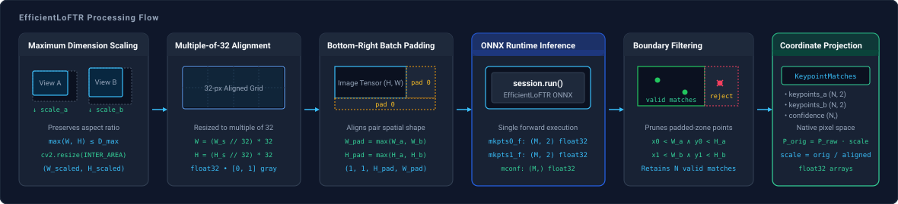

# EfficientLoFTR

`spatialhub.models.efficient_loftr` provides an ONNX Runtime adapter for **EfficientLoFTR**, a semi-dense local feature matching model using sparse transformers.

---

## Variants

The `EfficientLoFTRAdapter` accepts two model variants via `model_type`:

| Model Variant (`model_type`) | Description | Target Use Case |
| :--- | :--- | :--- |
| `"full"` (Default) | Full precision semi-dense feature matching model. | Maximum matching precision & robust keypoint coverage. |
| `"opt"` | Optimized/reparameterized lightweight model variant. | High throughput, lower memory footprint, and edge processing. |

---

## Initialization

Initialize `EfficientLoFTR` by specifying a model variant, or pass an explicit model path:

```python
from spatialhub import EfficientLoFTR

# Default full-precision model
matcher = EfficientLoFTR(model_type="full")

# Lightweight model with CUDA acceleration
matcher = EfficientLoFTR(model_type="opt", providers=["CUDAExecutionProvider"])
```

### Parameters

| Parameter | Type | Default | Description |
| :--- | :--- | :--- | :--- |
| `model_path` | `str | Path | None` | `None` | Path to local `.onnx` weight file. If omitted, downloads from Hugging Face Hub. |
| `model_type` | `str` | `"full"` | Model architecture variant (`"full"` or `"opt"`). |
| `providers` | `list[str] | str | None` | `None` | ONNX Runtime execution providers (e.g. `["CUDAExecutionProvider", "CPUExecutionProvider"]`). |

---

## Methods

### `match`

Executes semi-dense feature matching between an image pair and projects keypoints to native image space.

```python
matches = matcher.match(image_a, image_b, max_dim=1024)
```

#### Parameters

| Parameter | Type | Default | Description |
| :--- | :--- | :--- | :--- |
| `image_a` | `str | Path | np.ndarray` | *required* | First input image as file path or RGB array $(H, W, 3)$. |
| `image_b` | `str | Path | np.ndarray` | *required* | Second input image as file path or RGB array $(H, W, 3)$. |
| `max_dim` | `int | None` | `1024` | Maximum spatial dimension limit for aspect-ratio preserving downscaling. |

#### Return Value

The `match` method returns a [`KeypointMatches`](../structures/perception_primitives.md#keypointmatches) dataclass:

| Attribute | Shape | Dtype | Description |
| :--- | :--- | :--- | :--- |
| `keypoints_a` | `(N, 2)` | `np.float32` | Matched $(x, y)$ pixel coordinates in `image_a`. |
| `keypoints_b` | `(N, 2)` | `np.float32` | Matched $(x, y)$ pixel coordinates in `image_b`. |
| `confidence` | `(N,)` | `np.float32` | Correspondence confidence scores in $[0, 1]$. |

---

## Example

Demonstration script matching an image pair and visualizing correspondences:

```python title="examples/efficient_loftr.py"
--8<-- "examples/efficient_loftr.py:efficient_loftr"
```


Execute the sample script from the repository root:

```bash
uv run python examples/efficient_loftr.py
```

Visualization is saved to `examples/output/eloftr_matches.png`.

---

## End-to-End Flow



Dense keypoint matching at native image resolution exhibits quadratic computational and memory complexity $O(N_A \cdot N_B)$ under standard self- and cross-attention mechanisms. EfficientLoFTR resolves this through an asymmetric coarse-to-fine architecture: it establishes initial correspondences at low spatial resolution ($1/8$ scale) using linear attention and refines surviving candidates to sub-pixel precision at high resolution ($1/2$ scale).

### Maximum Dimension Scaling

Given an input image with native dimensions $(W_{\text{orig}}, H_{\text{orig}})$ and maximum dimension limit $D_{\max}$ (`max_dim`), dimensions are downscaled isotropically if either axis exceeds $D_{\max}$:

$$
(W_{\text{scaled}}, H_{\text{scaled}}) = \begin{cases} 
\left(\left\lfloor W_{\text{orig}} \cdot \frac{D_{\max}}{\max(W_{\text{orig}}, H_{\text{orig}})} \right\rfloor,\; \left\lfloor H_{\text{orig}} \cdot \frac{D_{\max}}{\max(W_{\text{orig}}, H_{\text{orig}})} \right\rfloor\right) & \text{if } D_{\max} \text{ and } \max(W_{\text{orig}}, H_{\text{orig}}) > D_{\max} \\[8pt]
(W_{\text{orig}}, H_{\text{orig}}) & \text{otherwise}
\end{cases}
$$

Isotropic scaling preserves the relative aspect ratio, preventing distortion of perspective rays and epipolar lines between views.

### Multiple-of-32 Alignment

Spatial dimensions are aligned down to the nearest integer multiple of 32, and pixel values are converted to single-channel float32 grayscale tensors in $[0.0, 1.0]$:

$$
W = \max\left(32,\ \left\lfloor\frac{W_{\text{scaled}}}{32}\right\rfloor \times 32\right), \qquad H = \max\left(32,\ \left\lfloor\frac{H_{\text{scaled}}}{32}\right\rfloor \times 32\right)
$$

The hierarchical feature pyramid extracts coarse representations at stride 8 and fine representations at stride 2. Enforcing 32-pixel alignment ensures that spatial dimensions divide evenly across all convolutional pooling layers without fractional boundary truncation.

### Bottom-Right Batch Padding

When an image pair $(A, B)$ has unequal aligned dimensions $(W_a, H_a)$ and $(W_b, H_b)$, resizing either image to match the other would alter its aspect ratio and distort the underlying epipolar geometry. Instead, both images are zero-padded along their bottom and right edges to a shared spatial size:

$$
W_{\text{pad}} = \max(W_a, W_b), \qquad H_{\text{pad}} = \max(H_a, H_b)
$$

Padding to identical dimensions allows packing both images into a unified batched tensor $(2, 1, H_{\text{pad}}, W_{\text{pad}})$ for parallel GPU execution while preserving their native geometric scales.

### Hierarchical Coarse-to-Fine Matching

1. **Coarse Matching ($1/8$ resolution)**: The backbone extracts coarse feature maps of dimension $(\frac{H}{8}, \frac{W}{8})$. Efficient linear Transformer layers aggregate context across both images. A dual-softmax operator evaluates mutual nearest-neighbor probabilities, yielding coarse match pairs $(\tilde{i}, \tilde{j})$ with match confidence $c \in [0, 1]$.
2. **Fine Sub-Pixel Refinement ($1/2$ resolution)**: For each coarse match passing confidence thresholding, local feature windows of size $w \times w$ are extracted from the $1/2$ scale fine feature maps. A lightweight regression head computes continuous sub-pixel coordinate displacement vectors $(\Delta x, \Delta y)$, producing high-precision keypoints $P_0 = (x_0, y_0)$ in image A and $P_1 = (x_1, y_1)$ in image B.

### Boundary Filtering & Projection

Because images were padded to $(W_{\text{pad}}, H_{\text{pad}})$, keypoints predicted inside the bottom-right padding regions represent uninformative canvas artifacts. Valid correspondences are retained using the spatial boundary condition $V$:

$$
V = \{ (P_0, P_1) \mid x_0 < W_a \land y_0 < H_a \land x_1 < W_b \land y_1 < H_b \}
$$

Surviving raw keypoint coordinates $P = (x, y)$ are projected back to native input coordinates by inverting the preprocessing scale factors:

$$
P_{\text{orig}, 0} = \left(x_0 \cdot \frac{W_{\text{orig}, a}}{W_a},\; y_0 \cdot \frac{H_{\text{orig}, a}}{H_a}\right), \qquad P_{\text{orig}, 1} = \left(x_1 \cdot \frac{W_{\text{orig}, b}}{W_b},\; y_1 \cdot \frac{H_{\text{orig}, b}}{H_b}\right)
$$

---

## Numerical Parity

Numerical parity verifies mathematical equivalence between the original PyTorch implementation and the exported ONNX Runtime CUDA graph.

In sparse transformer models, keypoint extraction relies on top-k sorting and parallel score reduction. Due to non-associative floating-point operations across parallel GPU threads, PyTorch and ONNX Runtime may produce keypoints in slightly different array order. SpatialHub embeds every matched point pair into a 4D spatial vector $(x_0, y_0, x_1, y_1)$ and resolves correspondences using KD-tree (`scipy.spatial.cKDTree`) nearest-neighbor queries.

Parity was evaluated on 30 image pairs from the [MegaDepth-1500](https://huggingface.co/SpatialHub/efficient-loftr-onnx/tree/main/0015_pairs) outdoor evaluation dataset (`max_dim` denotes the maximum spatial dimension scaling threshold):

<table>
  <thead>
    <tr>
      <th>Variant</th>
      <th>Max Dim</th>
      <th>Pairs</th>
      <th>Mean Matches (PyTorch / ONNX)</th>
      <th>Match Ratio</th>
      <th>Keypoint MAE (px)</th>
      <th>Keypoint Max Diff (px)</th>
      <th>Confidence MAE</th>
      <th>Confidence Max Diff</th>
    </tr>
  </thead>
  <tbody>
    <tr>
      <td rowspan="3" style="vertical-align: middle; text-align: center; font-weight: bold;"><code>full</code></td>
      <td><code>640</code></td>
      <td>30</td>
      <td>1091.4 / 1091.4</td>
      <td>99.9%</td>
      <td>0.0000</td>
      <td>0.0000</td>
      <td>0.000534</td>
      <td>0.005604</td>
    </tr>
    <tr>
      <td><code>768</code></td>
      <td>30</td>
      <td>1552.0 / 1552.0</td>
      <td>100.0%</td>
      <td>0.0000</td>
      <td>0.0000</td>
      <td>0.000543</td>
      <td>0.005379</td>
    </tr>
    <tr>
      <td><code>832</code></td>
      <td>30</td>
      <td>1850.8 / 1850.6</td>
      <td>100.0%</td>
      <td>0.0000</td>
      <td>0.0000</td>
      <td>0.000488</td>
      <td>0.005781</td>
    </tr>
    <tr>
      <td rowspan="3" style="vertical-align: middle; text-align: center; font-weight: bold;"><code>opt</code></td>
      <td><code>640</code></td>
      <td>30</td>
      <td>1150.2 / 1149.9</td>
      <td>100.0%</td>
      <td>0.0000</td>
      <td>0.0000</td>
      <td>0.003513</td>
      <td>0.023308</td>
    </tr>
    <tr>
      <td><code>768</code></td>
      <td>30</td>
      <td>1638.7 / 1638.5</td>
      <td>100.0%</td>
      <td>0.0000</td>
      <td>0.0000</td>
      <td>0.003573</td>
      <td>0.030832</td>
    </tr>
    <tr>
      <td><code>832</code></td>
      <td>30</td>
      <td>1956.6 / 1956.6</td>
      <td>100.0%</td>
      <td>0.0000</td>
      <td>0.0000</td>
      <td>0.003477</td>
      <td>0.034790</td>
    </tr>
  </tbody>
</table>

!!! note
    Keypoint coordinate error is $0.0000\text{ px}$ MAE and Max Diff across all tested configurations. Minor confidence variance ($\sim 10^{-4}$ in `full`, $\sim 10^{-3}$ in `opt`) stems from floating-point reduction order in the attention layers. Evaluated up to `max_dim=832`.

---

## Performance

Latency, throughput, and host process RAM deltas measured on the first pair of the [MegaDepth-1500](https://huggingface.co/SpatialHub/efficient-loftr-onnx/tree/main/0015_pairs) outdoor dataset (with native input resolutions of $1271 \times 953$ for image A and $1600 \times 1174$ for image B). Measurements reflect 5 unmeasured warmup iterations and 20 timed measurement iterations.

=== "CUDA Execution (`CUDAExecutionProvider`)"

    <table>
      <thead>
        <tr>
          <th>Variant</th>
          <th>Max Dim Limit</th>
          <th>Latency Mean (ms)</th>
          <th>P95 (ms)</th>
          <th>Throughput (Pairs/s)</th>
          <th>Host RAM Delta</th>
          <th>Peak VRAM Delta</th>
        </tr>
      </thead>
      <tbody>
        <tr>
          <td rowspan="4" style="vertical-align: middle; text-align: center; font-weight: bold;"><code>full</code></td>
          <td><code>640</code></td>
          <td>85.42 +/- 5.27</td>
          <td>96.85</td>
          <td><strong>11.7</strong></td>
          <td>+564.5 MB</td>
          <td>+1808.0 MB</td>
        </tr>
        <tr>
          <td><code>832</code></td>
          <td>205.73 +/- 40.02</td>
          <td>265.53</td>
          <td><strong>4.9</strong></td>
          <td>+200.1 MB</td>
          <td>+4338.0 MB</td>
        </tr>
        <tr>
          <td><code>960</code></td>
          <td>358.43 +/- 86.24</td>
          <td>541.61</td>
          <td><strong>2.8</strong></td>
          <td>+360.7 MB</td>
          <td>+6953.0 MB</td>
        </tr>
        <tr>
          <td><code>1024</code></td>
          <td>3560.52 +/- 334.86</td>
          <td>4224.72</td>
          <td><strong>0.3</strong></td>
          <td>+1859.1 MB</td>
          <td>+6953.0 MB</td>
        </tr>
        <tr>
          <td rowspan="4" style="vertical-align: middle; text-align: center; font-weight: bold;"><code>opt</code></td>
          <td><code>640</code></td>
          <td>121.49 +/- 14.46</td>
          <td>139.37</td>
          <td><strong>8.2</strong></td>
          <td>+101.2 MB</td>
          <td>+1626.0 MB</td>
        </tr>
        <tr>
          <td><code>832</code></td>
          <td>456.78 +/- 80.48</td>
          <td>562.17</td>
          <td><strong>2.2</strong></td>
          <td>+207.7 MB</td>
          <td>+4220.0 MB</td>
        </tr>
        <tr>
          <td><code>960</code></td>
          <td>878.12 +/- 80.74</td>
          <td>1009.08</td>
          <td><strong>1.1</strong></td>
          <td>+317.9 MB</td>
          <td>+5904.0 MB</td>
        </tr>
        <tr>
          <td><code>1024</code></td>
          <td>1453.20 +/- 133.25</td>
          <td>1660.77</td>
          <td><strong>0.7</strong></td>
          <td>+490.8 MB</td>
          <td>+6953.0 MB</td>
        </tr>
      </tbody>
    </table>

=== "CPU Execution (`CPUExecutionProvider`)"

    <table>
      <thead>
        <tr>
          <th>Variant</th>
          <th>Max Dim Limit</th>
          <th>Latency Mean (ms)</th>
          <th>P95 (ms)</th>
          <th>Throughput (Pairs/s)</th>
          <th>Host RAM Delta</th>
        </tr>
      </thead>
      <tbody>
        <tr>
          <td rowspan="4" style="vertical-align: middle; text-align: center; font-weight: bold;"><code>full</code></td>
          <td><code>640</code></td>
          <td>3085.78 +/- 333.01</td>
          <td>3690.02</td>
          <td><strong>0.3</strong></td>
          <td>+1175.2 MB</td>
        </tr>
        <tr>
          <td><code>832</code></td>
          <td>5789.84 +/- 268.09</td>
          <td>6189.51</td>
          <td><strong>0.2</strong></td>
          <td>+2731.2 MB</td>
        </tr>
        <tr>
          <td><code>960</code></td>
          <td>9123.22 +/- 450.85</td>
          <td>9671.42</td>
          <td><strong>0.1</strong></td>
          <td>+4065.2 MB</td>
        </tr>
        <tr>
          <td><code>1024</code></td>
          <td>11077.42 +/- 399.25</td>
          <td>11817.81</td>
          <td><strong>0.1</strong></td>
          <td>+3581.9 MB</td>
        </tr>
        <tr>
          <td rowspan="4" style="vertical-align: middle; text-align: center; font-weight: bold;"><code>opt</code></td>
          <td><code>640</code></td>
          <td>2833.60 +/- 120.07</td>
          <td>3020.90</td>
          <td><strong>0.4</strong></td>
          <td>+1332.2 MB</td>
        </tr>
        <tr>
          <td><code>832</code></td>
          <td>6070.13 +/- 1001.03</td>
          <td>8153.02</td>
          <td><strong>0.2</strong></td>
          <td>+1490.8 MB</td>
        </tr>
        <tr>
          <td><code>960</code></td>
          <td>8201.68 +/- 455.54</td>
          <td>8992.29</td>
          <td><strong>0.1</strong></td>
          <td>+3115.0 MB</td>
        </tr>
        <tr>
          <td><code>1024</code></td>
          <td>10058.98 +/- 647.43</td>
          <td>10939.23</td>
          <td><strong>0.1</strong></td>
          <td>+3940.5 MB</td>
        </tr>
      </tbody>
    </table>

---

## Developer Tooling

=== "Export ONNX"
    ```bash
    uv run tools/export/export_efficient_loftr.py \
        --checkpoint weights/eloftr_outdoor.ckpt \
        --output-folder onnx_weight \
        --opset 17
    ```

    | Parameter | Type | Default | Description |
    | :--- | :--- | :--- | :--- |
    | `--variant` | `str` | `"all"` | Model variant to export (`full`, `opt`, or `all`). |
    | `--checkpoint` | `str` | `None` | Path to source `.ckpt` PyTorch weights file (downloaded if omitted). |
    | `--output-folder` | `str` | `onnx_weight` | Destination directory for exported `.onnx` model files. |
    | `--width` | `int` | `640` | Input image width in pixels (must be a multiple of 32). |
    | `--height` | `int` | `480` | Input image height in pixels (must be a multiple of 32). |
    | `--opset` | `int` | `17` | ONNX Operator Set version. |

=== "Parity Check"
    ```bash
    uv run tools/benchmark/parity_efficient_loftr.py \
        --folder-a upstream/efficient_loftr/data/0015_pairs/folder_a \
        --folder-b upstream/efficient_loftr/data/0015_pairs/folder_b \
        --variant all \
        --max-dims 640 768 832 \
        --max-pairs 30 \
        --coord-tol 0.01 \
        --conf-tol 0.05 \
        --output-file .profile/parity_eloftr.txt
    ```

    | Parameter | Type | Default | Description |
    | :--- | :--- | :--- | :--- |
    | `--folder-a` | `str` | *Required* | Path to first folder of paired evaluation images. |
    | `--folder-b` | `str` | *Required* | Path to second folder of paired evaluation images. |
    | `--variant` | `str` | `"all"` | Model variant to test (`full`, `opt`, or `all`). |
    | `--max-dims` | `list[str]` | `["640", "1024"]` | Input spatial scale limits to evaluate. |
    | `--max-pairs` | `int` | `None` | Maximum number of image pairs to evaluate. |
    | `--coord-tol` | `float` | `0.01` | Keypoint coordinate tolerance threshold in pixels. |
    | `--conf-tol` | `float` | `0.01` | Confidence score tolerance threshold. |
    | `--checkpoint` | `str` | `None` | Optional path to custom PyTorch checkpoint file. |
    | `--model-dir` | `str` | `None` | Directory containing local `.onnx` model files. |
    | `--output-file` | `str` | `None` | File path to write markdown parity report. |

=== "Performance Profile"
    ```bash
    uv run tools/benchmark/profile_efficient_loftr.py \
        --variant all \
        --provider all \
        --image-a "upstream/efficient_loftr/data/0015_pairs/folder_a/0000.jpg" \
        --image-b "upstream/efficient_loftr/data/0015_pairs/folder_b/0000.jpg" \
        --max-dims 640 832 960 1024 \
        --warmup 5 \
        --iters 20 \
        --output-file .profile/profile_eloftr.txt
    ```

    | Parameter | Type | Default | Description |
    | :--- | :--- | :--- | :--- |
    | `--variant` | `str` | `"all"` | Model variant to profile (`full`, `opt`, or `all`). |
    | `--provider` | `str` | `"all"` | Execution provider filter (`cuda`, `cpu`, or `all`). |
    | `--image-a` | `str` | `None` | Path to first evaluation image. |
    | `--image-b` | `str` | `None` | Path to second evaluation image. |
    | `--resolutions` | `list[str]` | `["640x480"]` | Synthetic spatial resolutions if no images are given. |
    | `--max-dims` | `list[str]` | `["640", "1024"]` | Input spatial scale limits to test. |
    | `--warmup` | `int` | `5` | Number of unmeasured warmup iterations. |
    | `--iters` | `int` | `20` | Number of timed measurement iterations. |
    | `--model-dir` | `str` | `None` | Directory containing local `.onnx` model files. |
    | `--output-file` | `str` | `None` | File path to write markdown summary table. |

---
