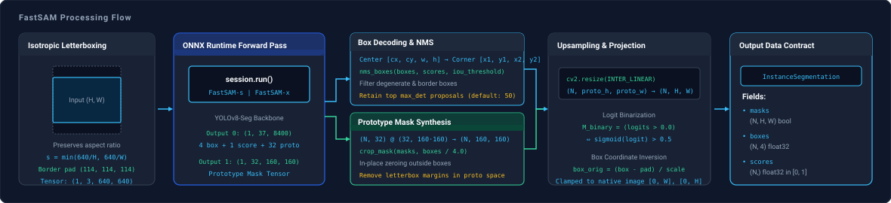

# FastSAM

`spatialhub.models.fastsam` provides an ONNX Runtime adapter for **FastSAM (YOLOv8-Seg)**, performing real-time instance segmentation and mask proposal generation.

---

## Variants

The `FastSAMAdapter` supports 2 YOLOv8-Seg model variants via `model_variant`:

| Model Variant (`model_variant`) | Resolution | Architecture & Target Use Case |
| :--- | :--- | :--- |
| `"s"` (Default) | $640 \times 640$ | Small YOLOv8-Seg backbone (high-throughput, edge processing, real-time robotics). |
| `"x"` | $640 \times 640$ | Extra Large YOLOv8-Seg backbone (maximum proposal precision & dense mask detail). |

---

## Initialization

Initialize `FastSAM` with a model variant:

```python
from spatialhub import FastSAM

# Default high-capacity variant
segmentor = FastSAM(model_variant="x")

# Lightweight variant with CUDA acceleration
segmentor = FastSAM(model_variant="s", providers=["CUDAExecutionProvider"])
```

### Parameters

| Parameter | Type | Default | Description |
| :--- | :--- | :--- | :--- |
| `model_path` | `str | Path | None` | `None` | Path to local `.onnx` weight file. If omitted, downloads from Hugging Face Hub. |
| `model_variant` | `str` | `"x"` | Model variant (`"s"` for lightweight real-time, `"x"` for high-capacity). |
| `imgsz` | `int` | `640` | Square input image resolution for letterboxing. |
| `conf_threshold` | `float` | `0.05` | Default candidate mask confidence score cutoff. |
| `iou_threshold` | `float` | `0.70` | Default Non-Maximum Suppression (NMS) IoU threshold. |
| `max_det` | `int` | `50` | Default upper bound on returned mask proposals. |
| `providers` | `list[str] | str | None` | `None` | ONNX Runtime execution providers (e.g. `["CUDAExecutionProvider", "CPUExecutionProvider"]`). |

---

## Methods

### `generate_masks`

Generates class-agnostic instance mask proposals and bounding boxes.

```python
results = segmentor.generate_masks(image="indoor_scene.jpg", conf_threshold=0.25)
```

#### Parameters

| Parameter | Type | Default | Description |
| :--- | :--- | :--- | :--- |
| `image` | `str | Path | np.ndarray` | *required* | Input image as file path or RGB array $(H, W, 3)$ with values in $[0, 255]$. |
| `conf_threshold` | `float | None` | `None` | Overrides default confidence cutoff threshold. |
| `iou_threshold` | `float | None` | `None` | Overrides default Non-Maximum Suppression IoU threshold. |
| `max_det` | `int | None` | `None` | Overrides default maximum detection count limit. |

#### Return Value

The `generate_masks` method returns an [`InstanceSegmentation`](../structures/perception_primitives.md#instancesegmentation) dataclass:

| Attribute | Shape | Dtype | Description |
| :--- | :--- | :--- | :--- |
| `boxes` | `(N, 4)` | `np.float32` | Bounding boxes in `[x1, y1, x2, y2]` native pixel space. |
| `masks` | `(N, H, W)` | `bool` | Binary proposal masks at native image resolution $(H, W)$. |
| `scores` | `(N,)` | `np.float32` | Confidence scores for each proposal mask in $[0, 1]$. |
| `ids` | `(N,)` | `np.int32` | Zero-indexed proposal identifiers. |
| `names` | `list[str]` | `list[str]` | Generic class labels (`["object", ...]`). |

---

## Example

Demonstration script generating proposals and visualizing masks:

```python title="examples/fastsam.py"
--8<-- "examples/fastsam.py:fastsam"
```


Execute the sample script from the repository root:

```bash
uv run python examples/fastsam.py
```

Visualization is saved to `examples/output/fastsam_masks.png`.

??? example "Single-Image Zero-Shot Instance Proposals"

    ```python
    from spatialhub import FastSAM

    with FastSAM(model_variant="s", providers=["CUDAExecutionProvider"]) as segmentor:
        results = segmentor.generate_masks(
            image="indoor_scene.jpg",
            conf_threshold=0.25,
            iou_threshold=0.70,
            max_det=50,
        )

        print("Detected proposal count:", len(results.masks))
        print("Mask spatial resolution:", results.masks.shape[1:])
        print("Bounding box coordinates (xyxy):", results.boxes.shape)
    ```

??? example "Dense Scene Proposal Extraction (`max_det = 300`)"

    ```python
    from spatialhub import FastSAM

    with FastSAM(model_variant="x", providers=["CUDAExecutionProvider"]) as segmentor:
        # Increase max_det for crowded environments (e.g. aerial or microscopic data)
        results = segmentor.generate_masks(
            image="cluttered_scene.jpg",
            conf_threshold=0.15,
            iou_threshold=0.65,
            max_det=300,
        )

        print(f"Extracted {len(results.masks)} candidate instance proposals.")
    ```

---

## End-to-End Flow



FastSAM operates via a unified anchor-free convolutional architecture that executes instance segmentation in a single feedforward pass. The network decouples instance segmentation into two concurrent branches: a detection head that predicts bounding boxes, confidence scores, and mask coefficients, and a Protonet branch that predicts a set of shared prototype masks.

### Isotropic Letterboxing

Given input image dimensions $(W_{\text{orig}}, H_{\text{orig}})$ and network input dimension $S_{\text{img}} = 640$, the image is scaled isotropically to preserve the native aspect ratio:

$$
(W_{\text{scaled}},\, H_{\text{scaled}}) = \left(\lfloor W_{\text{orig}} \cdot s \rfloor,\; \lfloor H_{\text{orig}} \cdot s \rfloor\right), \qquad s = \min\left(\frac{S_{\text{img}}}{H_{\text{orig}}},\; \frac{S_{\text{img}}}{W_{\text{orig}}}\right)
$$

Isotropic scaling prevents geometric distortion. Non-uniform (anisotropic) stretching alters object aspect ratios, deforming circular objects into ellipses and degrading anchor-free box coordinate regression.

To construct the square $S_{\text{img}} \times S_{\text{img}}$ tensor, symmetric constant zero padding is appended to the borders:

$$
\text{pad}_{\text{top}} = \left\lfloor \frac{S_{\text{img}} - H_{\text{scaled}}}{2} \right\rfloor, \qquad \text{pad}_{\text{bottom}} = S_{\text{img}} - H_{\text{scaled}} - \text{pad}_{\text{top}}
$$

$$
\text{pad}_{\text{left}} = \left\lfloor \frac{S_{\text{img}} - W_{\text{scaled}}}{2} \right\rfloor, \qquad \text{pad}_{\text{right}} = S_{\text{img}} - W_{\text{scaled}} - \text{pad}_{\text{left}}
$$

Pixel color values are converted to float32 in $[0.0, 1.0]$ in RGB channel order without additional mean subtraction.

### Dual-Branch Network Outputs

A single ONNX inference forward pass processes the letterboxed tensor $(1, 3, 640, 640)$ and emits two output tensors:

1. **Detection Predictions ($\mathbf{Y}_{\text{det}} \in \mathbb{R}^{1 \times 37 \times 8400}$)**: Evaluated across 8400 spatial anchor points across 3 feature pyramid scales ($80 \times 80$, $40 \times 40$, $20 \times 20$). Each column contains box center coordinates and extents $(cx, cy, w, h)$, a foreground confidence score $\text{conf}_i \in [0, 1]$, and 32 mask coefficients $C_i \in \mathbb{R}^{32}$.
2. **Prototype Feature Tensor ($\mathbf{P} \in \mathbb{R}^{1 \times 32 \times 160 \times 160}$)**: Emitted by the Protonet convolutional branch, containing 32 continuous prototype basis masks at spatial resolution $H_{\text{proto}} \times W_{\text{proto}} = 160 \times 160$.

### Bounding Box Decoding & Projection

For each anchor with center-format predictions $(cx, cy, w, h)$, corner coordinates are clamped to canvas boundaries $[0, S_{\text{img}}]$:

$$
x_1 = \operatorname{clip}\left(cx - \frac{w}{2},\ 0,\ S_{\text{img}}\right), \qquad y_1 = \operatorname{clip}\left(cy - \frac{h}{2},\ 0,\ S_{\text{img}}\right)
$$

$$
x_2 = \operatorname{clip}\left(cx + \frac{w}{2},\ 0,\ S_{\text{img}}\right), \qquad y_2 = \operatorname{clip}\left(cy + \frac{h}{2},\ 0,\ S_{\text{img}}\right)
$$

Anchors are filtered by confidence threshold $\text{conf}_i > \tau_{\text{conf}}$ and deduplicated via Non-Maximum Suppression (NMS) on bounding boxes with IoU cutoff $\tau_{\text{iou}}$. Surviving proposal coordinates are projected back to native image coordinates by inverting the letterbox transformation:

$$
x_{1}^{\text{orig}} = \operatorname{clip}\left(\frac{x_1 - \text{pad}_{\text{left}}}{s},\ 0,\ W_{\text{orig}}\right), \qquad y_{1}^{\text{orig}} = \operatorname{clip}\left(\frac{y_1 - \text{pad}_{\text{top}}}{s},\ 0,\ H_{\text{orig}}\right)
$$

$$
x_{2}^{\text{orig}} = \operatorname{clip}\left(\frac{x_2 - \text{pad}_{\text{left}}}{s},\ 0,\ W_{\text{orig}}\right), \qquad y_{2}^{\text{orig}} = \operatorname{clip}\left(\frac{y_2 - \text{pad}_{\text{top}}}{s},\ 0,\ H_{\text{orig}}\right)
$$

### Prototype Mask Synthesis & Boundary Cropping

Predicting individual full-resolution segmentation masks directly within the detection backbone would scale computational complexity and memory bandwidth proportionally to $O(N \cdot H \cdot W)$ for $N$ proposals. FastSAM reformulates instance mask generation as a linear combination of shared spatial prototypes.

For $N$ surviving proposals, mask coefficients are collected into matrix $C \in \mathbb{R}^{N \times 32}$. Bounding box coordinates are downscaled to prototype feature coordinates via the Protonet stride factor $r = \frac{S_{\text{img}}}{W_{\text{proto}}} = \frac{640}{160} = 4.0$:

$$
[x_1, y_1, x_2, y_2]_{\text{proto}} = \frac{1}{r} [x_1, y_1, x_2, y_2]
$$

Unbounded linear combinations of prototype bases can generate non-zero activations outside the target object. To confine each proposal mask to its predicted extent, spatial activations are computed via matrix multiplication and zeroed outside the proposal bounding box:

$$
M_{\text{proto}}[i,\, y,\, x] = \begin{cases}
(C_i \cdot \mathbf{P})_{y, x} & \text{if } x_{1, \text{proto}} \le x < x_{2, \text{proto}} \text{ and } y_{1, \text{proto}} \le y < y_{2, \text{proto}} \\
0 & \text{otherwise}
\end{cases}
$$

### Letterbox Margin Unpadding & Binary Mask Generation

Prototype coordinate padding margins are computed by downscaling canvas padding:

$$
p_{\text{top}} = \left\lfloor \frac{\text{pad}_{\text{top}}}{r} \right\rfloor, \qquad p_{\text{bottom}} = \left\lfloor \frac{\text{pad}_{\text{bottom}}}{r} \right\rfloor
$$

$$
p_{\text{left}} = \left\lfloor \frac{\text{pad}_{\text{left}}}{r} \right\rfloor, \qquad p_{\text{right}} = \left\lfloor \frac{\text{pad}_{\text{right}}}{r} \right\rfloor
$$

Padding margins are sliced out, removing background canvas artifacts:

$$
M_{\text{unpadded}} = M_{\text{proto}}[:, \, p_{\text{top}} : H_{\text{proto}} - p_{\text{bottom}}, \, p_{\text{left}} : W_{\text{proto}} - p_{\text{right}}]
$$

The cropped prototype masks are bilinearly upsampled to native dimensions $(W_{\text{orig}}, H_{\text{orig}})$ and converted to boolean masks:

$$
M_{\text{binary}} = \begin{cases}
1 & \text{if } \operatorname{Resize}\left(M_{\text{unpadded}},\, (W_{\text{orig}}, H_{\text{orig}})\right) > 0.0 \\
0 & \text{otherwise}
\end{cases}
$$

!!! note
    Because the sigmoid activation $\sigma(z) = \frac{1}{1 + e^{-z}}$ is monotonically strictly increasing with $\sigma(0.0) = 0.5$, evaluating $z > 0.0$ directly on raw logits is mathematically equivalent to $\sigma(z) > 0.5$ while bypassing transcendental exponentiation.

---

## Numerical Parity

Numerical parity evaluates mathematical agreement between the original PyTorch reference models (`FastSAM-s.pt`, `FastSAM-x.pt`) and the SpatialHub ONNX Runtime adapter on benchmark images at $640 \times 640$ resolution (`conf_threshold = 0.25`, `iou_threshold = 0.70`).

| Variant | Images | Preds MAE | Preds Max Err | Protos MAE | Protos Max Err | Mask mIoU | Box IoU | Score Diff |
| :--- | :--- | :--- | :--- | :--- | :--- | :--- | :--- | :--- |
| **FastSAM-s** | 10 | `5.378e-03` | `2.339e+01` | `1.100e-03` | `6.992e-02` | **0.9997** | **0.9998** | `2.891e-04` |
| **FastSAM-x** | 10 | `5.434e-03` | `1.041e+01` | `9.716e-04` | `1.317e-01` | **0.9999** | **0.9999** | `1.414e-04` |

---

## Performance

Latency, throughput, and memory footprint measured across $10$ unmeasured warmup iterations and $50$ timed measurement iterations at $640 \times 640$ network resolution (`conf_threshold = 0.25`, `iou_threshold = 0.70`, `max_det = 50`).

=== "CUDA Execution (`CUDAExecutionProvider`)"

    <table>
      <thead>
        <tr>
          <th>Variant</th>
          <th>Stage</th>
          <th>Latency Mean (ms)</th>
          <th>P95 (ms)</th>
          <th>Throughput (FPS)</th>
          <th>Peak RAM Delta</th>
          <th>Peak VRAM Delta</th>
        </tr>
      </thead>
      <tbody>
        <tr>
          <td rowspan="4" style="vertical-align: middle; text-align: center; font-weight: bold; border-right: 2px solid #ddd;"><code>FastSAM-s</code></td>
          <td>Preprocess</td>
          <td>3.13 +/- 0.30</td>
          <td>3.70</td>
          <td>319.3</td>
          <td>+0.0 MB</td>
          <td>0.0 MB</td>
        </tr>
        <tr>
          <td>Inference</td>
          <td>15.92 +/- 7.22</td>
          <td>31.96</td>
          <td><strong>62.8</strong></td>
          <td>+3.0 MB</td>
          <td>+36.0 MB</td>
        </tr>
        <tr>
          <td>Postprocess</td>
          <td>23.66 +/- 4.23</td>
          <td>27.73</td>
          <td><strong>42.3</strong></td>
          <td>+3.2 MB</td>
          <td>0.0 MB</td>
        </tr>
        <tr style="border-bottom: 2px solid #ccc;">
          <td>End-to-End</td>
          <td>42.71 +/- 3.46</td>
          <td>50.35</td>
          <td><strong>23.4</strong></td>
          <td>0.0 MB</td>
          <td>0.0 MB</td>
        </tr>
        <tr>
          <td rowspan="4" style="vertical-align: middle; text-align: center; font-weight: bold; border-right: 2px solid #ddd;"><code>FastSAM-x</code></td>
          <td>Preprocess</td>
          <td>3.95 +/- 0.59</td>
          <td>5.02</td>
          <td>253.4</td>
          <td>0.0 MB</td>
          <td>0.0 MB</td>
        </tr>
        <tr>
          <td>Inference</td>
          <td>87.19 +/- 9.03</td>
          <td>106.02</td>
          <td><strong>11.5</strong></td>
          <td>+2.9 MB</td>
          <td>+94.0 MB</td>
        </tr>
        <tr>
          <td>Postprocess</td>
          <td>42.45 +/- 10.43</td>
          <td>67.61</td>
          <td><strong>23.6</strong></td>
          <td>+0.5 MB</td>
          <td>0.0 MB</td>
        </tr>
        <tr>
          <td>End-to-End</td>
          <td>107.43 +/- 32.78</td>
          <td>118.21</td>
          <td><strong>9.3</strong></td>
          <td>+0.5 MB</td>
          <td>0.0 MB</td>
        </tr>
      </tbody>
    </table>

=== "CPU Execution (`CPUExecutionProvider`)"

    <table>
      <thead>
        <tr>
          <th>Variant</th>
          <th>Stage</th>
          <th>Latency Mean (ms)</th>
          <th>P95 (ms)</th>
          <th>Throughput (FPS)</th>
          <th>Peak RAM Delta</th>
        </tr>
      </thead>
      <tbody>
        <tr>
          <td rowspan="4" style="vertical-align: middle; text-align: center; font-weight: bold; border-right: 2px solid #ddd;"><code>FastSAM-s</code></td>
          <td>Preprocess</td>
          <td>3.10 +/- 0.38</td>
          <td>3.97</td>
          <td>322.6</td>
          <td>0.0 MB</td>
        </tr>
        <tr>
          <td>Inference</td>
          <td>144.05 +/- 23.95</td>
          <td>164.13</td>
          <td><strong>6.9</strong></td>
          <td>+28.3 MB</td>
        </tr>
        <tr>
          <td>Postprocess</td>
          <td>27.18 +/- 1.97</td>
          <td>30.86</td>
          <td><strong>36.8</strong></td>
          <td>0.0 MB</td>
        </tr>
        <tr style="border-bottom: 2px solid #ccc;">
          <td>End-to-End</td>
          <td>200.54 +/- 29.14</td>
          <td>258.07</td>
          <td><strong>5.0</strong></td>
          <td>0.0 MB</td>
        </tr>
        <tr>
          <td rowspan="4" style="vertical-align: middle; text-align: center; font-weight: bold; border-right: 2px solid #ddd;"><code>FastSAM-x</code></td>
          <td>Preprocess</td>
          <td>5.63 +/- 0.53</td>
          <td>6.54</td>
          <td>177.6</td>
          <td>0.0 MB</td>
        </tr>
        <tr>
          <td>Inference</td>
          <td>1154.62 +/- 76.45</td>
          <td>1289.76</td>
          <td><strong>0.9</strong></td>
          <td>+70.8 MB</td>
        </tr>
        <tr>
          <td>Postprocess</td>
          <td>25.17 +/- 2.57</td>
          <td>31.22</td>
          <td><strong>39.7</strong></td>
          <td>+1.7 MB</td>
        </tr>
        <tr>
          <td>End-to-End</td>
          <td>1131.42 +/- 37.23</td>
          <td>1221.03</td>
          <td><strong>0.9</strong></td>
          <td>+0.3 MB</td>
        </tr>
      </tbody>
    </table>

!!! tip
    Setting `max_det = 50` constrains the maximum number of dense mask upsamplings per frame, yielding **$23.4\text{ FPS}$** total throughput on `FastSAM-s` with CUDA execution. For dense scenes (e.g. aerial or microscopic data), `max_det` can be increased up to $300$ via `segmentor.generate_masks(..., max_det=300)`.

---

## Developer Tooling

=== "Export ONNX"
    ```bash
    # Export a specific variant
    uv run tools/export/export_fastsam.py \
        --variant s \
        --output-folder onnx_weight \
        --imgsz 640 \
        --opset 17 \
        --dynamic

    # Export all variants
    uv run tools/export/export_fastsam.py \
        --variant all \
        --output-folder onnx_weight
    ```

    | Parameter | Type | Default | Description |
    | :--- | :--- | :--- | :--- |
    | `--variant` | `str` | `"x"` | Model variant to export (`s`, `x`, or `all`). |
    | `--checkpoint` | `str` | `None` | Path to checkpoint file (`.pt`) (downloaded if omitted). |
    | `--output-folder` | `str` | `"onnx_weight"` | Destination directory for exported `.onnx` model files. |
    | `--imgsz` | `int` | `640` | Input image spatial dimension. |
    | `--opset` | `int` | `17` | ONNX Operator Set version. |
    | `--dynamic` | `bool` | `True` | Export with dynamic axes for batch dimension. |

=== "Parity Check"
    ```bash
    uv run tools/benchmark/parity_fastsam.py \
        --variant all \
        --data-dir .cache/images \
        --output-file .profile/parity_fastsam.md
    ```

    | Parameter | Type | Default | Description |
    | :--- | :--- | :--- | :--- |
    | `--variant` | `str` | `"all"` | Model variant to verify (`s`, `x`, or `all`). |
    | `--data-dir` | `str` | `".cache/images"` | Directory containing benchmark test images. |
    | `--num-images` | `int` | `10` | Number of images to evaluate. |
    | `--model-dir` | `str` | `None` | Optional path to local ONNX model directory. |
    | `--checkpoint` | `str` | `None` | Optional path to local PyTorch checkpoint file (`.pt`). |
    | `--imgsz` | `int` | `640` | Network input image dimension. |
    | `--conf` | `float` | `0.25` | Confidence threshold for proposals. |
    | `--iou` | `float` | `0.7` | IoU threshold for NMS deduplication. |
    | `--output-file` | `str` | `None` | Optional destination path for markdown parity report. |
    | `--output-json` | `str` | `None` | Optional destination path for JSON parity statistics. |

=== "Performance Profile"
    ```bash
    uv run tools/benchmark/profile_fastsam.py \
        --variant all \
        --provider all \
        --output-file .profile/profile_fastsam.md
    ```

    | Parameter | Type | Default | Description |
    | :--- | :--- | :--- | :--- |
    | `--variant` | `str` | `"all"` | Model variant to profile (`s`, `x`, or `all`). |
    | `--provider` | `str` | `"all"` | Target execution provider filter (`cuda`, `cpu`, or `all`). |
    | `--data-dir` | `str` | `".cache/images"` | Directory containing sample image for profiling. |
    | `--model-dir` | `str` | `None` | Optional directory containing local `.onnx` weight files. |
    | `--imgsz` | `int` | `640` | Network input dimension. |
    | `--conf` | `float` | `0.25` | Proposal confidence threshold. |
    | `--iou` | `float` | `0.7` | NMS IoU threshold. |
    | `--warmup` | `int` | `10` | Number of unmeasured warmup iterations. |
    | `--iters` | `int` | `50` | Number of timed measurement iterations. |
    | `--output-file` | `str` | `None` | Optional path to save markdown benchmark report. |

---
