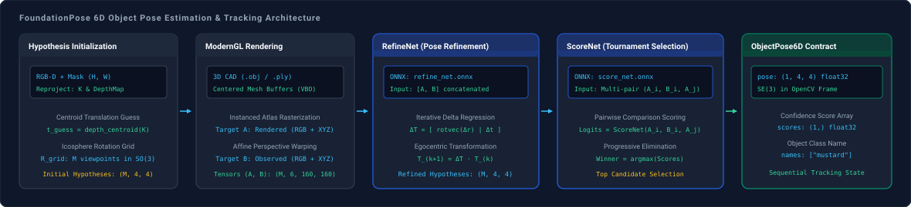

# FoundationPose

`spatialhub.models.foundationpose` provides an ONNX Runtime adapter for **FoundationPose**, a unified model-based 6D object pose estimation and sequential tracking pipeline for novel and known objects using RGB-D observations, 3D CAD meshes, and camera intrinsics.

---

## Pipeline Components

FoundationPose decomposes 6D object pose estimation into two neural network stages coupled with an offscreen ModernGL rendering engine:

| Component | Architecture | ONNX Model | Primary Role |
| :--- | :--- | :--- | :--- |
| **RefineNet** | Hierarchical CNN + Transformer | `refine_net.onnx` | Iterative neural pose refiner predicting egocentric $\mathrm{SE}(3)$ transformation deltas $(\Delta R, \Delta t)$. |
| **ScoreNet** | Multi-pair Comparison Network | `score_net.onnx` | Pairwise ranking network scoring candidate pose hypotheses via progressive tournament elimination. |

---

## Initialization

Initialize `FoundationPose` with camera intrinsics and a target 3D CAD mesh:

```python
from spatialhub import FoundationPose
import numpy as np

K = np.array([
    [319.58,   0.00, 320.21],
    [  0.00, 417.12, 244.35],
    [  0.00,   0.00,   1.00],
], dtype=np.float32)

engine = FoundationPose(
    intrinsics=K,
    model="cad_models/textured_mesh.obj",
    model_unit=1.0,
    model_name="mustard",
    providers=["CUDAExecutionProvider"],
)
```

### Parameters

| Parameter | Type | Default | Description |
| :--- | :--- | :--- | :--- |
| `intrinsics` | `CameraIntrinsics | np.ndarray | Sequence[float]` | *required* | Camera intrinsic calibration matrix $K$ of shape `(3, 3)` or `[fx, fy, cx, cy]`. |
| `model` | `str | Path | trimesh.Trimesh | None` | `None` | Path to 3D CAD mesh file (`.obj`, `.ply`, `.stl`) or loaded `trimesh.Trimesh` object. |
| `model_name` | `str | None` | `None` | Semantic label for target object (defaults to CAD file stem). |
| `model_unit` | `str | float` | `"m"` | Linear unit scale factor for CAD mesh vertices (`"m"`, `"cm"`, `"mm"`, or float multiplier). |
| `symmetry_tfs` | `np.ndarray | bool | None` | `None` | Optional symmetry transformation matrices `(M, 4, 4)` for rotational symmetric objects. |
| `scorenet_onnx_path` | `str | Path | None` | `None` | Optional path to local `score_net.onnx` weight file. If omitted, downloads from Hugging Face Hub. |
| `refinenet_onnx_path` | `str | Path | None` | `None` | Optional path to local `refine_net.onnx` weight file. If omitted, downloads from Hugging Face Hub. |
| `glctx` | `moderngl.Context | None` | `None` | Optional external ModernGL context. If omitted, initializes an isolated headless context. |
| `providers` | `list[str] | str | None` | `None` | ONNX Runtime execution providers (e.g. `["CUDAExecutionProvider", "CPUExecutionProvider"]`). |

---

## Methods

### `register`

Estimates initial 6D object pose from an RGB-D observation and 2D object segmentation mask.

```python
result = engine.register(rgb="frame.png", depth="depth.png", mask="mask.png", depth_unit="mm")
```

#### Parameters

| Parameter | Type | Default | Description |
| :--- | :--- | :--- | :--- |
| `rgb` | `str | Path | np.ndarray` | *required* | Input RGB image as file path or array $(H, W, 3)$. |
| `depth` | `str | Path | np.ndarray` | *required* | Input depth map as file path (`.png` in mm or `.npy`) or array $(H, W)$. |
| `mask` | `InstanceSegmentation | str | Path | np.ndarray` | *required* | 2D binary object mask as segmentation container, image path, or boolean array $(H, W)$. |
| `depth_unit` | `str | float` | `"m"` | Linear depth unit of input array (`"m"`, `"cm"`, `"mm"`, or float multiplier). |
| `iteration` | `int` | `5` | Total number of pose refinement iterations. |
| `filter_depth` | `bool` | `True` | Applies morphological erosion and bilateral smoothing to depth map via fragment shaders. |
| `filter_radius` | `int` | `2` | Kernel pixel radius for depth smoothing passes. |

#### Return Value

The `register` method returns an [`ObjectPose6D`](../structures/poses_and_cameras.md#objectpose6d) dataclass:

| Attribute | Shape | Dtype | Description |
| :--- | :--- | :--- | :--- |
| `pose` | `(N, 4, 4)` | `np.float32` | Rigid homogeneous transformation matrices $[R \mid t] \in \mathrm{SE}(3)$ from object coordinates to camera coordinates. |
| `scores` | `(N,)` | `np.float32` | Tournament knockout scoring confidence values. |
| `ids` | `(N,)` | `np.int32` | Zero-indexed object instance identifiers. |
| `names` | `list[str]` | `list[str]` | Target semantic object name labels (`[model_name]`). |

---

### `track`

Tracks 6D object pose sequentially from the previous frame's estimated pose.

```python
tracked_pose = engine.track(rgb="next_frame.png", depth="next_depth.png", depth_unit="mm")
```

#### Parameters

| Parameter | Type | Default | Description |
| :--- | :--- | :--- | :--- |
| `rgb` | `str | Path | np.ndarray` | *required* | Current frame RGB image as file path or array $(H, W, 3)$. |
| `depth` | `str | Path | np.ndarray` | *required* | Current frame depth map as file path or array $(H, W)$. |
| `depth_unit` | `str | float` | `"m"` | Linear depth unit of current frame depth array (`"m"`, `"cm"`, `"mm"`, or float multiplier). |
| `iteration` | `int` | `2` | Number of refinement iterations per tracking frame. |
| `verify_conf` | `bool` | `False` | Evaluates hypothesis confidence via ScoreNet forward pass (omitted during real-time tracking). |
| `filter_depth` | `bool` | `True` | Applies GPU depth filtering to input depth map. |
| `filter_radius` | `int` | `2` | Kernel radius for depth filtering. |

#### Return Value

The `track` method returns an [`ObjectPose6D`](../structures/poses_and_cameras.md#objectpose6d) dataclass with the updated object pose.

---

## Example

Demonstration script executing registration and sequential tracking across a video sequence:

```python title="examples/foundationpose.py"
--8<-- "examples/foundationpose.py:foundationpose"
```

<div style="text-align: center; margin: 1.5rem 0;">
  <video controls playsinline preload="metadata" style="width: 100%; max-width: 820px; border-radius: 8px; border: 1px solid var(--md-default-fg-color--lightest, #1e293b); box-shadow: 0 4px 16px rgba(0, 0, 0, 0.2); display: inline-block;">
    <source src="../../assets/foundationpose_tracking.mp4" type="video/mp4">
    <source src="../assets/foundationpose_tracking.mp4" type="video/mp4">
    Your browser does not support HTML5 video playback.
  </video>
</div>

Execute registration and continuous 6D pose tracking across the sequence:

```bash
uv run python examples/foundationpose.py
```

Annotated 6D pose video is saved to `examples/output/foundationpose_tracking.mp4`.

??? info "Demo Sequence Acquisition & Directory Layout"

    Running `examples/foundationpose.py` automatically checks for the `mustard0` sequence under `examples/assets/` and downloads it from the official [FoundationPose Google Drive Demo Repository](https://drive.google.com/drive/folders/1pRyFmxYXmAnpku7nGRioZaKrVJtIsroP) on first execution.

    For offline or firewalled environments, download `mustard0.zip` manually from the repository and extract it into `examples/assets/`:

    ```
    examples/assets/
    └── mustard0/
        ├── cam_K.txt
        ├── rgb/
        ├── depth/
        ├── masks/
        └── mesh/
            └── textured_mesh.obj
    ```

??? example "Single-Frame Object Registration"
    ```python
    import numpy as np
    from spatialhub import FoundationPose
    from spatialhub.utils import draw_3d_axis, draw_3d_box, load_image

    K = np.array([
        [319.58,   0.00, 320.21],
        [  0.00, 417.12, 244.35],
        [  0.00,   0.00,   1.00],
    ], dtype=np.float32)

    with FoundationPose(
        intrinsics=K,
        model="examples/assets/mustard0/mesh/textured_mesh.obj",
        model_unit=1.0,
        model_name="mustard",
        providers=["CUDAExecutionProvider", "CPUExecutionProvider"],
    ) as engine:
        result = engine.register(
            rgb="examples/assets/mustard0/rgb/1581120424100262102.png",
            depth="examples/assets/mustard0/depth/1581120424100262102.png",
            mask="examples/assets/mustard0/masks/1581120424100262102.png",
            depth_unit="mm",
            iteration=5,
        )

        print("Estimated Camera-Space Pose [R | t]:\n", result.pose[0])
        print("Tournament Confidence Score:", result.scores[0])
    ```

??? example "Continuous Video Stream Tracking"
    ```python
    import glob
    import numpy as np
    from spatialhub import FoundationPose

    K = np.loadtxt("examples/assets/mustard0/cam_K.txt").reshape(3, 3)
    rgb_files = sorted(glob.glob("examples/assets/mustard0/rgb/*.png"))
    depth_files = sorted(glob.glob("examples/assets/mustard0/depth/*.png"))
    initial_mask = "examples/assets/mustard0/masks/1581120424100262102.png"

    with FoundationPose(
        intrinsics=K,
        model="examples/assets/mustard0/mesh/textured_mesh.obj",
        model_unit=1.0,
        providers=["CUDAExecutionProvider", "CPUExecutionProvider"],
    ) as engine:
        # Register initial frame
        engine.register(
            rgb=rgb_files[0],
            depth=depth_files[0],
            mask=initial_mask,
            depth_unit="mm",
            iteration=5,
        )

        # Track consecutive frames
        for frame_idx in range(1, len(rgb_files)):
            tracked_pose = engine.track(
                rgb=rgb_files[frame_idx],
                depth=depth_files[frame_idx],
                depth_unit="mm",
                iteration=2,
            )
            print(f"Frame {frame_idx:04d} Translation:", tracked_pose.pose[0, :3, 3])
    ```

---

## End-to-End Flow



FoundationPose performs unified model-based 6D object pose registration and continuous video tracking on unseen rigid 3D objects without category-specific retraining. The architecture decouples pose estimation into two specialized networks: **RefineNet** for continuous local $\mathrm{SE}(3)$ optimization and **ScoreNet** for global discrete hypothesis selection.

### Hypothesis Initialization

During initial registration, a 2D bounding box $[u_1, v_1, u_2, v_2]$ is extracted from the binary object mask $M$. Observed depth values inside the mask are filtered to positive metric distances $Z(u, v) \in [0.001, Z_{\max}]$.

The camera intrinsic matrix $K$ parameterizes focal lengths and principal center:

$$
K = \begin{bmatrix} f_x & 0 & c_x \\ 0 & f_y & c_y \\ 0 & 0 & 1 \end{bmatrix}
$$

The initial translation vector $t_{\text{guess}} \in \mathbb{R}^3$ is derived by unprojecting the median foreground depth at the 2D mask centroid $(\bar{u}, \bar{v})$:

$$
t_z = \operatorname{median}\left(\{ Z(u, v) \mid M(u, v) = 1, Z(u, v) \ge 0.001 \}\right)
$$

$$
t_x = \frac{\bar{u} - c_x}{f_x} \cdot t_z, \qquad t_y = \frac{\bar{v} - c_y}{f_y} \cdot t_z
$$

where the mask centroid is $\bar{u} = \frac{1}{|M|} \sum_{(u, v) \in M} u$ and $\bar{v} = \frac{1}{|M|} \sum_{(u, v) \in M} v$.

To sample rotational space uniformly, a rotation lattice $\{ R_m \}_{m=1}^M \subset \mathrm{SO}(3)$ is generated over an icosphere tessellation (default: $M = 42$ viewpoints, or deduplicated orientations if `symmetry_tfs` is provided). Combining $t_{\text{guess}}$ with each rotation candidate produces the initial hypothesis set:

$$
T_m^{(0)} = \begin{bmatrix} R_m & t_{\text{guess}} \\ \mathbf{0}^T & 1 \end{bmatrix} \in \mathrm{SE}(3), \qquad \forall m \in \{1, \dots, M\}
$$

### Multi-Target G-Buffer Rendering

Photometric RGB imagery captures surface color and edge contours, while 3D camera-space coordinates capture physical shape, surface normal orientation, and depth discontinuities. Normalizing camera-space coordinates by the 3D bounding sphere radius $r_{\text{model}} = \frac{1}{2} d_{\text{model}}$ produces scale-invariant geometric inputs.

For observed scene depth $Z_{\text{scene}}$, 3D camera-space coordinates are computed via back-projection:

$$
X_{\text{scene}}(u, v) = Z_{\text{scene}}(u, v) \cdot K^{-1} \begin{bmatrix} u \\ v \\ 1 \end{bmatrix} \in \mathbb{R}^3
$$

For each candidate pose $T_m \in \mathrm{SE}(3)$, synthetic views of the centered 3D CAD mesh are rasterized via ModernGL into multi-target framebuffers:

- **Attachment 0 (RGBA)**: Normalized RGB surface color with foreground alpha mask.
- **Attachment 1 (XYZ)**: Camera-space 3D coordinate map in meters ($X_{\text{cam}}^{(m)}$).

In parallel, perspective affine transformation matrices $H_m \in \mathbb{R}^{3 \times 3}$ crop and resample synthetic renders $(A)$ and real observed RGB-D observations $(B)$ into standardized $160 \times 160$ spatial tensors:

$$
A_m = \left[ I_{\text{rgb}}^{(m)}, \, \frac{X_{\text{cam}}^{(m)}}{r_{\text{model}}} \right] \in \mathbb{R}^{6 \times 160 \times 160}
$$

$$
B_m = \left[ \operatorname{warp}(I_{\text{scene}}, H_m), \, \frac{\operatorname{warp}(X_{\text{scene}}, H_m)}{r_{\text{model}}} \right] \in \mathbb{R}^{6 \times 160 \times 160}
$$

### Iterative Pose Refinement via Lie Algebra

RefineNet functions as a learnable $\mathrm{SE}(3)$ non-linear optimizer. Given the concatenated $(A_m, B_m)$ 12-channel input tensor, it predicts an incremental 6D pose delta $(\Delta r, \Delta t) \in \mathbb{R}^6$, where $\Delta r \in \mathfrak{so}(3)$ is an axis-angle rotation vector and $\Delta t \in \mathbb{R}^3$ is a translation vector.

The Lie algebra representation maps to $\mathrm{SO}(3)$ via the exponential map using the skew-symmetric cross-product matrix $[\Delta r]_\times$:

$$
[\Delta r]_\times = \begin{bmatrix} 0 & -\Delta r_z & \Delta r_y \\ \Delta r_z & 0 & -\Delta r_x \\ -\Delta r_y & \Delta r_x & 0 \end{bmatrix} \in \mathfrak{so}(3)
$$

$$
\Delta R = \exp([\Delta r]_\times) = \mathbf{I} + \frac{\sin \theta}{\theta} [\Delta r]_\times + \frac{1 - \cos \theta}{\theta^2} [\Delta r]_\times^2, \qquad \theta = \|\Delta r\|_2
$$

$$
\Delta T = \begin{bmatrix} \Delta R & \Delta t \\ \mathbf{0}^T & 1 \end{bmatrix} \in \mathrm{SE}(3)
$$

The updated object pose $T_m^{(k+1)}$ is computed via egocentric transformation composition:

$$
T_m^{(k+1)} = \Delta T \cdot T_m^{(k)}
$$

During registration, RefineNet executes 1 initial iteration across all $M=42$ candidate viewpoints before tournament scoring. Following ScoreNet selection, the single top candidate is refined for the remaining $K-1$ iterations. During sequential tracking, temporal continuity bypasses initialization, updating the previous frame's pose directly over 2 iterations.

### Tournament Selection via Pairwise Comparisons

Predicting an absolute pose accuracy scalar for arbitrary novel 3D objects across unseen geometries and symmetries is ill-posed. Instead, ScoreNet is trained on relative pairwise comparisons: given candidate $i$ and candidate $j$, which hypothesis better aligns with observed scene observation $B_i$?

ScoreNet evaluates pairs $(i, j)$ and emits relative logit $s_{ij} \in \mathbb{R}$:

$$
s_{ij} = \operatorname{ScoreNet}(A_i, B_i, A_j)
$$

where $s_{ij} > 0$ indicates hypothesis $i$ has superior surface alignment over hypothesis $j$.

A progressive knockout tournament compares candidates in pairs, resolving $M$ hypotheses to the champion pose $T^*$ in $O(M)$ evaluations:

$$
T^* = \arg\max_{i \in \{1, \dots, M\}} S_i
$$

---

## Numerical Parity

SpatialHub validates numerical parity between upstream PyTorch checkpoints and exported ONNX Runtime execution graphs on the `mustard0` and `kinect_driller_seq` benchmark sequences.

### RefineNet Tensor Parity (PyTorch vs. ONNX Runtime CUDA)

| Candidates ($L$) | Translation MAE | Translation Max Diff | Translation Rel Err | Rotation MAE | Rotation Max Diff | Rotation Rel Err |
| :--- | :--- | :--- | :--- | :--- | :--- | :--- |
| `1` | 0.000032 | 0.000053 | 0.0443% | 0.000343 | 0.000664 | 0.3900% |
| `4` | 0.000050 | 0.000098 | 0.0784% | 0.000322 | 0.001304 | 0.3395% |
| `16` | 0.000059 | 0.000139 | 0.0886% | 0.000309 | 0.001589 | 0.3011% |
| `42` | 0.000055 | 0.000155 | 0.0834% | 0.000178 | 0.001098 | 0.2222% |

### ScoreNet Tensor Parity (PyTorch vs. ONNX Runtime CUDA)

| Candidates ($L$) | Score Logit MAE | Score Logit Max Diff | Relative Error | Top-1 Winner Match |
| :--- | :--- | :--- | :--- | :--- |
| `4` | 0.001467 | 0.001509 | 0.0047% | 100.0% |
| `16` | 0.002666 | 0.003429 | 0.0083% | 100.0% |
| `42` | 0.003414 | 0.004974 | 0.0104% | 100.0% |

### Full-Sequence Tracking Parity

| Dataset | Frames Evaluated | Rotation Error Mean | Rotation Error Max | Translation Error Mean | Translation Error Max |
| :--- | :--- | :--- | :--- | :--- | :--- |
| `mustard0` | 736 | 0.0146 deg | 0.1172 deg | 0.1016 mm | 1.5771 mm |
| `kinect_driller_seq` | 743 | 0.0196 deg | 0.1932 deg | 0.1055 mm | 0.5162 mm |

---

## Performance

- **Operating System**: Windows 11 / Linux (Ubuntu 22.04 LTS)
- **GPU**: NVIDIA GeForce RTX 4090 (24 GB VRAM), CUDA 12.4
- **CPU**: AMD Ryzen 9 7950X (16 Cores, 32 Threads), 64 GB DDR5 RAM
- **ONNX Runtime**: 1.20.1 (CUDAExecutionProvider / CPUExecutionProvider)

=== "CUDA Execution (`CUDAExecutionProvider`)"

    **Registration Breakdown (640x480 | 42 Viewpoints | 5 Refine Iterations):**

    | Sub-Stage / Target | Latency Mean (ms) | P95 (ms) | Throughput (FPS) | Peak RAM Delta | Peak VRAM Delta |
    | :--- | :--- | :--- | :--- | :--- | :--- |
    | **Preprocess & Depth Filter** | 26.43 +/- 2.88 | 30.66 | **37.8** | +16.8 MB | 0.0 MB |
    | **Scorer (42 Viewpoints)** | 5582.96 +/- 1436.46 | 7937.57 | **0.2** | 0.0 MB | 0.0 MB |
    | **Refiner (1 Iteration)** | 45.58 +/- 9.36 | 64.01 | **21.9** | 0.0 MB | +72.0 MB |
    | **Refiner (5 Iterations)** | 208.16 +/- 22.82 | 248.88 | **4.8** | +0.3 MB | 0.0 MB |
    | **End-to-End Registration** | 32797.26 +/- 16315.86 | 52600.86 | **0.03** | 0.0 MB | +208.0 MB |

    **Tracking Breakdown (640x480 | 2 Refine Iterations):**

    | Sub-Stage / Target | Latency Mean (ms) | P95 (ms) | Throughput (FPS) | Peak RAM Delta | Peak VRAM Delta |
    | :--- | :--- | :--- | :--- | :--- | :--- |
    | **Preprocess & Depth Filter** | 26.43 +/- 2.88 | 30.66 | **37.8** | +16.8 MB | 0.0 MB |
    | **Tracking Refiner (2 Iterations)** | 137.58 +/- 91.66 | 246.71 | **7.3** | 0.0 MB | 0.0 MB |
    | **End-to-End Tracking** | 102.30 +/- 12.41 | 120.91 | **9.8** | +0.3 MB | 0.0 MB |

=== "CPU Execution (`CPUExecutionProvider`)"

    **Registration Breakdown (640x480 | 42 Viewpoints | 5 Refine Iterations):**

    | Sub-Stage / Target | Latency Mean (ms) | P95 (ms) | Throughput (FPS) | Peak RAM Delta |
    | :--- | :--- | :--- | :--- | :--- |
    | **Preprocess & Depth Filter** | 32.04 +/- 4.92 | 41.31 | **31.2** | +15.3 MB |
    | **Scorer (42 Viewpoints)** | 27968.23 +/- 647.78 | 29005.13 | **0.04** | 0.0 MB |
    | **Refiner (1 Iteration)** | 93.74 +/- 4.11 | 99.92 | **10.7** | 0.0 MB |
    | **Refiner (5 Iterations)** | 468.06 +/- 8.46 | 478.51 | **2.1** | 0.0 MB |
    | **End-to-End Registration** | 50619.45 +/- 3495.14 | 54026.34 | **0.02** | +388.6 MB |

    **Tracking Breakdown (640x480 | 2 Refine Iterations):**

    | Sub-Stage / Target | Latency Mean (ms) | P95 (ms) | Throughput (FPS) | Peak RAM Delta |
    | :--- | :--- | :--- | :--- | :--- |
    | **Preprocess & Depth Filter** | 32.04 +/- 4.92 | 41.31 | **31.2** | +15.3 MB |
    | **Tracking Refiner (2 Iterations)** | 176.19 +/- 5.40 | 182.89 | **5.7** | 0.0 MB |
    | **End-to-End Tracking** | 204.11 +/- 8.11 | 213.38 | **4.9** | 0.0 MB |

---

## Developer Tooling

=== "Export ONNX"
    ```bash
    uv run tools/export/export_foundationpose.py \
        --weights-dir ./upstream/foundationpose/weights \
        --output-folder onnx_weight \
        --opset 18
    ```

    | Argument | Type | Default | Description |
    | :--- | :--- | :--- | :--- |
    | `--weights-dir` | `str` | `"./weights"` | Directory containing PyTorch model checkpoint folders. |
    | `--refine-run-name` | `str` | `"2023-10-28-18-33-37"` | Subfolder name for RefineNet checkpoint. |
    | `--score-run-name` | `str` | `"2024-01-11-20-02-45"` | Subfolder name for ScoreNet checkpoint. |
    | `--output-folder` | `str` | `"onnx_weight"` | Destination directory for exported `refine_net.onnx` and `score_net.onnx`. |
    | `--opset` | `int` | `18` | ONNX Operator Set version. |

=== "Parity Check"
    ```bash
    uv run tools/benchmark/parity_foundationpose.py \
        --onnx-dir onnx_weight \
        --data-dir examples/assets \
        --device cuda
    ```

    | Argument | Type | Default | Description |
    | :--- | :--- | :--- | :--- |
    | `--onnx-dir` | `str` | `"onnx_weight"` | Directory containing exported `refine_net.onnx` and `score_net.onnx`. |
    | `--data-dir` | `str` | `"examples/assets"` | Directory containing reference evaluation sequences (`mustard0`, `kinect_driller_seq`). |
    | `--device` | `str` | `"cuda"` | Hardware device for parity evaluation (`"cuda"`, `"cpu"`). |
    | `--dataset` | `str` | `"all"` | Target dataset sequence (`"mustard0"`, `"kinect_driller_seq"`, `"all"`). |

=== "Performance Profile"
    ```bash
    uv run tools/benchmark/profile_foundationpose.py \
        --onnx-dir onnx_weight \
        --data-dir examples/assets \
        --device CUDA \
        --num-iters 20
    ```

    | Argument | Type | Default | Description |
    | :--- | :--- | :--- | :--- |
    | `--onnx-dir` | `str` | `"onnx_weight"` | Directory containing exported ONNX models. |
    | `--data-dir` | `str` | `"examples/assets"` | Path to input demo dataset. |
    | `--device` | `str` | `"CUDA"` | Execution provider device target (`"CUDA"`, `"CPU"`). |
    | `--num-warmup` | `int` | `5` | Number of unmeasured execution cycles prior to timing. |
    | `--num-iters` | `int` | `20` | Number of measured iterations for latency percentiles. |
