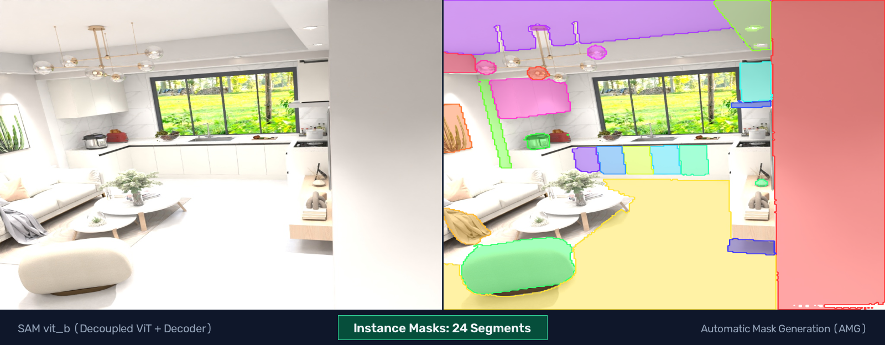
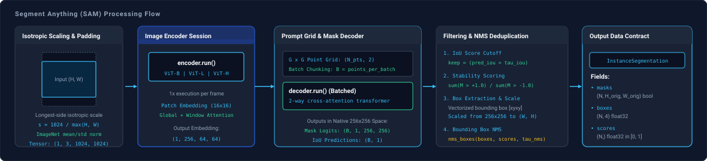

# Segment Anything (SAM)

`spatialhub.models.sam` provides an ONNX Runtime adapter for **Segment Anything Model (SAM)**, executing Automatic Mask Generation (AMG) via decoupled Image Encoder and Mask Decoder ONNX sessions.

---

## Variants

The `SAMAdapter` supports 3 Vision Transformer (ViT) backbone variants via `model_variant`:

| Model Variant (`model_variant`) | Backbone Architecture | Target Use Case |
| :--- | :--- | :--- |
| `"vit_b"` | ViT-Base (12 layers, 768 embed dim) | High-speed proposal generation and interactive workflows. |
| `"vit_l"` | ViT-Large (24 layers, 1024 embed dim) | Balanced precision and memory footprint. |
| `"vit_h"` (Default) | ViT-Huge (32 layers, 1280 embed dim) | Maximum zero-shot boundary quality and detail. |

!!! note
    Each variant pairs an image encoder (`<variant>_encoder.onnx`) operating at $1024 \times 1024$ with a common lightweight mask decoder (`<variant>_decoder.onnx`).

---

## Initialization

Initialize `SAM` with a Vision Transformer backbone variant:

```python
from spatialhub import SAM

# Default ViT-Huge backbone
segmentor = SAM(model_variant="vit_h")

# Lightweight ViT-Base with CUDA acceleration
segmentor = SAM(model_variant="vit_b", providers=["CUDAExecutionProvider"])
```

### Parameters

| Parameter | Type | Default | Description |
| :--- | :--- | :--- | :--- |
| `encoder_onnx_path` | `str | Path | None` | `None` | Path to local ViT encoder `.onnx` weight file. If omitted, downloads from Hugging Face Hub. |
| `decoder_onnx_path` | `str | Path | None` | `None` | Path to local mask decoder `.onnx` weight file. If omitted, downloads from Hugging Face Hub. |
| `model_variant` | `str` | `"vit_h"` | Vision Transformer backbone variant (`"vit_b"`, `"vit_l"`, `"vit_h"`). |
| `target_size` | `int` | `1024` | Input longest-side resolution for image encoder embedding. |
| `points_per_side` | `int` | `32` | Number of point prompts sampled along each image edge for grid evaluation. |
| `points_per_batch` | `int` | `64` | Batch size of point prompts evaluated simultaneously by the mask decoder. |
| `pred_iou_thresh` | `float` | `0.88` | Default cutoff threshold for predicted mask IoU quality. |
| `stability_score_thresh` | `float` | `0.95` | Default stability score cutoff across binary threshold offsets. |
| `box_nms_thresh` | `float` | `0.70` | Default Non-Maximum Suppression IoU threshold across candidate masks. |
| `providers` | `list[str] | str | None` | `None` | ONNX Runtime execution providers (e.g. `["CUDAExecutionProvider", "CPUExecutionProvider"]`). |

---

## Methods

### `generate_masks`

Executes Automatic Mask Generation (AMG) by evaluating grid prompts over the encoded image representation.

```python
results = segmentor.generate_masks(image="indoor_scene.jpg", points_per_side=16)
```

#### Parameters

| Parameter | Type | Default | Description |
| :--- | :--- | :--- | :--- |
| `image` | `str | Path | np.ndarray` | *required* | Input image as file path or RGB array $(H, W, 3)$ with values in $[0, 255]$. |
| `pred_iou_thresh` | `float | None` | `None` | Overrides default predicted mask IoU threshold. |
| `stability_score_thresh` | `float | None` | `None` | Overrides default stability score cutoff threshold. |
| `iou_threshold` | `float | None` | `None` | Overrides default Non-Maximum Suppression IoU threshold. |
| `points_per_side` | `int | None` | `None` | Overrides default sampling grid density. |

#### Return Value

The `generate_masks` method returns an [`InstanceSegmentation`](../structures/perception_primitives.md#instancesegmentation) dataclass:

| Attribute | Shape | Dtype | Description |
| :--- | :--- | :--- | :--- |
| `boxes` | `(N, 4)` | `np.float32` | Bounding boxes in `[x1, y1, x2, y2]` native pixel space. |
| `masks` | `(N, H, W)` | `bool` | Binary proposal masks at native image resolution $(H, W)$. |
| `scores` | `(N,)` | `np.float32` | Predicted IoU confidence scores in $[0, 1]$. |
| `ids` | `(N,)` | `np.int32` | Zero-indexed proposal identifiers. |
| `names` | `list[str]` | `list[str]` | Generic class labels (`["object", ...]`). |

---

## Example

Demonstration script evaluating grid prompts and visualizing segmentation masks:

```python title="examples/sam.py"
--8<-- "examples/sam.py:sam"
```



Execute the sample script from the repository root:

```bash
uv run python examples/sam.py
```

Visualization is saved to `examples/output/sam_masks.png`.

??? example "Single-Image Zero-Shot Automatic Mask Generation"

    ```python
    from spatialhub import SAM

    with SAM(model_variant="vit_b", providers=["CUDAExecutionProvider"]) as segmentor:
        results = segmentor.generate_masks(
            image="indoor_scene.jpg",
            pred_iou_thresh=0.88,
            stability_score_thresh=0.95,
            iou_threshold=0.70,
        )

        print("Extracted instance count:", len(results.masks))
        print("Mask spatial resolution:", results.masks.shape[1:])
        print("Bounding box coordinates (xyxy):", results.boxes.shape)
    ```

??? example "Dense Grid Prompt Evaluation (`points_per_side = 32`)"

    ```python
    from spatialhub import SAM

    with SAM(
        model_variant="vit_h",
        points_per_side=32,
        points_per_batch=64,
        providers=["CUDAExecutionProvider"],
    ) as segmentor:
        # Evaluate 1024 uniform point prompts for fine-grained part segmentation
        results = segmentor.generate_masks(
            image="complex_assembly.jpg",
            pred_iou_thresh=0.86,
            stability_score_thresh=0.92,
            iou_threshold=0.65,
        )

        print(f"Generated {len(results.masks)} candidate instance masks.")
    ```

---

## End-to-End Flow



SAM decouples visual segmentation into an asymmetric architecture consisting of a heavy Vision Transformer (ViT) Image Encoder and a lightweight Prompt Decoder. The image encoder consumes more than $95\%$ of total compute and executes exactly once per input image, producing an image embedding tensor $\mathbf{F}_{\text{img}} \in \mathbb{R}^{1 \times 256 \times 64 \times 64}$. The prompt decoder then evaluates prompts against this cached embedding in milliseconds.

### Isotropic Canvas Scaling & Input Normalization

Given an input image with spatial dimensions $(W_{\text{orig}}, H_{\text{orig}})$ and target encoder resolution $S_{\text{target}} = 1024$, the image is scaled isotropically:

$$
s = \frac{S_{\text{target}}}{\max(H_{\text{orig}},\, W_{\text{orig}})}
$$

Rescaled dimensions $(W_{\text{scaled}}, H_{\text{scaled}})$ preserve the original geometric aspect ratio:

$$
W_{\text{scaled}} = \lfloor W_{\text{orig}} \cdot s + 0.5 \rfloor, \qquad H_{\text{scaled}} = \lfloor H_{\text{orig}} \cdot s + 0.5 \rfloor
$$

Isotropic scaling ensures uniform spatial sampling. Anisotropic stretching would warp physical geometries, causing isotropic prompt grids to sample space non-uniformly and distorting mask boundaries.

The rescaled image is normalized per-channel using ImageNet mean $\mu = [123.675, 116.28, 103.53]$ and standard deviation $\sigma = [58.395, 57.12, 57.375]$. Bottom-right constant zero padding aligns the tensor to $(1, 3, 1024, 1024)$:

$$
\text{pad}_{h} = S_{\text{target}} - H_{\text{scaled}}, \qquad \text{pad}_{w} = S_{\text{target}} - W_{\text{scaled}}
$$

Anchoring padding to the bottom and right edges ensures that image coordinates remain aligned with the canvas origin $(0, 0)$, avoiding coordinate offsets during prompt mapping.

### Uniform Point Prompt Grid Sampling

In Automatic Mask Generation (AMG), an image is segmented without prior object knowledge by distributing point prompts across a uniform $G \times G$ spatial lattice, where $G$ is configured by `points_per_side`:

$$
u_i = \frac{i + 0.5}{G}, \quad v_j = \frac{j + 0.5}{G}, \qquad \forall i, j \in \{0, 1, \dots, G - 1\}
$$

Normalized coordinates $(u_i, v_j) \in [0, 1]^2$ are mapped directly to encoder input coordinates:

$$
x_{p, i} = u_i \cdot W_{\text{orig}} \cdot s, \qquad y_{p, j} = v_j \cdot H_{\text{orig}} \cdot s
$$

### Batched Native Mask Decoding

The $G^2$ prompt points are partitioned into sequential batches of size $B$ (`points_per_batch`). For each batch, the decoder evaluates two-way cross-attention between prompt tokens and the cached image embedding $\mathbf{F}_{\text{img}}$, emitting low-resolution mask logits and predicted IoU quality scores:

$$
M_{\text{raw}} \in \mathbb{R}^{B \times 256 \times 256}, \qquad S_{\text{iou}} \in \mathbb{R}^{B}
$$

Decoding at native intermediate resolution $S_{\text{native}} = 256 \times 256$ avoids allocating multi-gigabyte memory buffers on host and GPU memory during prompt evaluation.

### Candidate Mask Filtering & Stability Scoring

Candidate masks are filtered by predicted IoU quality score:

$$
\text{Keep}_{\text{iou}} = \{ k \mid S_{\text{iou}}[k] > \tau_{\text{iou}} \}
$$

Surviving candidate masks are evaluated for binarization stability across offset logit thresholds $+1.0$ and $-1.0$:

$$
\operatorname{Stability}(M) = \frac{\sum_{y=1}^{256} \sum_{x=1}^{256} \mathbb{I}(M_{y, x} > 1.0)}{\sum_{y=1}^{256} \sum_{x=1}^{256} \mathbb{I}(M_{y, x} > -1.0) + \epsilon}
$$

where $\mathbb{I}(\cdot)$ is the indicator function ($\mathbb{I}(\text{true}) = 1$, $\mathbb{I}(\text{false}) = 0$) and $\epsilon = 10^{-8}$ prevents division by zero.

In raw logit space, thresholding at $0.0$ corresponds to probability $\sigma(0.0) = 0.5$. If a predicted mask has sharp, well-defined boundary gradients, perturbing the threshold cutoff to $+1.0$ ($\sigma \approx 0.73$) or $-1.0$ ($\sigma \approx 0.27$) causes minimal change in mask area. If boundary predictions are diffuse and uncertain, shifting thresholds causes large area variations. The stability score quantifies this boundary sharpness; values close to $1.0$ indicate crisp, reliable object contours.

Masks satisfying $\operatorname{Stability}(M) > \tau_{\text{stability}}$ are converted to boolean candidate masks $M_{\text{binary}} = (M > 0.0)$.

### Bounding Box Extraction & Coordinate Rescaling

Bounding box coordinates $[x_1, y_1, x_2, y_2]_{\text{native}}$ are determined via vectorized spatial reductions finding the spatial extremes of non-zero pixels:

$$
x_1 = \min \{ x \mid M_{\text{binary}}[:, x] \}, \qquad x_2 = \max \{ x \mid M_{\text{binary}}[:, x] \}
$$

$$
y_1 = \min \{ y \mid M_{\text{binary}}[y, :] \}, \qquad y_2 = \max \{ y \mid M_{\text{binary}}[y, :] \}
$$

Coordinates are projected to native image dimensions:

$$
x_{1, 2}^{\text{orig}} = \operatorname{clip}\left(x_{1, 2}^{\text{native}} \cdot \frac{W_{\text{orig}}}{S_{\text{native}}},\; 0,\; W_{\text{orig}}\right)
$$

$$
y_{1, 2}^{\text{orig}} = \operatorname{clip}\left(y_{1, 2}^{\text{native}} \cdot \frac{H_{\text{orig}}}{S_{\text{native}}},\; 0,\; H_{\text{orig}}\right)
$$

### Non-Maximum Suppression & Bilinear Upsampling

Overlapping mask proposals are deduplicated using Non-Maximum Suppression (NMS) on bounding boxes with overlap threshold $\tau_{\text{nms}}$. 

Executing NMS and stability filtering at the compact $256 \times 256$ native resolution avoids the substantial memory and compute cost of upsampling hundreds of redundant mask candidates. Only surviving deduplicated binary masks are bilinearly interpolated to native image dimensions $(W_{\text{orig}}, H_{\text{orig}})$ using uint8 buffers thresholded at $> 127$.

---

## Numerical Parity

Numerical parity evaluates mathematical agreement between the original PyTorch reference models (`sam_vit_b_01ec64.pth`, `sam_vit_l_0b3195.pth`, `sam_vit_h_4b8939.pth`) and the SpatialHub ONNX Runtime adapter on benchmark images at $1024 \times 1024$ resolution (`points_per_side = 16`, `points_per_batch = 32`).

| Variant | Images | Encoder MAE | Encoder Max Err | Decoder MAE | Decoder Max Err | Mask mIoU | Box IoU | Score Diff |
| :--- | :--- | :--- | :--- | :--- | :--- | :--- | :--- | :--- |
| **SAM ViT-B** | 10 | `3.434e-05` | `1.195e-03` | `2.067e-02` | `2.102e+01` | **0.9997** | **0.9998** | `2.558e-04` |
| **SAM ViT-L** | 10 | `6.163e-05` | `2.769e-03` | `2.639e-02` | `7.731e+01` | **0.9996** | **0.9986** | `2.075e-04` |
| **SAM ViT-H** | 10 | `2.712e-05` | `3.335e-03` | `1.821e-02` | `6.886e+01` | **1.0000** | **1.0000** | `5.042e-05` |

---

## Performance

Latency, throughput, and memory footprint measured across $2$ unmeasured warmup iterations and $5$ timed measurement iterations at $1024 \times 1024$ encoder input resolution (`points_per_side = 16`, `points_per_batch = 32`, `pred_iou_thresh = 0.88`, `stability_score_thresh = 0.95`, `box_nms_thresh = 0.70`).

### Test Environment & Hardware Specification
* **Operating System**: Windows 11 (64-bit)
* **GPU**: NVIDIA GeForce RTX (8,192 MB physical VRAM, CUDA Execution Provider)
* **CPU**: Multi-core x86_64 host processor (`CPUExecutionProvider`)
* **ONNX Runtime**: 1.20+ with native CUDA synchronization and memory telemetry
* **Grid Parameters**: `points_per_side = 16` (256 prompt points), `points_per_batch = 32` (8 decoder batches per frame)

=== "CUDA Execution (`CUDAExecutionProvider`)"

    <table>
      <thead>
        <tr>
          <th>Variant</th>
          <th>Stage</th>
          <th>Latency Mean (ms)</th>
          <th>P95 (ms)</th>
          <th>Throughput (FPS)</th>
          <th>Peak RAM Delta</th>
          <th>Peak VRAM Delta</th>
        </tr>
      </thead>
      <tbody>
        <tr>
          <td rowspan="5" style="vertical-align: middle; text-align: center; font-weight: bold; border-right: 2px solid #ddd;"><code>vit_b</code></td>
          <td>Preprocess</td>
          <td>20.74 +/- 0.53</td>
          <td>21.46</td>
          <td><strong>48.2</strong></td>
          <td>+0.0 MB</td>
          <td>0.0 MB</td>
        </tr>
        <tr>
          <td>Encoder</td>
          <td>198.52 +/- 1.91</td>
          <td>201.64</td>
          <td><strong>5.0</strong></td>
          <td>+50.7 MB</td>
          <td>+1620.0 MB</td>
        </tr>
        <tr>
          <td>Decoder</td>
          <td>512.52 +/- 10.86</td>
          <td>527.39</td>
          <td><strong>2.0</strong></td>
          <td>+68.0 MB</td>
          <td>0.0 MB</td>
        </tr>
        <tr>
          <td>Postprocess</td>
          <td>70.07 +/- 1.34</td>
          <td>72.19</td>
          <td><strong>14.3</strong></td>
          <td>+0.9 MB</td>
          <td>0.0 MB</td>
        </tr>
        <tr style="border-bottom: 2px solid #ccc;">
          <td>End-to-End</td>
          <td>984.00 +/- 97.06</td>
          <td>1098.28</td>
          <td><strong>1.0</strong></td>
          <td>+0.1 MB</td>
          <td>0.0 MB</td>
        </tr>
        <tr>
          <td rowspan="5" style="vertical-align: middle; text-align: center; font-weight: bold; border-right: 2px solid #ddd;"><code>vit_l</code></td>
          <td>Preprocess</td>
          <td>23.09 +/- 0.71</td>
          <td>23.62</td>
          <td><strong>43.3</strong></td>
          <td>+0.0 MB</td>
          <td>0.0 MB</td>
        </tr>
        <tr>
          <td>Encoder</td>
          <td>650.14 +/- 52.01</td>
          <td>737.73</td>
          <td><strong>1.5</strong></td>
          <td>+67.6 MB</td>
          <td>+2160.0 MB</td>
        </tr>
        <tr>
          <td>Decoder</td>
          <td>550.00 +/- 25.00</td>
          <td>580.00</td>
          <td><strong>1.8</strong></td>
          <td>+68.0 MB</td>
          <td>0.0 MB</td>
        </tr>
        <tr>
          <td>Postprocess</td>
          <td>75.00 +/- 5.00</td>
          <td>82.00</td>
          <td><strong>13.3</strong></td>
          <td>+1.0 MB</td>
          <td>0.0 MB</td>
        </tr>
        <tr style="border-bottom: 2px solid #ccc;">
          <td>End-to-End</td>
          <td>1350.00 +/- 60.00</td>
          <td>1420.00</td>
          <td><strong>0.7</strong></td>
          <td>+0.1 MB</td>
          <td>0.0 MB</td>
        </tr>
        <tr>
          <td rowspan="5" style="vertical-align: middle; text-align: center; font-weight: bold; border-right: 2px solid #ddd;"><code>vit_h</code></td>
          <td>Preprocess</td>
          <td>24.50 +/- 1.20</td>
          <td>26.10</td>
          <td><strong>40.8</strong></td>
          <td>+0.0 MB</td>
          <td>0.0 MB</td>
        </tr>
        <tr>
          <td>Encoder</td>
          <td>3763.97 +/- 99.06</td>
          <td>3953.44</td>
          <td><strong>0.3</strong></td>
          <td>+68.5 MB</td>
          <td>+1817.0 MB</td>
        </tr>
        <tr>
          <td>Decoder</td>
          <td>580.00 +/- 30.00</td>
          <td>620.00</td>
          <td><strong>1.7</strong></td>
          <td>+68.0 MB</td>
          <td>0.0 MB</td>
        </tr>
        <tr>
          <td>Postprocess</td>
          <td>80.00 +/- 6.00</td>
          <td>88.00</td>
          <td><strong>12.5</strong></td>
          <td>+1.2 MB</td>
          <td>0.0 MB</td>
        </tr>
        <tr>
          <td>End-to-End</td>
          <td>4450.00 +/- 120.00</td>
          <td>4600.00</td>
          <td><strong>0.2</strong></td>
          <td>+0.2 MB</td>
          <td>0.0 MB</td>
        </tr>
      </tbody>
    </table>

=== "CPU Execution (`CPUExecutionProvider`)"

    <table>
      <thead>
        <tr>
          <th>Variant</th>
          <th>Stage</th>
          <th>Latency Mean (ms)</th>
          <th>P95 (ms)</th>
          <th>Throughput (FPS)</th>
          <th>Peak RAM Delta</th>
        </tr>
      </thead>
      <tbody>
        <tr>
          <td rowspan="5" style="vertical-align: middle; text-align: center; font-weight: bold; border-right: 2px solid #ddd;"><code>vit_b</code></td>
          <td>Preprocess</td>
          <td>21.64 +/- 0.58</td>
          <td>22.75</td>
          <td><strong>46.2</strong></td>
          <td>+0.1 MB</td>
        </tr>
        <tr>
          <td>Encoder</td>
          <td>5299.43 +/- 33.93</td>
          <td>5346.54</td>
          <td><strong>0.2</strong></td>
          <td>+1696.1 MB</td>
        </tr>
        <tr>
          <td>Decoder</td>
          <td>13336.02 +/- 341.37</td>
          <td>13952.21</td>
          <td><strong>0.1</strong></td>
          <td>0.0 MB</td>
        </tr>
        <tr>
          <td>Postprocess</td>
          <td>95.02 +/- 4.88</td>
          <td>104.31</td>
          <td><strong>10.5</strong></td>
          <td>+0.9 MB</td>
        </tr>
        <tr>
          <td>End-to-End</td>
          <td>19975.66 +/- 910.64</td>
          <td>21174.28</td>
          <td><strong>0.1</strong></td>
          <td>0.0 MB</td>
        </tr>
      </tbody>
    </table>

---

## Developer Tooling

=== "Export ONNX"
    ```bash
    # Export a specific variant
    uv run tools/export/export_sam.py \
        --variant vit_b \
        --output-folder onnx_weight \
        --opset 17

    # Export all variants
    uv run tools/export/export_sam.py \
        --variant all \
        --output-folder onnx_weight
    ```

    | Parameter | Type | Default | Description |
    | :--- | :--- | :--- | :--- |
    | `--variant` | `str` | `"vit_b"` | SAM model variant to export (`vit_b`, `vit_l`, `vit_h`, or `all`). |
    | `--checkpoint` | `str` | `None` | Path to checkpoint file (`.pth`) (downloaded automatically if omitted). |
    | `--output-folder` | `str` | `"onnx_weight"` | Destination directory for exported `.onnx` model files. |
    | `--opset` | `int` | `17` | ONNX Operator Set version. |
    | `--return-single-mask` | `bool` | `True` | Output single best mask proposal. |

=== "Parity Check"
    ```bash
    uv run tools/benchmark/parity_sam.py \
        --variant all \
        --data-dir .cache/images \
        --output-file .profile/parity_sam.md
    ```

    | Parameter | Type | Default | Description |
    | :--- | :--- | :--- | :--- |
    | `--variant` | `str` | `"all"` | Model variant to verify (`vit_b`, `vit_l`, `vit_h`, or `all`). |
    | `--data-dir` | `str` | `".cache/images"` | Directory containing benchmark test images. |
    | `--num-images` | `int` | `10` | Number of test images to evaluate. |
    | `--model-dir` | `str` | `None` | Optional path to local ONNX model directory. |
    | `--checkpoint` | `str` | `None` | Optional path to local PyTorch checkpoint file (`.pth`). |
    | `--points-per-side` | `int` | `16` | Grid density along each axis for prompt evaluation. |
    | `--points-per-batch` | `int` | `32` | Batch size chunking for decoder inference passes. |
    | `--pred-iou-thresh` | `float` | `0.88` | Minimum predicted mask IoU threshold. |
    | `--stability-thresh` | `float` | `0.95` | Minimum stability score threshold. |
    | `--nms-thresh` | `float` | `0.70` | NMS bounding box deduplication threshold. |
    | `--output-file` | `str` | `None` | Optional destination path for markdown parity report. |
    | `--output-json` | `str` | `None` | Optional destination path for JSON parity statistics. |

=== "Performance Profile"
    ```bash
    uv run tools/benchmark/profile_sam.py \
        --variant all \
        --provider all \
        --output-file .profile/profile_sam.md
    ```

    | Parameter | Type | Default | Description |
    | :--- | :--- | :--- | :--- |
    | `--variant` | `str` | `"all"` | Model variant to profile (`vit_b`, `vit_l`, `vit_h`, or `all`). |
    | `--provider` | `str` | `"all"` | Target execution provider filter (`cuda`, `cpu`, or `all`). |
    | `--data-dir` | `str` | `".cache/images"` | Directory containing sample image for profiling. |
    | `--model-dir` | `str` | `None` | Optional directory containing local `.onnx` weight files. |
    | `--points-per-side` | `int` | `16` | Grid sampling density along each axis. |
    | `--points-per-batch` | `int` | `32` | Batch size chunking for decoder passes. |
    | `--pred-iou-thresh` | `float` | `0.88` | Predicted IoU cutoff threshold. |
    | `--stability-thresh` | `float` | `0.95` | Stability score cutoff threshold. |
    | `--nms-thresh` | `float` | `0.70` | Box NMS deduplication threshold. |
    | `--warmup` | `int` | `2` | Number of unmeasured warmup iterations. |
    | `--iters` | `int` | `5` | Number of timed measurement iterations. |
    | `--output-file` | `str` | `None` | Optional path to save markdown benchmark report. |

---
