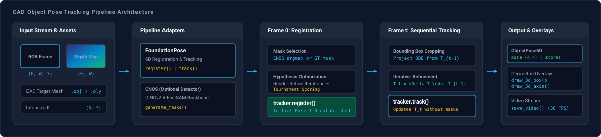

# CAD Object Pose Tracking

Sequentially estimates and tracks the 6D pose $[R \mid \mathbf{t}] \in \mathrm{SE}(3)$ of a known 3D CAD object across continuous RGB-D video streams using initial mask registration and iterative neural tracking.

---

## Adapters

| Role | Adapter | Description |
| :--- | :--- | :--- |
| 6D Pose Estimation & Tracking | [`FoundationPose`](../models/foundationpose.md) | Category-agnostic 6D object pose registration and iterative neural tracking |
| Zero-Shot 2D Localization | [`CNOS`](../models/cnos.md) | CAD-based 2D object mask proposal generation using DINOv2 and FastSAM |

---

## Architecture



---

## Stages

### Initial Registration

On the initial frame (frame 0), an object segmentation mask is obtained through one of two methods:

- **Ground Truth (`--detector gt`)**: The initial binary mask is loaded directly from `<seq-dir>/masks/000000.png`.
- **Zero-Shot CAD Detection (`--detector cnos`)**: CNOS generates 2D mask proposals via FastSAM and computes DINOv2 visual similarity against multi-view CAD templates. The candidate mask with the highest detector confidence score is selected.

Once the mask is resolved:

1. `FoundationPose.register(rgb, depth, mask)` samples initial orientation hypotheses over an icosphere rotation grid and estimates 3D translation from depth values inside the mask.
2. The neural refinement network iteratively updates candidate poses via render-and-compare cycles.
3. The scoring model evaluates hypotheses via pairwise tournament comparisons to determine the optimal initial 6D rigid transformation $[R_0 \mid \mathbf{t}_0] \in \mathrm{SE}(3)$.

### Continuous Sequential Tracking

On subsequent video frames ($t \ge 1$), tracking executes sequentially without re-segmentation:

1. `FoundationPose.track(rgb, depth)` projects the oriented 3D bounding box corners using prior pose $T_{t-1}$ to crop the region of interest from both observed and rendered frames.
2. The neural network predicts the inter-frame relative transformation $\Delta T \in \mathrm{SE}(3)$:
   $$T_t = \Delta T \cdot T_{t-1}, \quad T_t \in \mathrm{SE}(3)$$
3. 3D bounding box contours (`draw_3d_box`) and coordinate axes (`draw_3d_axis`) are overlaid on each frame, and the annotated sequence is written to an MP4 video file.

---

## Execution

### Dataset

The pipeline operates on synchronized RGB-D frame sequences and a corresponding 3D CAD mesh. The built-in demonstration uses the YCB-Video `mustard0` sequence located at `examples/assets/mustard0`:

- CAD Mesh: `examples/assets/mustard0/mesh/textured_simple.obj`
- Intrinsics: `examples/assets/mustard0/cam_K.txt`
- RGB Frames: `examples/assets/mustard0/rgb/*.png`
- Depth Maps: `examples/assets/mustard0/depth/*.png`
- Initial Mask: `examples/assets/mustard0/masks/000000.png`

### Script

```python title="pipelines/cad_pose_tracking.py" linenums="283"
--8<-- "pipelines/cad_pose_tracking.py:cad_pose_tracking"
```

### Command

Run tracking with ground truth mask initialization:

```bash
uv run python pipelines/cad_pose_tracking.py
```

Run tracking with automated zero-shot CAD detection:

```bash
uv run python pipelines/cad_pose_tracking.py --detector cnos
```

### Parameters

| Parameter | Type | Default | Description |
| :--- | :--- | :--- | :--- |
| `--seq-dir` | `Path` | `examples/assets/mustard0` | Path to directory containing `rgb/`, `depth/`, `cam_K.txt`, and optional `masks/` and `mesh/`. |
| `--model` | `Path` | `None` | Optional path to 3D CAD mesh file (.obj, .ply). Defaults to `<seq-dir>/mesh/textured_simple.obj`. |
| `--detector` | `str` | `gt` | Object mask initialization method: `gt` (ground truth mask file) or `cnos` (zero-shot CAD detector). |
| `--output-video` | `Path` | `examples/output/cad_tracking.mp4` | Destination path for annotated MP4 video output. |
| `--max-frames` | `int` | `None` | Maximum sequential frames to track. |
| `--debug-dir` | `Path` | `None` | Optional directory to save intermediate stage inspection artifacts (proposals, mask, depth, registered pose). |
| `--show` | `flag` | `False` | Display tracking frames interactively if GUI OpenCV is available. |
| `--verify-conf` | `flag` | `True` | Evaluate geometric depth inlier confidence ratio on each tracking frame. |

---

## Output

<div style="text-align: center; margin: 1.5rem 0;">
  <video controls playsinline preload="metadata" style="width: 100%; max-width: 820px; border-radius: 8px; border: 1px solid var(--md-default-fg-color--lightest, #1e293b); box-shadow: 0 4px 16px rgba(0, 0, 0, 0.2); display: inline-block;">
    <source src="../../assets/foundationpose_tracking.mp4" type="video/mp4">
    <source src="../assets/foundationpose_tracking.mp4" type="video/mp4">
    Your browser does not support HTML5 video playback.
  </video>
</div>
