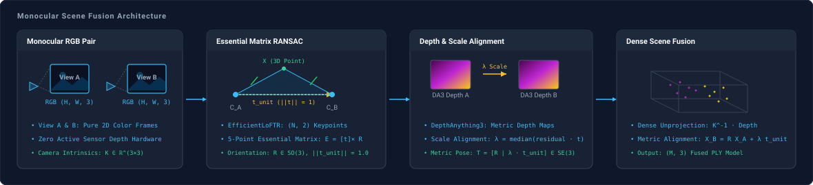
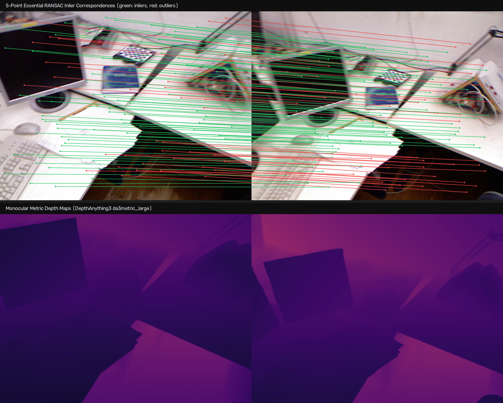

# Monocular Fusion

Reconstructs a metric 3D point cloud from two monocular RGB viewpoints using 5-point Essential matrix RANSAC, Depth Anything 3 metric depth estimation, and inlier baseline scale alignment.

---

## Adapters

| Role | Adapter | Description |
| :--- | :--- | :--- |
| Feature Matching | [`EfficientLoFTR`](../models/eloftr.md) | Semi-dense keypoint correspondence matching |
| Depth Estimation | [`Depth Anything 3`](../models/depthanything3.md) | Zero-shot metric monocular depth estimation |

---

## Architecture



---

## Stages

### Epipolar Matching and Depth Estimation

`EfficientLoFTR` detects semi-dense 2D correspondences across the viewpoint pair. `estimate_relative_pose_2d` computes the Essential matrix $E$ using normalized 5-point RANSAC, resolving relative camera rotation $R$ and unit translation direction $\mathbf{t}_{\text{unit}}$ with positive cheirality in both views.

`DepthAnything3` predicts per-pixel metric depth fields for both images without active depth sensor hardware.



### Scale Alignment and Fusion

Because monocular epipolar geometry lacks absolute physical scale, the unit translation direction is scaled to metric units using inlier correspondences:

$$\lambda_i = \mathbf{t}_{\text{unit}}^T (\mathbf{X}_{B, i} - R \mathbf{X}_{A, i}), \quad \lambda = \operatorname{median}(\{ \lambda_i \mid \lambda_i > 0 \})$$

where $\mathbf{X}_A, \mathbf{X}_B$ are 3D inlier points unprojected using the predicted metric depth maps. The complete metric transformation $T = [R \mid \lambda \mathbf{t}_{\text{unit}}] \in \mathrm{SE}(3)$ aligns View A points into View B coordinates, merging them into a fused point cloud.

---

## Execution

### Dataset

Download [`rgbd_dataset_freiburg1_desk.tgz`](https://vision.in.tum.de/rgbd/dataset/freiburg1/rgbd_dataset_freiburg1_desk.tgz) from the [TUM RGB-D Benchmark](https://cvg.cit.tum.de/data/datasets/rgbd-dataset/download) and extract into `data/`:

```bash
mkdir -p data
tar -xvzf rgbd_dataset_freiburg1_desk.tgz -C data/
```

### Script

```python title="pipelines/monocular_fusion.py" linenums="202"
--8<-- "pipelines/monocular_fusion.py:monocular_fusion"
```

### Command

```bash
uv run python pipelines/monocular_fusion.py
```

### Parameters

| Parameter | Type | Default | Description |
| :--- | :--- | :--- | :--- |
| `--image-a` | `Path` | `data/.../1305031453.459685.png` | Viewpoint A RGB color image. |
| `--image-b` | `Path` | `data/.../1305031453.791716.png` | Viewpoint B RGB color image. |
| `--intrinsics` | `Path` | `examples/assets/tum_fr1_intrinsics.npy` | Camera intrinsic calibration matrix $K$ of shape `(3, 3)`. |
| `--groundtruth` | `Path` | `data/.../groundtruth.txt` | Optional TUM ground truth trajectory file. |
| `--output-ply` | `Path` | `examples/output/fused_scene_monocular.ply` | Destination path for exported dense 3D point cloud file. |

---

## 3D Viewer

<iframe src="../../assets/fusion_point_cloud_viewer.html?mode=monocular" width="100%" height="540px" style="border: 1px solid var(--md-default-fg-color--lightest); border-radius: 8px; margin: 1rem 0;" title="Interactive 3D Point Cloud Viewer"></iframe>

---

## Evaluation

Evaluation on TUM RGB-D `freiburg1_desk` sequence ($640 \times 480$ resolution, $\Delta t \approx 0.33\text{ s}$):

### Execution Statistics

| Metric | Value | Description |
| :--- | :--- | :--- |
| Total Correspondences | 2,724 | 2D matches detected by EfficientLoFTR |
| Consensus Inliers | 1,902 (69.8%) | Inliers satisfying 5-point Essential matrix epipolar geometry |
| Fused Point Cloud | 614,400 vertices | Dense 3D points merged from both viewpoints |

### Ground Truth Comparison

| Parameter | Estimated | Ground Truth | Absolute Error |
| :--- | :--- | :--- | :--- |
| Relative Rotation | $7.77^\circ$ | $7.39^\circ$ | $1.46^\circ$ |
| Baseline Distance | $12.40\text{ cm}$ | $15.22\text{ cm}$ | $2.83\text{ cm}$ |
| Translation $(x, y, z)$ | $[3.11, -5.00, 10.91]\text{ cm}$ | $[2.10, -5.06, 14.20]\text{ cm}$ | $3.45\text{ cm}$ |

Translation vector error is computed as the 3D Euclidean distance $\|\mathbf{t}_{\text{est}} - \mathbf{t}_{\text{gt}}\|_2$ between estimated and ground truth translation vectors.
