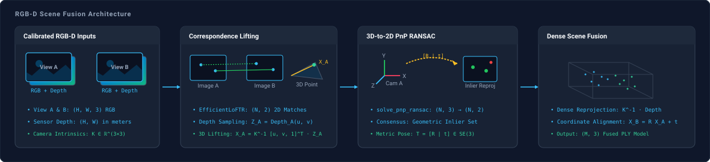
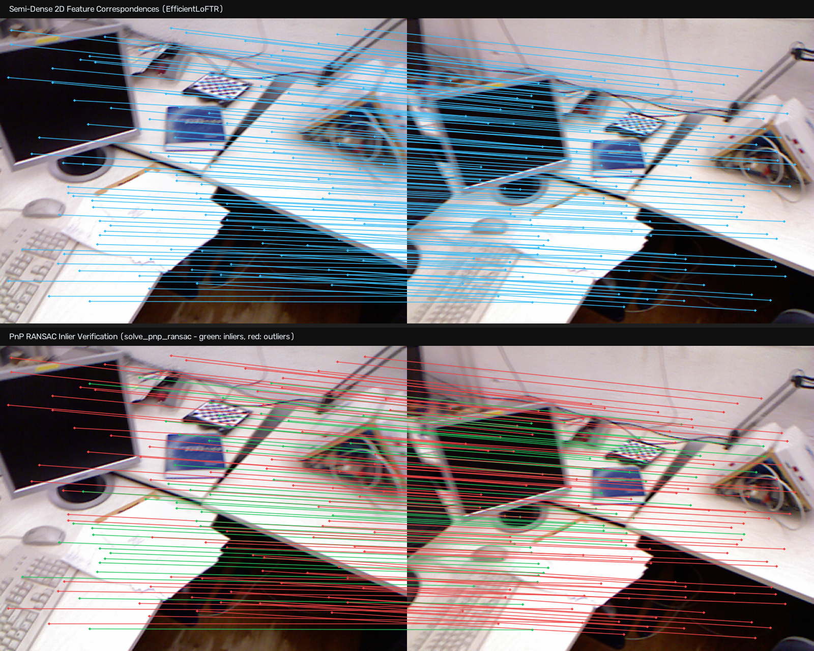

# RGB-D Fusion

Reconstructs a metric 3D point cloud from two calibrated RGB-D viewpoints using 3D-to-2D PnP RANSAC and dense depth map unprojection.

---

## Adapters

| Role | Adapter | Description |
| :--- | :--- | :--- |
| Feature Matching | [`EfficientLoFTR`](../models/eloftr.md) | Semi-dense keypoint correspondence matching |

---

## Architecture



---

## Stages

### Feature Matching and Pose Estimation

`EfficientLoFTR` detects semi-dense 2D correspondences across the viewpoint pair. Optical depth values are sampled from View A sensor depth at each keypoint coordinate. Correspondences outside the calibrated sensor range or lacking valid depth returns are filtered out before lifting into 3D camera coordinates.

`solve_pnp_ransac` estimates the rigid 6-DoF transformation $[R \mid \mathbf{t}] \in \mathrm{SE}(3)$ mapping View A into View B coordinates, filtering geometrically inconsistent correspondences.



### Dense Fusion

Each depth pixel is lifted into Euclidean coordinates in its native camera coordinate frame via `unproject_depth_map`. Dense points from View A are aligned into View B coordinates using the estimated rigid transformation matrix $T$:

$$\mathbf{X}_B = R \mathbf{X}_A + \mathbf{t}$$

The aligned coordinates are merged with View B points, along with their native RGB color values, and exported to `.ply` format.

---

## Execution

### Dataset

Download [`rgbd_dataset_freiburg1_desk.tgz`](https://vision.in.tum.de/rgbd/dataset/freiburg1/rgbd_dataset_freiburg1_desk.tgz) from the [TUM RGB-D Benchmark](https://cvg.cit.tum.de/data/datasets/rgbd-dataset/download) and extract into `data/`:

```bash
mkdir -p data
tar -xvzf rgbd_dataset_freiburg1_desk.tgz -C data/
```

### Script

```python title="pipelines/rgbd_fusion.py" linenums="213"
--8<-- "pipelines/rgbd_fusion.py:rgbd_fusion"
```

### Command

```bash
uv run python pipelines/rgbd_fusion.py
```

### Parameters

| Parameter | Type | Default | Description |
| :--- | :--- | :--- | :--- |
| `--image-a` | `Path` | `data/.../1305031453.459685.png` | Viewpoint A RGB color image. |
| `--depth-a` | `Path` | `data/.../1305031453.473352.png` | Viewpoint A 16-bit sensor depth image. |
| `--image-b` | `Path` | `data/.../1305031453.791716.png` | Viewpoint B RGB color image. |
| `--depth-b` | `Path` | `data/.../1305031453.805041.png` | Viewpoint B 16-bit sensor depth image. |
| `--intrinsics` | `Path` | `examples/assets/tum_fr1_intrinsics.npy` | Camera intrinsic calibration matrix $K$ of shape `(3, 3)`. |
| `--groundtruth` | `Path` | `data/.../groundtruth.txt` | Optional TUM ground truth trajectory file. |
| `--output-ply` | `Path` | `examples/output/fused_scene_rgbd.ply` | Destination path for exported dense 3D point cloud file. |
| `--depth-scale` | `float` | `5000.0` | Depth unit scale factor converting 16-bit PNG values to meters. |

---

## 3D Viewer

<iframe src="../../assets/fusion_point_cloud_viewer.html?mode=rgbd" width="100%" height="540px" style="border: 1px solid var(--md-default-fg-color--lightest); border-radius: 8px; margin: 1rem 0;" title="Interactive 3D Point Cloud Viewer"></iframe>

---

## Evaluation

Evaluation on TUM RGB-D `freiburg1_desk` sequence ($640 \times 480$ resolution, $\Delta t \approx 0.33\text{ s}$):

### Execution Statistics

| Metric | Value | Description |
| :--- | :--- | :--- |
| Total Correspondences | 2,724 | 2D matches detected by EfficientLoFTR |
| Consensus Inliers | 945 (38.8%) | Inliers satisfying PnP 3D-to-2D reprojection consensus |
| Median Reprojection Error | $1.08\text{ px}$ | Median residual across consensus inliers in View B |
| Fused Point Cloud | 503,324 vertices | Dense 3D points merged from both viewpoints |

### Ground Truth Comparison

| Parameter | Estimated | Ground Truth | Absolute Error |
| :--- | :--- | :--- | :--- |
| Relative Rotation | $7.80^\circ$ | $7.39^\circ$ | $1.71^\circ$ |
| Baseline Distance | $17.51\text{ cm}$ | $15.22\text{ cm}$ | $2.29\text{ cm}$ |
| Translation $(x, y, z)$ | $[5.04, -6.78, 15.34]\text{ cm}$ | $[2.10, -5.06, 14.20]\text{ cm}$ | $3.58\text{ cm}$ |

Translation vector error is computed as the 3D Euclidean distance $\|\mathbf{t}_{\text{est}} - \mathbf{t}_{\text{gt}}\|_2$ between estimated and ground truth translation vectors.
