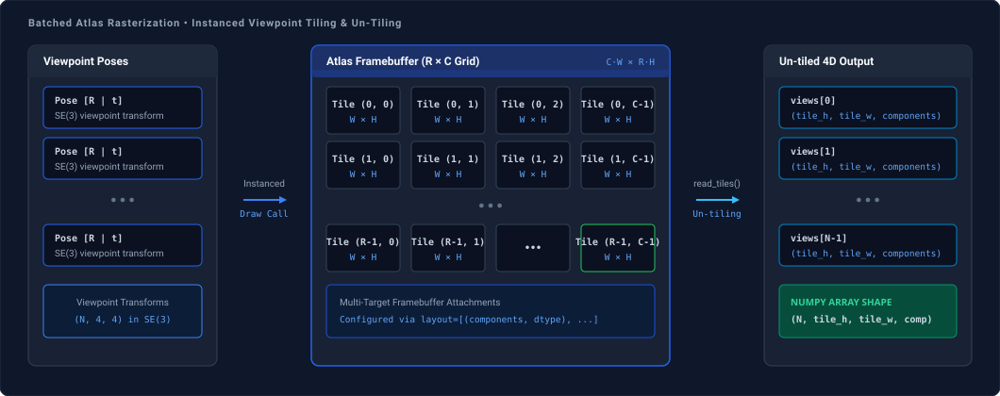

# Atlas Renderer

`AtlasRenderer` renders multiple 3D object poses in a single GPU draw call by tiling them across a 2D grid atlas framebuffer with multi-target color attachments.

---

## Architecture

Sequential template rendering introduces driver dispatch overhead. `AtlasRenderer` packs $N$ viewpoints into an instanced draw call on an offscreen framebuffer grid of dimensions $(C \cdot W_{\text{tile}}, R \cdot H_{\text{tile}})$:



After rasterization, `read_tiles()` un-tiles the 2D atlas grid into a continuous 4D array of shape `(N, tile_h, tile_w, components)`.

---

## Initialization

Initialize `AtlasRenderer` by passing an existing context, or omit `ctx` to let the renderer initialize and own a standalone headless context:

```python
from spatialhub.utils.moderngl import AtlasRenderer, create_moderngl_context

# Pass an existing context
ctx = create_moderngl_context()
renderer = AtlasRenderer(ctx=ctx)

# Standalone context managed by context manager
with AtlasRenderer() as renderer:
    pass
```

### Parameters

| Argument | Type | Default | Description |
| :--- | :--- | :--- | :--- |
| `ctx` | `moderngl.Context | None` | `None` | Optional execution context. If `None`, creates and owns a standalone context. |

---

## Methods

### `render`

Executes an instanced draw call across the atlas grid framebuffer.

```python
renderer.render(
    vao=vao,
    num_instances=100,
    grid_shape=(10, 10),
    tile_shape=(128, 128),
    layout=[(4, "f4"), (4, "f4")],
)
```

#### Parameters

| Argument | Type | Default | Description |
| :--- | :--- | :--- | :--- |
| `vao` | `moderngl.VertexArray` | *required* | Instanced vertex array object. Must configure per-instance transformation attributes with divisor 1 (via `/i`). |
| `num_instances` | `int` | *required* | Total number of viewpoints or object instances ($N$). |
| `grid_shape` | `tuple[int, int]` | *required* | Number of grid rows and columns $(R, C)$ in the atlas layout ($R \cdot C \ge N$). |
| `tile_shape` | `tuple[int, int]` | *required* | Output resolution $(H_{\text{tile}}, W_{\text{tile}})$ of each tile crop in pixels. |
| `layout` | `list[tuple[int, str]]` | *required* | Color attachment configuration as `(components, dtype_str)` pairs matching fragment shader outputs. See [Attachment Layout Specification](#attachment-layout-specification). |

#### Return Value

Returns `None`. Rendered pixels are written to internal color and depth framebuffer attachments.

#### Attachment Layout Specification

The `layout` argument configures the framebuffer Multiple Render Targets (MRT). Each tuple `(components, dtype_str)` specifies the channel count ($1 \le \text{components} \le 4$) and data type.

Index $i$ in `layout` corresponds to `layout(location = i)` in the fragment shader and `read_tiles(attachment_index=i)`:

| `dtype_str` | OpenGL Format | NumPy Dtype | Description |
| :--- | :--- | :--- | :--- |
| `"f4"` | 32-bit float | `np.float32` | Floating-point color, normals, coordinates |
| `"f2"` | 16-bit float | `np.float16` | Half-precision floating-point |
| `"u1"` | 8-bit unsigned int | `np.uint8` | Standard 8-bit unsigned integer channels |
| `"i1"` | 8-bit signed int | `np.int8` | Signed 8-bit integer |
| `"u2"` | 16-bit unsigned int | `np.uint16` | Unsigned 16-bit integer |
| `"i2"` | 16-bit signed int | `np.int16` | Signed 16-bit integer |
| `"u4"` | 32-bit unsigned int | `np.uint32` | Unsigned 32-bit integer |
| `"i4"` | 32-bit signed int | `np.int32` | Signed 32-bit integer (e.g. segmentation IDs) |

---

### `read_tiles`

Reads back a framebuffer attachment and un-tiles the 2D grid into an indexed 4D NumPy array.

```python
# Read back attachment by index corresponding to layout configuration
primary_views = renderer.read_tiles(attachment_index=0)
secondary_views = renderer.read_tiles(attachment_index=1)
```

#### Parameters

| Argument | Type | Default | Description |
| :--- | :--- | :--- | :--- |
| `attachment_index` | `int` | `0` | Zero-based index of the target color attachment defined in `layout`. |

#### Return Value

Returns an un-tiled NumPy array of shape `(N, tile_h, tile_w, components)` matching the attachment data type.

---

## Resource Lifecycle

Resource lifecycle depends on context ownership:

- **Standalone Mode (`ctx=None`)**: The renderer creates and owns the OpenGL context. Calling `renderer.release()` frees all internal framebuffers, renderbuffers, and terminates the context. Using `with AtlasRenderer() as renderer:` automates this.
- **Shared Context Mode (`ctx=ctx`)**: The caller owns the context. Calling `renderer.release()` frees internal framebuffer attachments while keeping the context open for other render passes or adapters. The caller must invoke `ctx.release()` when finished.
- **User Buffers**: Geometry VBOs, VAOs, and shader programs created by the user must be released explicitly via their respective `.release()` methods.


