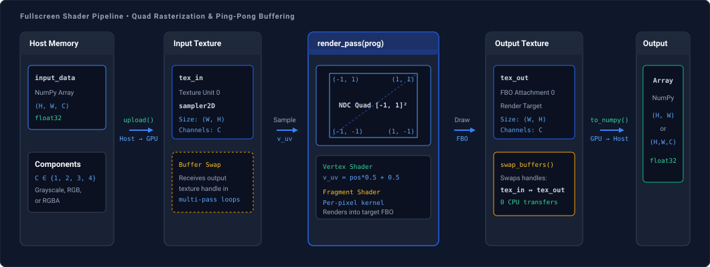

# Fullscreen Shaders

`FullscreenRenderer` executes hardware-accelerated image processing and geometric raster operations using custom GLSL fragment shaders rendered over a screen-filling quad in normalized device coordinates (NDC).

---

## Architecture

Input arrays are uploaded to an internal 2D texture. A unit quad spanning $[-1, 1]$ in NDC is rasterized using `TRIANGLE_STRIP`, evaluating the fragment shader in parallel across GPU execution cores. For iterative operations, ping-pong framebuffer swapping alternates input and output textures without memory reallocations or CPU transfers:



---

## Initialization

Initialize `FullscreenRenderer` by providing an existing context, or omit `ctx` to let the renderer initialize and own a standalone headless context:

```python
from spatialhub.utils.moderngl import FullscreenRenderer, create_moderngl_context

# Pass an existing context
ctx = create_moderngl_context()
renderer = FullscreenRenderer(ctx=ctx)

# Standalone context managed by context manager
with FullscreenRenderer() as renderer:
    pass
```

### Parameters

| Argument | Type | Default | Description |
| :--- | :--- | :--- | :--- |
| `ctx` | `moderngl.Context | None` | `None` | Optional execution context. If `None`, creates and owns a standalone context. |

---

## Methods

### `create_program`

Compiles vertex and fragment shader sources into a `moderngl.Program`. The vertex shader must declare `in vec2 in_position;`.

```python
prog = renderer.create_program(vert_shader=vert_source, frag_shader=frag_source)
```

#### Parameters

| Argument | Type | Default | Description |
| :--- | :--- | :--- | :--- |
| `vert_shader` | `str` | *required* | GLSL vertex shader source. Must declare `in vec2 in_position;`. |
| `frag_shader` | `str` | *required* | GLSL fragment shader source. |

#### Return Value

Returns compiled `moderngl.Program` object.

---

### `upload`

Uploads an array of shape `(H, W)` or `(H, W, C)` into the internal input texture. Supports 1, 2, 3, or 4 components formatted as `float32`.

```python
renderer.upload(input_data)
```

#### Parameters

| Argument | Type | Default | Description |
| :--- | :--- | :--- | :--- |
| `input_data` | `np.ndarray` | *required* | Input array with 2 or 3 dimensions and 1 to 4 channels in `float32`. |

#### Return Value

Returns `None`. Resizes internal texture storage if input dimensions have changed.

---

### `render_pass`

Draws the fullscreen quad using the specified program. The input texture is bound to texture unit 0.

```python
renderer.render_pass(prog=prog, texture_uniform_name="tex_in")
```

#### Parameters

| Argument | Type | Default | Description |
| :--- | :--- | :--- | :--- |
| `prog` | `moderngl.Program` | *required* | Compiled shader program to execute. |
| `vao` | `moderngl.VertexArray | None` | `None` | Optional VAO. If `None`, automatically retrieves or creates a cached quad VAO for `prog`. |
| `texture_uniform_name` | `str` | `"tex_in"` | Name of the `sampler2D` uniform in `prog` bound to the input texture. |

#### Return Value

Returns `None`. Rendered pixels are written to the output texture via the internal framebuffer.

---

### `swap_buffers`

Swaps the input and output textures (`tex_in` and `tex_out`) and rebinds the target framebuffer. Used for multi-pass iterative processing without transferring intermediate results back to CPU memory.

```python
renderer.swap_buffers()
```

#### Return Value

Returns `None`. Pointer swap executed in VRAM.

---

### `to_numpy`

Reads the output texture from GPU memory into a NumPy array. Squeezes single-component textures to shape `(H, W)`.

```python
output = renderer.to_numpy()
```

#### Return Value

Returns an array of shape `(H, W)` for single-channel data or `(H, W, C)` for multi-channel data in `float32`.

---

### `apply`

Convenience method that executes `upload()`, `render_pass()`, and `to_numpy()` in a single call.

```python
output = renderer.apply(prog=prog, input_data=image, texture_uniform_name="tex_in")
```

#### Parameters

| Argument | Type | Default | Description |
| :--- | :--- | :--- | :--- |
| `prog` | `moderngl.Program` | *required* | Compiled shader program to execute. |
| `input_data` | `np.ndarray` | *required* | Input array with shape `(H, W)` or `(H, W, C)` in `float32`. |
| `vao` | `moderngl.VertexArray | None` | `None` | Optional custom VAO. Defaults to cached internal quad VAO. |
| `texture_uniform_name` | `str` | `"tex_in"` | Name of the input texture sampler uniform. |

#### Return Value

Returns rendered output array in `float32`.

---

## Resource Lifecycle

Resource lifecycle depends on context ownership:

- **Standalone Mode (`ctx=None`)**: Calling `renderer.release()` or using `with FullscreenRenderer() as renderer:` frees internal quad buffers, cached VAOs, textures, framebuffer objects, and terminates the context.
- **Shared Context Mode (`ctx=ctx`)**: Calling `renderer.release()` frees internal textures, cached VAOs, and quad buffers, leaving the external context open. The caller is responsible for invoking `ctx.release()`.
- **External Resources**: Shader programs compiled via `create_program()` and any caller-provided custom VAOs must be explicitly released via their respective `.release()` methods.

        