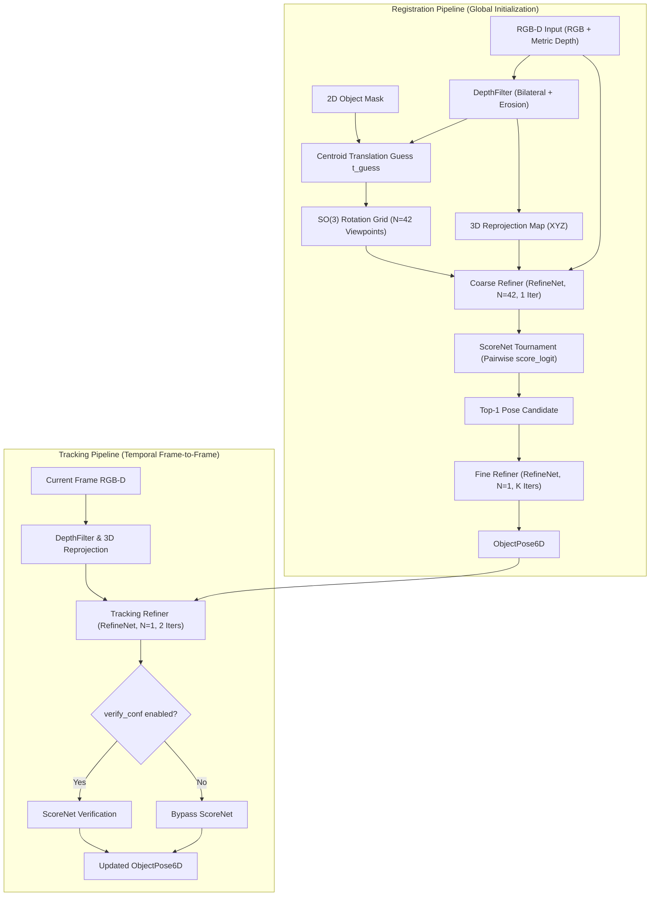

# FoundationPose Technical Reference

`spatialhub.models.foundationpose` provides an ONNX Runtime adapter for **FoundationPose**, a unified model-based 6D object pose estimation and tracking pipeline for novel and known objects using RGB-D observations and 3D CAD models.

---

## Supported Model Components

FoundationPose decomposes 6D pose estimation into two neural networks:

| Component | ONNX File | Default Hugging Face Source | Description |
| :--- | :--- | :--- | :--- |
| **RefineNet** (`refine_net`) | `refine_net.onnx` | `SpatialHub/foundationpose-onnx` | Iterative neural pose refiner predicting egocentric $SE(3)$ transformation deltas $(\Delta R, \Delta t)$ from synthetic vs. observed RGB-D crops. |
| **ScoreNet** (`score_net`) | `score_net.onnx` | `SpatialHub/foundationpose-onnx` | Pairwise candidate evaluation network computing raw unnormalized logit comparisons (`score_logit`) via dynamic multi-head self-attention. |

---

## Architecture & Data Flow

FoundationPose operates across two operational pathways: global **Registration** (estimating initial $SE(3)$ pose from a 2D segmentation mask and depth map) and temporal **Tracking** (updating pose sequentially across video frames).

<div align="center">



</div>

---

## Mathematical Formulation & Processing Pipeline

### Depth Preprocessing & 3D Reprojection

Observed depth maps $D \in \mathbb{R}^{H \times W}$ undergo GPU-accelerated morphological erosion and bilateral smoothing in `DepthFilter` to suppress edge discontinuities and sensor noise.

The filtered depth is backprojected to camera-space 3D coordinates using camera intrinsic matrix $K$:

$$
X(u, v) = \frac{u - c_x}{f_x} \cdot D(u, v), \quad Y(u, v) = \frac{v - c_y}{f_y} \cdot D(u, v), \quad Z(u, v) = D(u, v)
$$

### Centroid Translation & Rotation Grid Initialization

From binary mask $M \in \{0, 1\}^{H \times W}$, initial translation $t_{\text{guess}} \in \mathbb{R}^3$ is estimated from the median depth of valid foreground pixels:

$$
z_0 = \text{median}(\{ D(u, v) \mid M(u, v) = 1 \land D(u, v) > 0 \})
$$

$$
t_{\text{guess}} = \begin{bmatrix} (u_{\text{center}} - c_x) \cdot z_0 / f_x \\ (v_{\text{center}} - c_y) \cdot z_0 / f_y \\ z_0 \end{bmatrix}
$$

A candidate rotation grid $\{R_i\}_{i=1}^{42} \subset SO(3)$ is generated by subdividing an icosahedron into 42 viewing directions, adjusted for object symmetry transformations if provided. Hypotheses are initialized as $T_i = [R_i \mid t_{\text{guess}}] \in SE(3)$.

### Crop Window Generation & G-Buffer Atlas Rendering

For each candidate pose $T_i$:
- A tight 2D bounding box is projected onto the image plane and scaled by `crop_ratio` (default $1.2$).
- ModernGL renders synthetic RGB and 3D coordinate G-Buffer templates $(A_i \in \mathbb{R}^{6 \times 160 \times 160})$ via instanced GPU drawing.
- Observed RGB and 3D coordinate channels are affine perspective warped into matching crops $(B_i \in \mathbb{R}^{6 \times 160 \times 160})$.

### Egocentric Iterative Pose Refinement (`RefineNet`)

`RefineNet` takes concatenated crops $(A_i, B_i)$ and regresses egocentric translation deltas $\Delta t \in \mathbb{R}^3$ and rotation vector deltas $\Delta r \in \mathbb{R}^3$:

$$
T^{(k+1)} = \Delta T \cdot T^{(k)}
$$

where $\Delta T = [ \mathbf{R}(\Delta r) \mid \Delta t ]$, $\mathbf{R}(\Delta r) = \text{Rodrigues}(\Delta r)$, and updates are scaled by continuous normalizers:

$$
\Delta t = \tanh(\Delta t_{\text{raw}}) \odot \sigma_t \cdot \frac{d_{\text{mesh}}}{2}, \quad \Delta r = \tanh(\Delta r_{\text{raw}}) \cdot \sigma_r
$$

### Pairwise Tournament Selection & Scoring (`ScoreNet`)

`ScoreNet` evaluates candidate pairs using dynamic multi-head self-attention over candidate embeddings. The model outputs unnormalized scalar logits (`score_logit`):

$$
\text{score\_logit} = W x + b
$$

Subgroups of candidate poses are compared in tournament rounds until the top candidate is isolated and refined.

---

## SpatialHub Adapter API & Usage Examples

### 6D Pose Registration

```python
import numpy as np
from spatialhub import FoundationPose
from spatialhub.utils import draw_3d_axis, draw_3d_box, load_image, save_image

# Camera intrinsic matrix K (3x3)
K = np.array([
    [572.41,   0.0, 325.26],
    [  0.0, 573.57, 242.04],
    [  0.0,   0.0,   1.0]
], dtype=np.float32)

with FoundationPose(
    intrinsics=K,
    model="cad_models/object.ply",
    model_unit="mm",
    providers=["CUDAExecutionProvider", "CPUExecutionProvider"],
) as engine:
    # Register 6D pose from RGB, metric Depth, and 2D Segmentation Mask
    result = engine.register(
        rgb="scene_rgb.png",
        depth="scene_depth.png",  # Supports .npy, float32, or 16-bit PNG (mm)
        mask="object_mask.png",
        depth_unit="mm",
        iteration=5,
    )

    print(f"Estimated 6D Pose (4x4):\n{result.pose[0]}")
    print(f"Confidence Logit Score: {result.scores[0] if result.scores is not None else None}")

    # Visualize 3D bounding box and coordinate frame axes
    frame_rgb = load_image("scene_rgb.png")
    annotated = draw_3d_box(
        image=frame_rgb,
        pose=result.pose,
        intrinsics=K,
        bbox_corners_3d=engine.model_bounds,
        color=(52, 211, 153),
        thickness=2,
    )
    annotated = draw_3d_axis(
        image=annotated,
        pose=result.pose,
        intrinsics=K,
        axis_length=0.08,
        thickness=2,
    )
    save_image(annotated, "registration_vis.png")
```

### Sequential 6D Pose Tracking

```python
# Initialize tracking on subsequent video frames
frame_paths = ["frame_0001.png", "frame_0002.png", "frame_0003.png"]
depth_paths = ["depth_0001.png", "depth_0002.png", "depth_0003.png"]

for rgb_path, depth_path in zip(frame_paths, depth_paths):
    tracked_res = engine.track(
        rgb=rgb_path,
        depth=depth_path,
        depth_unit="mm",
        iteration=2,
        verify_conf=False,
    )
    print(f"Tracked Pose:\n{tracked_res.pose[0]}")
```

### Dynamic Target CAD Model Switching

```python
# Switch active CAD model on existing engine without reallocating ONNX sessions
engine.set_model(
    model="cad_models/another_object.obj",
    model_unit="m",
    model_name="second_object",
)
```

---

## Performance Benchmarks

Stage-by-stage latency, throughput, and memory deltas measured at $640 \times 480$ resolution.

### CUDA Execution (`CUDAExecutionProvider`)

#### Registration Breakdown (5 Refinement Steps)

| Target / Stage | Device | Latency Mean (ms) | Median (ms) | P95 (ms) | Throughput (FPS) | Peak RAM Delta | Peak VRAM Delta |
| :--- | :--- | :--- | :--- | :--- | :--- | :--- | :--- |
| **Preprocess & Depth Filter** | `CUDA` | 26.43 +/- 2.88 | 26.93 | 30.66 | **37.8** | +16.8 MB | 0.0 MB |
| **Scorer (42 Viewpoints)** | `CUDA` | 5582.96 +/- 1436.46 | 5774.46 | 7937.57 | **0.2** | 0.0 MB | 0.0 MB |
| **Refiner (1 Iteration)** | `CUDA` | 45.58 +/- 9.36 | 42.65 | 64.01 | **21.9** | 0.0 MB | +72.0 MB |
| **Refiner (5 Iterations)** | `CUDA` | 208.16 +/- 22.82 | 203.43 | 248.88 | **4.8** | +0.3 MB | 0.0 MB |
| **End-to-End Registration** | `CUDA` | 32797.26 +/- 16315.86 | 27735.47 | 52600.86 | **0.03** | 0.0 MB | +208.0 MB |

#### Tracking Breakdown (2 Refinement Steps)

| Target / Stage | Device | Latency Mean (ms) | Median (ms) | P95 (ms) | Throughput (FPS) | Peak RAM Delta | Peak VRAM Delta |
| :--- | :--- | :--- | :--- | :--- | :--- | :--- | :--- |
| **Preprocess & Depth Filter** | `CUDA` | 26.43 +/- 2.88 | 26.93 | 30.66 | **37.8** | +16.8 MB | 0.0 MB |
| **Tracking Refiner (2 Iterations)** | `CUDA` | 137.58 +/- 91.66 | 86.58 | 246.71 | **7.3** | 0.0 MB | 0.0 MB |
| **End-to-End Tracking** | `CUDA` | 102.30 +/- 12.41 | 103.62 | 120.91 | **9.8** | +0.3 MB | 0.0 MB |

---

### CPU Execution (`CPUExecutionProvider`)

#### Registration Breakdown (5 Refinement Steps)

| Target / Stage | Device | Latency Mean (ms) | Median (ms) | P95 (ms) | Throughput (FPS) | Peak RAM Delta |
| :--- | :--- | :--- | :--- | :--- | :--- | :--- |
| **Preprocess & Depth Filter** | `CPU` | 32.04 +/- 4.92 | 30.54 | 41.31 | **31.2** | +15.3 MB |
| **Scorer (42 Viewpoints)** | `CPU` | 27968.23 +/- 647.78 | 27840.57 | 29005.13 | **0.0** | 0.0 MB |
| **Refiner (1 Iteration)** | `CPU` | 93.74 +/- 4.11 | 92.92 | 99.92 | **10.7** | 0.0 MB |
| **Refiner (5 Iterations)** | `CPU` | 468.06 +/- 8.46 | 471.91 | 478.51 | **2.1** | 0.0 MB |
| **End-to-End Registration** | `CPU` | 50619.45 +/- 3495.14 | 51788.70 | 54026.34 | **0.0** | +388.6 MB |

#### Tracking Breakdown (2 Refinement Steps)

| Target / Stage | Device | Latency Mean (ms) | Median (ms) | P95 (ms) | Throughput (FPS) | Peak RAM Delta |
| :--- | :--- | :--- | :--- | :--- | :--- | :--- |
| **Preprocess & Depth Filter** | `CPU` | 32.04 +/- 4.92 | 30.54 | 41.31 | **31.2** | +15.3 MB |
| **Tracking Refiner (2 Iterations)** | `CPU` | 176.19 +/- 5.40 | 177.63 | 182.89 | **5.7** | 0.0 MB |
| **End-to-End Tracking** | `CPU` | 204.11 +/- 8.11 | 202.42 | 213.38 | **4.9** | 0.0 MB |

---

### Technical Notes on Benchmark Profile

- **Registration vs. Tracking Operational Regimes**: Registration is an asynchronous initialization step executed once per object instance or upon tracking failure recovery. It executes $\approx 88$ ModernGL G-Buffer template renders and $\approx 30$ ONNX Runtime chunked inferences across the 42-viewpoint candidate grid. In contrast, Tracking executes $\approx 2$ template renders and $2$ ONNX forward passes on a single candidate ($N=1$), operating at $\sim 10\text{ FPS}$ on GPU.
- **Median vs. Mean Latency**: Interleaving ModernGL OpenGL framebuffer drawing with ONNX Runtime CUDA kernel launches can produce driver queue variance on desktop environments. The **Median** metric provides the most stable operational baseline.
- **Refiner Iteration Scaling**: Refiner latency scales linearly with iteration count ($42.65\text{ ms}$ for 1 iter vs. $203.43\text{ ms}$ for 5 iters on CUDA). Reducing tracking iterations from 2 to 1 increases tracking throughput to $\sim 15\text{ FPS}$.

---

## Tooling & Verification Commands

### ONNX Export

Export FoundationPose **RefineNet** and **ScoreNet** PyTorch models to ONNX format using the centralized export utility:

```bash
uv run tools/export/export_foundationpose.py \
    --weights-dir ./upstream/foundationpose/weights \
    --output-folder onnx_weight \
    --opset 18
```

| Parameter | Type | Default | Description |
| :--- | :--- | :--- | :--- |
| `--weights-dir` | `str` | `"./weights"` | Directory containing model checkpoint folders. |
| `--refine-run-name` | `str` | `"2023-10-28-18-33-37"` | RefineNet checkpoint run folder name. |
| `--score-run-name` | `str` | `"2024-01-11-20-02-45"` | ScoreNet checkpoint run folder name. |
| `--output-folder` | `str` | `"onnx_weight"` | Destination directory for exported `.onnx` model files. |
| `--opset` | `int` | `18` | ONNX Operator Set version. |

### Performance Profile

Benchmark stage-by-stage latency, throughput, and memory footprint across execution providers:

```bash
uv run tools/benchmark/profile_foundationpose.py \
    --provider all \
    --register-iters 5 \
    --track-iters 2 \
    --warmup 5 \
    --iters 20 \
    --output-file .profile/profile_foundationpose.md
```

| Parameter | Type | Default | Description |
| :--- | :--- | :--- | :--- |
| `--provider` | `str` | `"all"` | Target execution provider filter (`cuda`, `cpu`, or `all`). |
| `--model-dir` | `str` | `None` | Optional directory containing local `.onnx` weight files. |
| `--register-iters` | `int` | `5` | Number of refinement iterations for registration benchmark. |
| `--track-iters` | `int` | `2` | Number of refinement iterations for tracking benchmark. |
| `--warmup` | `int` | `5` | Number of unmeasured warmup iterations. |
| `--iters` | `int` | `20` | Number of timed measurement iterations. |
| `--output-file` | `str` | `None` | Optional path to save markdown benchmark report. |

### Parity Check

Evaluate numerical parity between PyTorch reference models and SpatialHub ONNX Runtime adapter:

```bash
uv run tools/benchmark/parity_foundationpose.py \
    --dataset all \
    --max-frames 20 \
    --output-file .profile/parity_foundationpose.md
```

| Parameter | Type | Default | Description |
| :--- | :--- | :--- | :--- |
| `--dataset` | `str` | `"all"` | Target sequence dataset (`mustard0`, `kinect_driller_seq`, or `all`). |
| `--data-dir` | `str` | `"upstream/foundationpose/demo_data"` | Path to demo sequence dataset folders. |
| `--weights-dir` | `str` | `None` | Directory containing PyTorch model weights folders. |
| `--model-dir` | `str` | `None` | Optional directory containing local `.onnx` model files. |
| `--max-frames` | `int` | `20` | Maximum number of sequential frames to evaluate per dataset. |
| `--output-file` | `str` | `None` | Optional path to incrementally append Markdown parity tables. |
| `--output-json` | `str` | `None` | Optional path to write parity metrics as JSON. |

---

## Parameter Reference

### `FoundationPoseAdapter.__init__`

| Parameter | Type | Default | Description |
| :--- | :--- | :--- | :--- |
| `intrinsics` | `CameraIntrinsics | np.ndarray | Sequence[float]` | required | Camera intrinsics as `CameraIntrinsics`, 3x3 matrix, or `[fx, fy, cx, cy]`. |
| `model` | `str | Path | trimesh.Trimesh | None` | `None` | Optional 3D CAD model file path or trimesh geometry instance. |
| `model_name` | `str | None` | `None` | Optional identifier for the target object. Derived from model filename if omitted. |
| `model_unit` | `str | float` | `"m"` | Unit system of input model (`"m"`, `"cm"`, `"mm"`, or float multiplier to meters). |
| `symmetry_tfs` | `np.ndarray | bool | None` | `None` | Optional symmetry transformation matrices of shape `(M, 4, 4)` for rotation grid reduction. |
| `scorenet_onnx_path` | `str | Path | None` | `None` | Optional local path to `score_net.onnx`. Auto-resolved from Hugging Face if `None`. |
| `refinenet_onnx_path` | `str | Path | None` | `None` | Optional local path to `refine_net.onnx`. Auto-resolved from Hugging Face if `None`. |
| `glctx` | `moderngl.Context | None` | `None` | Optional existing ModernGL context instance for shared OpenGL resource pools. |
| `providers` | `list[str | tuple] | None` | `None` | Optional ONNX Runtime execution provider specifications. |

### `FoundationPoseAdapter.set_model`

| Parameter | Type | Default | Description |
| :--- | :--- | :--- | :--- |
| `model` | `str | Path | trimesh.Trimesh` | required | 3D CAD model file path or trimesh geometry instance. |
| `model_unit` | `str | float` | `"m"` | Unit system of input model (`"m"`, `"cm"`, `"mm"`, or custom float multiplier). |
| `symmetry_tfs` | `np.ndarray | bool | None` | `None` | Optional symmetry transformation matrices of shape `(M, 4, 4)` or boolean flag. |
| `model_name` | `str | None` | `None` | Optional identifier for the model. |

### `FoundationPoseAdapter.register`

| Parameter | Type | Default | Description |
| :--- | :--- | :--- | :--- |
| `rgb` | `np.ndarray | str | Path` | required | Input RGB image array `(H, W, 3)` or file path. |
| `depth` | `np.ndarray | str | Path` | required | Input depth map array `(H, W)` or file path. |
| `mask` | `InstanceSegmentation | np.ndarray | str | Path` | required | 2D binary object segmentation mask. |
| `depth_unit` | `str | float` | `"m"` | Unit system of input depth (`"m"`, `"cm"`, `"mm"`, or float multiplier to meters). |
| `iteration` | `int` | `5` | Number of pose refinement iterations. |
| `filter_depth` | `bool` | `True` | Whether to apply GPU bilateral smoothing and erosion to the depth map. |
| `filter_radius` | `int` | `2` | Neighborhood pixel radius for depth filtering. |

### `FoundationPoseAdapter.track`

| Parameter | Type | Default | Description |
| :--- | :--- | :--- | :--- |
| `rgb` | `np.ndarray | str | Path` | required | Current frame RGB image array `(H, W, 3)` or file path. |
| `depth` | `np.ndarray | str | Path` | required | Current frame depth map array `(H, W)` or file path. |
| `depth_unit` | `str | float` | `"m"` | Unit system of input depth. |
| `iteration` | `int` | `2` | Number of tracking refinement iterations per frame. |
| `verify_conf` | `bool` | `False` | Whether to evaluate hypothesis score logit using `ScoreNet`. |
| `filter_depth` | `bool` | `True` | Whether to apply bilateral depth filtering. |
| `filter_radius` | `int` | `2` | Pixel radius for depth filter pass. |

---

## Returned Result Data Structure

Returns a [`ObjectPose6D`](https://spatialhub-ai.github.io/spatialhub/structures/poses_and_cameras/#objectpose6d) dataclass container:

| Attribute | Type | Shape | Description |
| :--- | :--- | :--- | :--- |
| `pose` | `np.ndarray` | `(N, 4, 4)` float32 | Estimated 4x4 object-to-camera rigid transformation matrices $[R \mid t]$. |
| `scores` | `np.ndarray | None` | `(N,)` float32 | Confidence logits associated with estimated poses. |
| `ids` | `np.ndarray | None` | `(N,)` int64 | Optional class or instance identifier indices. |
| `names` | `list[str] | None` | Length `N` | Target object model identifiers. |
